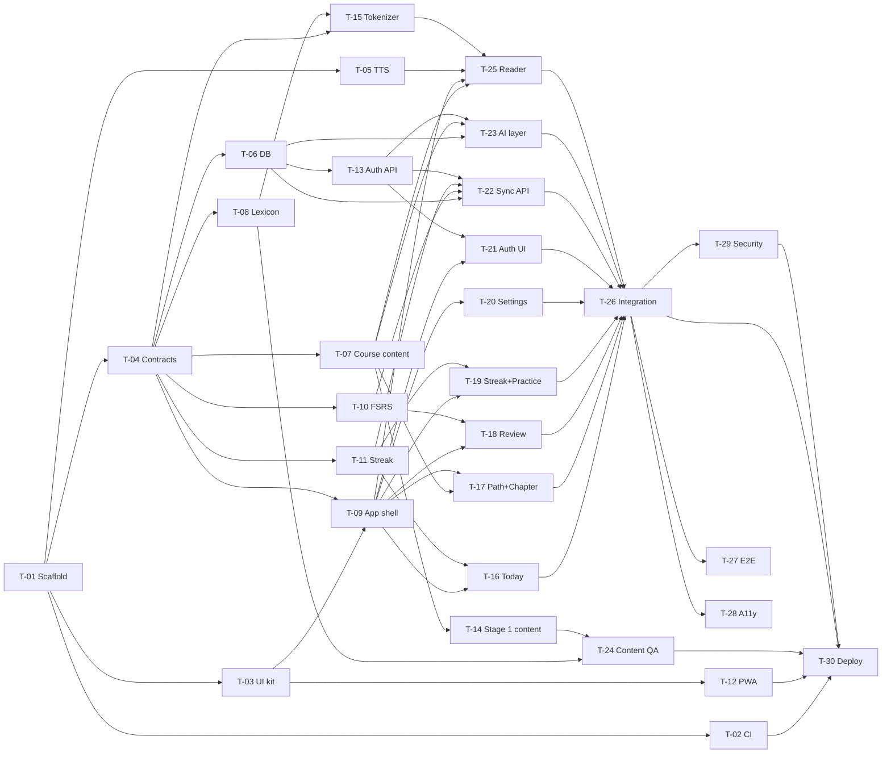

# Frenchy DONE

Finished tasks, moved here from `TODO.md` when their PR merges, in ID order. Rarely needed: read a block only when your work depends on how that task was built. History of the waves is at the end.

- Sections: [Done tasks](#done-tasks) · [History](#history)

---

## Done tasks

### D-01 · Learning plan and app spec
| Priority | Model · effort | Size | Depends on |
|---|---|---|---|
| P0 | Opus 5.5 · High | M | — |

**Status:** done · **Output:** `docs/PLAN.md`
- [x] Learner profile, daily loop, beginner route through the book (4 stages)
- [x] App vision, MVP / Phase 2 / Phase 3 features
- [x] Data model sketch and AI provider strategy

### D-02 · Tech stack decision
| Priority | Model · effort | Size | Depends on |
|---|---|---|---|
| P0 | Opus 5.5 · High | S | D-01 |

**Status:** done · **Output:** `docs/PLAN.md` §4, `docs/HANDOFF.md`
- [x] Compared Cloudflare against Vercel + Supabase, Firebase, Convex, PocketBase and local-first options
- [x] Picked Vite + React SPA (PWA) + Hono on Cloudflare Workers, D1 + Drizzle, R2, Better Auth
- [x] Recorded trade-offs: no row-level security in D1, Better Auth added, cli-bridge stays local

### D-03 · Session handoff notes
| Priority | Model · effort | Size | Depends on |
|---|---|---|---|
| P1 | Sonnet 5.5 · Medium | S | D-02 |

**Status:** done · **Output:** `docs/HANDOFF.md`
- [x] Wrote where we are, user decisions, next steps

### D-04 · Read Stage 1 of the book, map chapter pages
| Priority | Model · effort | Size | Depends on |
|---|---|---|---|
| P1 | Opus 5.5 · Medium | M | — |

**Status:** done · **Output:** `docs/PLAN.md` §2 (chapter → PDF page table)
- [x] Read Stage 1 chapters (1, 2, 12, 10, 4, 7, 33, App. A)
- [x] Mapped chapter start pages (PDF page = printed page + 11)

### D-05 · Clickable mockups (15 screens)
| Priority | Model · effort | Size | Depends on |
|---|---|---|---|
| P0 | Opus 5.5 · High | L | D-01 |

**Status:** done · **Output:** canvas https://claude.ai/artifact/Hguy86o9nTJ88gJ1Rvvd37
- [x] Welcome, onboarding, Today, course map, chapter, reader (tap a word), sentence sheet
- [x] Practice hub, SRS review (3 card types, 4 grades), session complete, streak
- [x] My words, conjugation drill, AI tutor, settings
- [x] Original mascot, color palette and type, contrast fixes

### D-06 · Repo setup for orchestration
| Priority | Model · effort | Size | Depends on |
|---|---|---|---|
| P0 | Opus 5.5 · High | M | D-05 |

**Status:** done · **Output:** `TODO.md`, `CLAUDE.md`, `design/README.md`, `design/mockups/`, branch `main`
- [x] Copied the latest mockups from the canvas into `design/mockups/`
- [x] Wrote design tokens and screen index in `design/README.md`
- [x] Wrote this TODO.md (tasks, dependencies, waves, model/effort)
- [x] Wrote CLAUDE.md (always update TODO, log lessons, Karpathy rules, orchestration protocol)
- [x] Created `main` from the working branch
- [ ] Set `main` as the default branch and protect it (human: see H-01)

### T-01 · Scaffold the app
| Priority | Model · effort | Size | Depends on | Blocks | Wave |
|---|---|---|---|---|---|
| P0 | Opus 5.5 · High | M | — | all NEXT tasks | 0 |

**Status:** done · **Claimed by:** local session · **Branch:** `task/T-01-scaffold` · **PR:** https://github.com/MinhTam2773/frenchy/pull/1
**Owns:** `package.json`, `package-lock.json`, `tsconfig*.json`, `vite.config.ts`, `wrangler.jsonc`, `index.html`, `eslint.config.js`, `.prettierrc`, `vitest.config.ts` (or workspace), `.gitignore`, `.dev.vars.example`, `README.md`, `src/client/main.tsx`, `src/client/App.tsx`, `src/client/styles.css`, `src/worker/index.ts`, `src/worker/routes/health.ts`, `src/shared/index.ts`
**Goal:** One repo that runs the React SPA and the Hono API together with one `npm run dev`, with strict TypeScript, lint and tests wired up.
**Done when:** `npm run dev` serves the SPA at `/` (deep links like `/path` too) and `{ "ok": true }` at `/api/health`; `npm run check` is green.

- [x] Create `src/client/`, `src/worker/`, `src/shared/` per PLAN §4 repo layout; `index.html` at the root
- [x] Vite + React + TypeScript (strict) for the client
- [x] Tailwind CSS (current stable, Vite plugin) with an empty theme in `src/client/styles.css` (T-03 fills it)
- [x] Hono app in `src/worker/index.ts` exporting `app` and `type AppType`; `GET /api/health` in `src/worker/routes/health.ts`; each feature later mounts with one line
- [x] `@cloudflare/vite-plugin` + `wrangler.jsonc`: `main` = worker entry, recent `compatibility_date`, static assets with SPA fallback, and `/api/*` always routed to the Worker first (check the current option name in Cloudflare docs; navigation requests to `/api/*` must not get `index.html`)
- [x] Local-only bindings in wrangler config: D1 `DB` (placeholder id), R2 `AUDIO` (placeholder). Do **not** create remote resources
- [x] Path aliases `@client/*`, `@worker/*`, `@shared/*` in tsconfig and Vite
- [x] Separate tsconfigs for client (DOM types) and worker (types from `wrangler types`)
- [x] ESLint (typescript-eslint, react-hooks, jsx-a11y) + Prettier
- [x] Vitest with two projects: `client` (jsdom + Testing Library) and `worker` (`@cloudflare/vitest-pool-workers`); one passing sample test in each
- [x] npm scripts: `dev`, `build`, `preview`, `test`, `test:watch`, `lint`, `typecheck`, `format`, `check` (lint + typecheck + test + build), `cf-typegen`
- [x] `.gitignore`: add `node_modules`, `dist`, `.wrangler`, `.dev.vars`, `coverage`, `playwright-report`; keep `*.pdf` and `book/`
- [x] `.dev.vars.example` listing the secrets later tasks need (names only, no values)
- [x] README: prerequisites, `npm install`, `npm run dev`, `npm run check`
- [x] Manually verify: `/`, `/path` (SPA) and `/api/health` (JSON)
- [x] Finish: `npm run check` green
- [x] Finish: TODO.md updated (steps ticked, status, lessons)
- [x] Finish: PR to `main` merged (CI does not exist yet: paste local `npm run check` output in the PR)

### T-02 · CI on GitHub Actions
| Priority | Model · effort | Size | Depends on | Blocks | Wave |
|---|---|---|---|---|---|
| P0 | Sonnet 5.5 · High | S | T-01 | T-30 (and safe merging for all) | 1 |

**Status:** done · **Claimed by:** local session · **Branch:** `task/T-02-ci` · **PR:** https://github.com/MinhTam2773/frenchy/pull/3
**Owns:** `.github/workflows/ci.yml`, `.github/pull_request_template.md`, `.nvmrc`
**Goal:** Every PR runs lint, typecheck, tests and build; merging requires green CI.
**Done when:** a PR shows a passing `ci` check; a deliberately failing test makes it red.

- [x] `.nvmrc` with the Node LTS used locally
- [x] Workflow on `pull_request` and `push` to `main`: checkout, setup-node from `.nvmrc` with npm cache, `npm ci`, `npm run lint`, `npm run typecheck`, `npm test`, `npm run build`
- [x] Concurrency group that cancels superseded runs on the same branch
- [x] Confirm the workers-pool tests run in CI without Cloudflare credentials
- [x] PR template: task ID, what changed, how it was verified, "TODO.md updated" checkbox
- [x] Prove it: push a commit with a failing test on a scratch branch, see red, revert
- [x] Note in the PR that the user should require the `ci` check on `main` (H-01)
- [x] Finish: `npm run check` green
- [x] Finish: TODO.md updated (steps ticked, status, lessons)
- [x] Finish: PR to `main` merged with CI green

### T-03 · UI kit and design tokens
| Priority | Model · effort | Size | Depends on | Blocks | Wave |
|---|---|---|---|---|---|
| P0 | Sonnet 5.5 · High | M | T-01 | T-09, T-12 | 1 |

**Status:** done · **Claimed by:** T-03 subagent (lead session) · **Branch:** `task/T-03-ui-kit` · **PR:** https://github.com/MinhTam2773/frenchy/pull/7
**Owns:** `src/client/styles.css` (theme), `src/client/ui/**`
**Goal:** Reusable components that match the mockups exactly, so screens are just composition.
**Done when:** every component in the list renders in `Gallery.tsx` in all its states, tests pass, and no component uses raw hex colors.

- [x] Read `design/README.md` and skim the mockups for sizes and states
- [x] Tailwind theme: all color tokens, Fredoka + Nunito (font links in `index.html`), radii, and solid "chunky" bottom-shadow utilities per variant
- [x] `Button` (primary, secondary, success, danger, warn, ghost; renders as a link when given `to`/`href`; press moves 4px down and drops the shadow)
- [x] `IconButton` (required `aria-label` at the type level), `Card`, `Chip` (neutral, masc, fem, new, status), `ProgressBar` (`role="progressbar"`), `Toggle` (`role="switch"`), `SegmentedTabs` (`role="tablist"`), `StreakChip`
- [x] `TopBar` (back/close, title, right slot) and `TabBar` (5 tabs, active pill, `aria-current="page"`)
- [x] `BottomSheet`: drag handle, `aria-modal`, focus trap, Esc closes, focus returns to the trigger
- [x] `Icon` set as inline SVG components covering every icon in the mockups
- [x] `Mascot` component with `mood="happy" | "cheer"` from the mockup SVG
- [x] `Gallery.tsx` showing every component and state (T-09 mounts it at `/dev/ui`)
- [x] Tests: Button as link, BottomSheet Esc + focus return, Toggle flips `aria-checked`, TabBar marks current route
- [x] Contrast test: every text/background token pair used by the kit meets 4.5:1 (small contrast helper + table of pairs)
- [x] Finish: `npm run check` green
- [x] Finish: TODO.md updated (steps ticked, status, lessons)
- [x] Finish: PR to `main` merged with CI green

### T-04 · Shared schemas, fixtures and API contract
| Priority | Model · effort | Size | Depends on | Blocks | Wave |
|---|---|---|---|---|---|
| P0 | Opus 5.5 · High | M | T-01 | T-06, T-07, T-08, T-09, T-10, T-11, T-15 | 1 |

**Status:** done · **Claimed by:** T-04 subagent (lead session) · **Branch:** `task/T-04-contracts` · **PR:** https://github.com/MinhTam2773/frenchy/pull/8
**Owns:** `src/shared/schemas/**`, `src/shared/fixtures/**`, `src/shared/constants.ts`, `docs/api-contract.md`
**Goal:** One typed contract (zod schemas + inferred types) that the client, the worker, the content pipeline and the mocks all import, so parallel tasks agree without talking to each other.
**Done when:** every schema has a valid fixture and a rejected invalid case in tests, and `docs/api-contract.md` lists every MVP endpoint.

- [x] `content.ts`: `Course`, `Stage`, `Chapter` (id, book chapter number, PDF start/end page, title, kind `appendix | grammar | conversation`, week range, sections), `GrammarTag`, `Text` (id, chapterId, title, kind `story | dialogue`, minutes, paragraphs → sentences → tokens `{ t, lemma?, pos?, gender?, form?, isNew? }`, sentence translations, newWords, grammarTags), `DeckCard`, `GrammarNote`
- [x] `lexicon.ts`: `Lexeme` (lemma, pos, gender, glosses, frequency rank), `FormEntry` (form → lemma + features: person, number, tense, mood)
- [x] `user.ts`: `Profile` (currentChapterId, timeZone (IANA), dailyGoalMinutes, settings: voice, rate, playOnTap)
- [x] `srs.ts`: `Card` (id, type `sentence_meaning | meaning_sentence | cloze`, front, back, clozeAnswer, source `{ kind: starter | text | word | tutor, ref }`, FSRS fields: due, stability, difficulty, elapsedDays, scheduledDays, reps, lapses, state, lastReview), `Rating` (1–4), `ReviewInput` (cardId, rating, reviewedAt, durationMs)
- [x] `words.ts` (`WordStatus`: lemma, `new | learning | known`) and `activity.ts` (`DailyActivity`: local date, minutes, reviews, readings, freezeUsed; `StreakSummary`: current, best, freezesLeft, todayDone)
- [x] `ai.ts`: `TranslateRequest/Response`, `ExplainRequest` (sentence, chapterId) / `ExplainResponse` (translation, gloss `[{ fr, en }]`, notes)
- [x] `constants.ts`: card types, grade labels, word statuses, daily goal options (15/30/45/60)
- [x] Fixtures in `src/shared/fixtures/` mirroring the mockups' dummy data: "Le matin de Léa" with full token annotations, 3 review cards (one of each type), profile on Ch 10, 12-day streak with one freeze, word list
- [x] `docs/api-contract.md`: method, path, auth, request schema, response schema for profile, cards (due, stats, create, starter), reviews, words, activity/streak, ai/translate, ai/explain (auth routes come from Better Auth)
- [x] Tests: each schema parses its fixture and rejects a broken copy
- [x] Finish: `npm run check` green
- [x] Finish: TODO.md updated (steps ticked, status, lessons)
- [x] Finish: PR to `main` merged with CI green

QUESTION: Review undo (T-18) has no server endpoint. Default in the contract: the client holds the last grade and posts it when the next card is graded or the session ends. Alternative: an undo route that restores the previous card state (see G-20).
ANSWER (lead, 2026-10-18): keep the default (client holds the last grade). No undo route in MVP.

### T-05 · Text-to-speech helper
| Priority | Model · effort | Size | Depends on | Blocks | Wave |
|---|---|---|---|---|---|
| P1 | Sonnet 5.5 · Medium | S | T-01 | T-25 | 1 |

**Status:** done · **Claimed by:** T-05 subagent (lead session) · **Branch:** `task/T-05-tts` · **PR:** https://github.com/MinhTam2773/frenchy/pull/6
**Owns:** `src/client/lib/tts/**`
**Goal:** One small module that speaks French well on every device that can.
**Done when:** `useTts()` speaks with the best available fr-FR voice, reports `supported=false` cleanly where it can't, and tests pass.

- [x] `speak(text, { rate, voiceURI })` on the Web Speech API; cancels any utterance in progress
- [x] Voice choice: saved voice → best local `fr-FR` → any `fr-*`; handle voices loading late (`voiceschanged`)
- [x] Default rate 0.8; allowed range 0.6–1.0
- [x] `useTts()` hook: `speak`, `stop`, `speaking`, `supported`, `voices`
- [x] Sentence boundary callback (where `onboundary` is supported) so the reader can highlight the spoken sentence
- [x] Tests with a mocked `speechSynthesis`
- [x] Finish: `npm run check` green
- [x] Finish: TODO.md updated (steps ticked, status, lessons)
- [x] Finish: PR to `main` merged with CI green

### T-06 · Database schema, migrations and user scoping
| Priority | Model · effort | Size | Depends on | Blocks | Wave |
|---|---|---|---|---|---|
| P0 | Opus 5.5 · Medium | M | T-04 | T-13, T-22, T-23 | 2 |

**Status:** done · **Claimed by:** T-06 subagent (lead session) · **Branch:** `task/T-06-db` · **PR:** https://github.com/MinhTam2773/frenchy/pull/14
**Owns:** `src/worker/db/**`, `migrations/**`, `drizzle.config.ts`, `scripts/db/seed.ts`
**Goal:** D1 tables for all MVP user data, plus one helper that makes cross-user reads impossible by construction.
**Done when:** migrations apply on a fresh local D1, the seed loads mockup-like data, and an isolation test proves user A can't read user B's rows.

- [x] Drizzle ORM + drizzle-kit for D1 (sqlite dialect)
- [x] Tables from PLAN §4: `profiles`, `cards`, `reviews`, `word_status`, `daily_activity`, `translation_cache`, matching the T-04 schemas (ids as text UUIDs, timestamps as integer ms UTC, local dates as `YYYY-MM-DD` text)
- [x] Indexes/uniques: `cards(user_id, due)`, `reviews(user_id, reviewed_at)`, unique `word_status(user_id, lemma)`, unique `daily_activity(user_id, date)`, unique `translation_cache(key)`
- [x] Leave the Better Auth tables to T-13, but use `user_id text` that will reference `user.id`
- [x] `scopedDb(db, userId)` exposing per-table query helpers that always filter by `user_id`; routes never touch raw tables
- [x] Scripts: `db:generate`, `db:migrate:local`, `db:seed:local`
- [x] Seed: a demo profile on Ch 10, 18 due cards, 12 days of activity with one freeze (matches the mockups)
- [x] Tests (workers pool + local D1): migrations apply cleanly; `scopedDb` isolation between two users
- [x] Finish: `npm run check` green
- [x] Finish: TODO.md updated (steps ticked, status, lessons)
- [x] Finish: PR to `main` merged with CI green

Notes for T-13 / T-22 / T-23:
- Tables: `profiles`, `cards`, `reviews`, `word_status`, `daily_activity`, plus `activity_minutes` (PK user + minute start, for ping dedupe) and `text_reads` (PK user + text + local date; the earliest `finished_at` per text is the first finish). That resolves G-19; `text_reads` is keyed per day because the contract counts a reading once per text per day, not only the first time. `translation_cache` is shared (not user data) and goes through `translationCacheDb(db)`.
- API: `scopedDb(createDb(env.DB), userId)` returns `{ userId, profiles, cards, reviews, wordStatus, dailyActivity, activityMinutes, textReads, batch }`; each table has `select(where?)`, `insert(rows)`, `update(set, where?)`, `delete(where?)`, returning un-awaited drizzle queries pinned to the user (await one, or pass several to `batch([...])`). Column refs for `where` come from `schema` (exported from `src/worker/db`).
- T-13: Better Auth tables are not created. Add your schema file to `schema` in `drizzle.config.ts` (or export it from `src/worker/db/schema.ts`) so `npm run db:generate` writes one migration chain, and add the `user_id` foreign keys then if wanted.
- Worker tests get every migration applied by `src/worker/db/test-setup.ts` (see L-24).

### T-07 · Course structure, grammar inventory and content validator
| Priority | Model · effort | Size | Depends on | Blocks | Wave |
|---|---|---|---|---|---|
| P0 | Sonnet 5.5 · High | M | T-04 | T-14, T-17, T-23, T-25 | 2 |

**Status:** done · **Claimed by:** T-07 subagent (lead session) · **Branch:** `task/T-07-course-content` · **PR:** https://github.com/MinhTam2773/frenchy/pull/13
**Owns:** `content/course.json`, `content/grammar.json`, `scripts/content/check.ts`, `src/shared/content/**` (loaders)
**Goal:** The course map and the "allowed grammar per chapter" list as validated JSON, plus a checker every content task must pass.
**Done when:** `npm run content:check` validates the course and grammar files, rejects the bad fixtures, and runs in CI.

- [x] `content/course.json`: all 4 stages with chapters in the beginner route order from PLAN §2, each with book chapter number, PDF start page, PDF end page (next chapter's start − 1), title, kind and week range
- [x] Chapter sections: if the book is available locally in `book/`, add section labels and PDF pages for Stage 1; otherwise leave `sections: []` and keep G-06 open. Never copy book text
- [x] `content/grammar.json`: ordered grammar tags introduced per chapter (e.g. `articles.definite`, `gender.basic`, `etre.present`, `avoir.present`, `aller.present`, `faire.present`, `er.present`, `numbers.0-100`, `questions.intonation`, `questions.est-ce-que`), including *aller* and *faire* in Stage 1 (L-02)
- [x] Loaders in `src/shared/content/` (typed, used by client and worker): `getCourse()`, `allowedGrammar(chapterId)`, `getText(id)`
- [x] `scripts/content/check.ts` + `npm run content:check`: zod-validates every content file; unique ids; valid route order; each text uses only allowed grammar tags; every word token has a lemma; every sentence has a translation; ≤ 8 new words per text; deck cards point to existing texts
- [x] Add `npm run content:check` to `.github/workflows/ci.yml` (hot file)
- [x] Tests: validator accepts good fixtures and names the exact problem for each bad one
- [x] Finish: `npm run check` green
- [x] Finish: TODO.md updated (steps ticked, status, lessons)
- [x] Finish: PR to `main` merged with CI green

### T-08 · Offline lexicon pipeline
| Priority | Model · effort | Size | Depends on | Blocks | Wave |
|---|---|---|---|---|---|
| P1 | Opus 5.5 · High | L | T-04 | T-15, T-24 | 2 |

**Status:** done · **Claimed by:** T-08 subagent (lead session) · **Branch:** `task/T-08-lexicon` · **PR:** https://github.com/MinhTam2773/frenchy/pull/17
**Owns:** `scripts/lexicon/**`, `content/lexicon/**`, `src/shared/lexicon/**`, `docs/LICENSES.md`
**Goal:** Instant, free word taps: a compact French → English lexicon with form → lemma lookup, shipped as static JSON.
**Done when:** `lookupForm('vais')` returns *aller* (1st person singular, present), the shards fit the size budget, and the license and attribution are recorded.

- [x] Research the source: Wiktionary-derived data (e.g. wiktextract / kaikki.org French entries with English glosses). Record the license (Wiktionary text is CC BY-SA and GFDL) and the attribution needed in `docs/LICENSES.md`; log the decision as a lesson (kaikki.org French extract of 2026-10-03, used under CC BY-SA 4.0; L-29)
- [x] If the license blocks what PLAN wants (sharing the app with others), stop, write a `QUESTION:` under this task and in G-01, and propose alternatives (not needed: the owner accepts CC BY-SA attribution + share-alike on the lexicon data; the remaining duty is a credits screen, B-21, see G-25)
- [x] Build script reads the raw dump from a local path (gitignored, never committed) and keeps French entries for the parts of speech we need (`npm run lexicon:build`; dumps in `scripts/lexicon/raw/`, URLs in the script header)
- [x] Frequency: pick a frequency list with a compatible license; keep the top ~10k lemmas plus every lemma used in `content/` (Lexique 3.83 lemma frequencies, CC BY-SA 4.0; top 10,000 lemma + pos pairs)
- [x] Output `content/lexicon/lemmas-<shard>.json` (lemma → pos, gender, ≤ 3 glosses, rank) and `content/lexicon/forms-<shard>.json` (form → candidates with person, number, tense, mood), sharded by first letter; budget ≤ 2 MB gzipped total (27 shards each, a–z + `other`; 10,102 lexemes, 97,544 forms; 14.1 MB raw, 1.04 MB gzipped)
- [x] `src/shared/lexicon/lookup.ts`: `lookupForm(form)` lazy-loads one shard and returns candidates by frequency (also `lookupLemma(lemma)` for glosses; keys via `formKey()` in `key.ts`)
- [x] Coverage report script: % of word tokens in `content/` found; list the misses (`npm run lexicon:coverage`; 0 tokens until T-14)
- [x] Tests: *vais* → aller, *préfère* → préférer, *heures* → heure (f, pl), *l'* → le/la, *au* = à + le (`lookup.test.ts`; `shards.test.ts` checks every shard against the zod schemas and the budget)
- [x] Finish: `npm run check` green
- [x] Finish: TODO.md updated (steps ticked, status, lessons; L-29 to L-31, G-25, G-26, B-21)
- [x] Finish: PR to `main` merged with CI green

### T-09 · App shell, routing, data layer and mocks
| Priority | Model · effort | Size | Depends on | Blocks | Wave |
|---|---|---|---|---|---|
| P0 | Sonnet 5.5 · High | M | T-03, T-04 | T-16 to T-21, T-25 | 2 |

**Status:** done · **Claimed by:** T-09 subagent (lead session) · **Branch:** `task/T-09-app-shell` · **PR:** https://github.com/MinhTam2773/frenchy/pull/12
**Owns:** `src/client/App.tsx`, `src/client/routes.tsx`, `src/client/layouts/**`, `src/client/lib/api.ts`, `src/client/lib/query.ts`, `src/client/lib/session.ts`, `src/client/mocks/**`, placeholder pages in `src/client/features/*/`, `src/client/README.md`
**Goal:** Every MVP route exists with the right layout, typed API calls work, and MSW serves fixture data so screen tasks can run in parallel without a backend.
**Done when:** every route renders its placeholder inside the right layout, `/dev/ui` shows the gallery, and a sample query returns fixture data through MSW.

- [x] React Router (SPA) routes: `/` welcome, `/onboarding`, `/today`, `/path`, `/chapter/:chapterId`, `/read/:textId`, `/practice`, `/review`, `/review/done`, `/streak`, `/me`, `/dev/ui` (dev only, mounts T-03 `Gallery`); plus a `/words` placeholder (the kit's tab bar links to it, G-28) and a not-found page
- [x] One placeholder page per route at `src/client/features/<feature>/<Name>Page.tsx`
- [x] Layouts: tab layout (TabBar) for Today, Path, Practice, Words (Phase 2), Me; full-screen layout for onboarding, chapter, reader, review, streak
- [x] TanStack Query provider with defaults (sensible `staleTime`, retry once)
- [x] Typed API client with normalized errors (`ApiClientError`). Deviation: typed by the shared zod schemas, not `hc<AppType>` (L-32)
- [x] MSW for browser and Node, on when `VITE_USE_MOCKS=true` (default in dev until T-26); `handlers/base.ts` serves every contract endpoint from `src/shared/fixtures`, feature handlers go in `src/client/mocks/handlers/<feature>.ts` and `handlers/index.ts` picks them up by glob (no registration edit)
- [x] `useSession()` stub (mock signed-in user) and a guard that sends signed-out users to `/`
- [x] Lazy-load the reader and review routes
- [x] `src/client/README.md`: how to add a screen (folder, route line, mock handler file)
- [x] Tests: each route renders; TabBar marks the current route
- [x] Finish: `npm run check` green
- [x] Finish: TODO.md updated (steps ticked, status, lessons)
- [x] Finish: PR to `main` merged with CI green

### T-10 · FSRS scheduling module
| Priority | Model · effort | Size | Depends on | Blocks | Wave |
|---|---|---|---|---|---|
| P0 | Sonnet 5.5 · High | S | T-04 | T-18, T-22 | 2 |

**Status:** done · **Claimed by:** T-10 subagent (lead session) · **Branch:** `task/T-10-fsrs` · **PR:** https://github.com/MinhTam2773/frenchy/pull/11
**Owns:** `src/shared/srs/**`
**Goal:** A thin, tested wrapper around `ts-fsrs` shared by the client (interval previews) and the worker (authoritative scheduling).
**Done when:** grading is deterministic under a fixed clock with fuzz off, and the interval labels match the format in the Review mockup ("1m", "6m", "1d", "4d").

- [x] Add `ts-fsrs`; one config object (target retention 0.9, max interval, fuzz on in production)
- [x] `newCard()`, `previewIntervals(card, now)` → the 4 labels, `grade(card, rating, now)` → next card state + review log
- [x] Mapping between ts-fsrs cards and the shared `Card` FSRS fields (dates as epoch ms)
- [x] Interval label formatter (m, h, d, mo, y)
- [x] Tests: new card + Good is due in the future; Again lowers stability; labels; deterministic with a fixed `now` and fuzz off
- [x] Finish: `npm run check` green
- [x] Finish: TODO.md updated (steps ticked, status, lessons)
- [x] Finish: PR to `main` merged with CI green

### T-11 · Streak and freeze logic
| Priority | Model · effort | Size | Depends on | Blocks | Wave |
|---|---|---|---|---|---|
| P0 | Sonnet 5.5 · High | S | T-04 | T-16, T-19, T-22 | 2 |

**Status:** done · **Claimed by:** T-11 subagent (lead session) · **Branch:** `task/T-11-streak` · **PR:** https://github.com/MinhTam2773/frenchy/pull/10
**Owns:** `src/shared/streak/**`
**Goal:** A pure function that turns daily activity rows into the streak, best streak, freezes and calendar, in the user's time zone.
**Done when:** the tests cover gaps, freezes, the 2-freeze cap, DST changes and time-zone changes, and all pass.

- [x] Rule (default until H-07 confirms): a day counts when ≥ 1 review is graded or ≥ 1 reading is finished. One freeze is earned per 7 counted days in a row, at most 2 held, and a freeze is spent automatically on a missed day. Implemented as: `current` counts counted days in the run (a freeze day keeps the run alive but adds 0); a freeze is earned on every 7th counted day of a run (7, 14, 21, …); minutes alone don't count; a broken run restarts at 0 with no freezes; today never breaks the streak
- [x] `computeStreak(rows, todayLocalDate)` → `{ current, best, freezesLeft, todayDone, calendar }`, fully derived from the rows (deterministic). `freezeUsed` on the rows is **ignored** (it is an output, not an input; see L-38)
- [x] Local-date helpers using `Intl.DateTimeFormat` with the IANA time zone (no heavy date library)
- [x] Tests: simple run, missed day with and without a freeze, cap of 2, today not done yet doesn't break the streak, DST (America/Toronto in March and November), user changes time zone
- [x] Finish: `npm run check` green
- [x] Finish: TODO.md updated (steps ticked, status, lessons)
- [x] Finish: PR to `main` merged with CI green

### T-12 · PWA (installable app)
| Priority | Model · effort | Size | Depends on | Blocks | Wave |
|---|---|---|---|---|---|
| P1 | Sonnet 5.5 · High | S | T-03 | T-30 | 2 |

**Status:** done · **Claimed by:** T-12 subagent (lead session) · **Branch:** `task/T-12-pwa` · **PR:** https://github.com/MinhTam2773/frenchy/pull/15
**Owns:** PWA section of `vite.config.ts` (hot file), `public/icons/**`, `src/client/pwa/**`, PWA meta tags in `index.html`
**Goal:** Frenchy installs to the home screen on iPhone, Android and desktop, and loads fast from cache.
**Done when:** Chrome reports the app as installable, the service worker caches the shell and content, and `/api/*` is never cached.

- [x] `vite-plugin-pwa`; manifest: name "Frenchy", short name, theme `#2B59F0`, background `#F6F8FF`, display standalone, icons 192/512 + maskable made from the mascot
- [x] Runtime caching: app shell, fonts, `content/**` and lexicon shards (stale-while-revalidate); `/api/*` network-only
- [x] "New version available" toast with reload (`<PwaPrompts />`, mounted in `main.tsx`)
- [x] iOS: `apple-touch-icon`, web-app meta tags, a one-time "Add to Home Screen" hint in Safari
- [x] Installability checked without Lighthouse (Lighthouse not installed here): Chrome DevTools Protocol `Page.getInstallabilityErrors` is empty in a persistent profile, the manifest parses with no errors, `navigator.serviceWorker.ready` resolves, the page is controlled after reload, the shell loads offline, `/api/*` is never cached. Paste in the PR (G-34)
- [x] Finish: `npm run check` green
- [x] Finish: TODO.md updated (steps ticked, status, lessons)
- [x] Finish: PR to `main` merged with CI green

### T-13 · Auth backend (Better Auth on Workers + D1)
| Priority | Model · effort | Size | Depends on | Blocks | Wave |
|---|---|---|---|---|---|
| P0 | Opus 5.5 · High | M | T-06 | T-21, T-22, T-23 | 3 |

**Status:** done · **Claimed by:** T-13 subagent (lead session) · **Branch:** `task/T-13-auth-api` · **PR:** https://github.com/MinhTam2773/frenchy/pull/25
**Owns:** `src/worker/auth/**`, `src/worker/middleware/session.ts`, `src/worker/routes/auth.ts`, auth migrations in `migrations/`
**Goal:** Email and Google sign-in with sessions stored in D1, and a `requireUser` middleware every API route uses.
**Done when:** the workers-pool tests cover sign up, sign in, session read, a protected route (401 vs 200) and sign out.

- [x] First check that the current Better Auth works in the Workers runtime with D1 (Drizzle adapter). If not, stop, log a lesson, and write a `QUESTION:` with an alternative before building
- [x] Create the auth instance per request from `env`; mount at `/api/auth/*`
- [x] Email + password (minimum length, rate-limited attempts)
- [x] Google OAuth when `GOOGLE_CLIENT_ID`/`SECRET` are set (H-03); email-only otherwise, exposed through a small config endpoint the UI can read
- [x] Generate the Better Auth tables → Drizzle schema → migration; apply locally
- [x] `requireUser` middleware sets `c.var.user`, otherwise returns a 401 JSON error
- [x] Create the `profiles` row on first sign-in (onboarding fills it)
- [x] Cookies: secure, httpOnly, `SameSite=Lax`; trusted origins from env
- [x] Tests (workers pool) for the flows in "Done when"
- [x] Finish: `npm run check` green
- [x] Finish: TODO.md updated (steps ticked, status, lessons)
- [x] Finish: PR to `main` merged with CI green

Notes for T-21 / T-22 / T-23:
- Go: Better Auth 1.7.10 runs in workerd with D1 through the Drizzle adapter (sign-up, sign-in, session, sign-out, rate limit and Google start all tested). Caveat G-35 (password hashing CPU).
- `requireUser` (`src/worker/middleware/session.ts`) with `Hono<UserEnv>`: sets `c.var.user` (Better Auth user: `id`, `email`, `name`, `image`, `emailVerified`, `createdAt`, `updatedAt`) and `c.var.session`; 401 `{ error: { code: 'unauthorized' } }` otherwise. Use `scopedDb(createDb(c.env.DB), c.var.user.id)`.
- `GET /api/auth/config` → `AuthConfig` `{ google }` (`@shared/schemas`). Client: `better-auth/react` `createAuthClient()` with the default `/api/auth` base path. Cookie `better-auth.session_token` (`__Secure-` prefixed over https).
- The profile row is created on every session create if missing (`onConflictDoNothing`), so `GET /api/profile` always finds one. Time zone defaults to Cloudflare's `request.cf.timezone` or `UTC`; T-21 onboarding should PATCH the device's `Intl.DateTimeFormat().resolvedOptions().timeZone`.
- QUESTION: password hashing (scrypt) needs more CPU than the Workers Free plan's 10 ms per request (G-35). Default kept: Better Auth's scrypt, which assumes Workers Paid. Alternative: a custom `password.hash/verify` with cheaper parameters (weaker against offline cracking). Decide before T-30.

### T-14 · Stage 1 content generation (fan-out per chapter)
| Priority | Model · effort | Size | Depends on | Blocks | Wave |
|---|---|---|---|---|---|
| P0 | Opus 5.5 · High (one agent per chapter) | L total, M per chapter | T-07 | T-24 | 3 |

**Status:** done · **Claimed by:** lead (briefs) + one T-14 subagent per chapter · **Branch:** `task/T-14-stage1-<chapterId>` (one per chapter) · **PR:** https://github.com/MinhTam2773/frenchy/pull/20 and https://github.com/MinhTam2773/frenchy/pull/27
**Owns:** `scripts/content/prompts/**` (lead only), `content/chapters/<chapterId>/**` (each sub-agent owns exactly one chapter folder)
**Goal:** Original, leveled Stage 1 lessons: 3–5 texts per chapter, a grammar note and a starter deck, with every token annotated so the reader is exact.
**Done when:** all 8 Stage 1 chapters pass `npm run content:check` and are handed to T-24 for QA.

- [x] Lead writes the generation brief `scripts/content/prompts/text.md`: original French only (the book sets topic order, never copy its sentences), only grammar tags allowed up to the chapter, ≤ 8 new words per text, 60–120 words per A1 text, stories and dialogues, natural everyday topics, per-token annotations (lemma, pos, gender, form), English translation per sentence
- [x] Lead writes the deck brief: 20–30 cards per chapter mixing `sentence_meaning`, `meaning_sentence` and `cloze`, clozes with one unambiguous answer
- [x] Fan out, one sub-agent per chapter (tick when that chapter passes `content:check`):
  - [x] App. A · Pronunciation (short texts focused on sounds, plus a sound-pairs note)
  - [x] Ch 1 · Articles
  - [x] Ch 2 · Basic gender endings
  - [x] Ch 12 · *Être*, *avoir*, irregular verbs (also *aller* and *faire*, L-02)
  - [x] Ch 10 · Present tense of -er verbs
  - [x] Ch 4 · Numbers
  - [x] Ch 7 · Asking questions
  - [x] Ch 33 · Conversation: meeting people (dialogues)
- [x] Each chapter folder holds `texts/*.json`, `note.json` (a pattern card like the Chapter mockup) and `deck.json`
- [x] `npm run content:check` green for all chapters
- [x] Do not self-approve: hand over to T-24 (a different agent). Each chapter agent's doubts are in its PR (#20, this PR) for T-24
- [x] Finish: `npm run check` green
- [x] Finish: TODO.md updated (steps ticked, status, lessons)
- [x] Finish: PR(s) to `main` merged with CI green

### T-15 · French tokenizer and word annotation
| Priority | Model · effort | Size | Depends on | Blocks | Wave |
|---|---|---|---|---|---|
| P0 | Opus 5.5 · High | M | T-04, T-08 | T-25 | 3 |

**Status:** done · **Claimed by:** T-15 subagent (lead session) · **Branch:** `task/T-15-tokenizer` · **PR:** https://github.com/MinhTam2773/frenchy/pull/26
**Owns:** `src/shared/text/**`
**Notes (decisions, see PR):** tokens are `word` / `gap` (a gap is a run of spaces and punctuation), exactly like content `WordToken` / `GapToken`, so the reader treats both alike; a test checks `tokenize()` reproduces annotated lesson sentences token for token. `annotate(tokens, index)` takes the sentence's tokens instead of `(token, context)`. *est-ce que* is three word tokens (as in `text.md`) and each one carries `phrase`. Titles keep their period (`M.`), clock times (`8 h 30`) and numbers (`12,50`) are one token (G-55).
**Goal:** Turn any French text into tappable tokens and sentences, and give each word the best lemma and form info available.
**Done when:** a table-driven test of tricky inputs passes (elision, hyphenated inversion, French punctuation, compounds, abbreviations).

- [x] `tokenize(text)` → word, punctuation and space tokens with offsets
- [x] Elision with both `'` and `’`: l', d', j', m', t', s', n', c', qu', jusqu', lorsqu', puisqu'
- [x] Hyphens: inversions split (*parles-tu*, *a-t-il*); fixed compounds kept whole (*aujourd'hui*, *peut-être*, *est-ce que* as a phrase)
- [x] French punctuation spacing (« », non-breaking spaces before ? ! : ;) and numbers
- [x] `splitSentences(text)` that respects abbreviations (M., Mme, etc.) and ellipses
- [x] `annotate(token, context)`: content annotation first; otherwise lexicon candidates with simple context rules (*a* vs *à*, *est* as a verb after a subject, verb readings after subject pronouns); otherwise unknown
- [x] `describeForm()` for the word sheet, e.g. "il / elle · present · -er verb"
- [x] Table-driven tests
- [x] Finish: `npm run check` green
- [x] Finish: TODO.md updated (steps ticked, status, lessons)
- [x] Finish: PR to `main` merged with CI green

### T-16 · Today screen
| Priority | Model · effort | Size | Depends on | Blocks | Wave |
|---|---|---|---|---|---|
| P0 | Sonnet 5.5 · High | M | T-09, T-11 | T-26 | 3 |

**Status:** done · **Claimed by:** T-16 subagent (lead session) · **Branch:** `task/T-16-today` · **PR:** https://github.com/MinhTam2773/frenchy/pull/23
**Owns:** `src/client/features/today/**`, `src/client/lib/activity/**`, `src/client/mocks/handlers/today.ts`
**Goal:** The daily screen from `Today.dc.html`: review first, then the book, reading and output.
**Done when:** it matches the mockup at 390 px with fixture data, the edge states work, and tests pass.

- [x] Header: wordmark, streak chip, freeze chip (both link to `/streak`). Chips are the kit's 44 px high, not the mockup's 40 (L-18)
- [x] Greeting and daily minutes progress against the goal
- [x] Review card: due count, estimated minutes (≈ 35 s per card), Start review → `/review`
- [x] Book card: current chapter, PDF pages → `/chapter/:id`. "Current section" is not shown: nothing tracks which section the learner is on (G-37)
- [x] Reading card: next unread text of the current chapter → `/read/:id`; also "all texts read" and "no texts yet" states (content has none until T-14)
- [x] Output card: "Write 3–5 sentences" (links to the tutor once B-03 lands; until then a simple notes prompt or hidden, decide in the PR). Decision: a static prompt card with no link and no chevron, detail "Use today’s new words in your own notes"; B-03 turns it into a link to the tutor
- [x] `useToday()` combining profile, due count, streak summary and next text; MSW handler (no `mocks/handlers/today.ts`: `base.ts` already serves every endpoint, and tests override with `server.use`)
- [x] Edge states: 0 due ("All caught up", next due time), streak at risk, no chapter set → onboarding; also no cards at all, loading and error with retry
- [x] `useActiveMinutes()`: visibility-aware minute tracking that pings the activity API (mocked for now). Mounted by the Today page only (G-38)
- [x] Tests: due count, links, empty state, at-risk state
- [x] Finish: `npm run check` green
- [x] Finish: TODO.md updated (steps ticked, status, lessons)
- [x] Finish: PR to `main` merged with CI green

### T-17 · Course map and chapter screens
| Priority | Model · effort | Size | Depends on | Blocks | Wave |
|---|---|---|---|---|---|
| P0 | Sonnet 5.5 · High | M | T-09, T-07 | T-26 | 3 |

**Status:** done · **Claimed by:** T-17 subagent (lead session) · **Branch:** `task/T-17-path-chapter` · **PR:** https://github.com/MinhTam2773/frenchy/pull/22
**Owns:** `src/client/features/path/**`, `src/client/features/chapter/**`, `src/client/mocks/handlers/path.ts`
**Goal:** `Path.dc.html` and `Chapter.dc.html`: the winding stage path and the chapter page that sits next to the book.
**Done when:** both match their mockups with the real `course.json`, setting the current chapter works (mocked), and tests pass.

**Decisions:** appendices are reference nodes (book icon, never done or locked, left out of "n of m chapters done"; G-23); the done node is ink on gold (about 8.6:1) because white on gold is 1.8:1 (L-51); all chapters open from every node (G-07); the mockup's "§2 now" has no data behind it (G-39); `routes.test.tsx` lost its `/path` and `/chapter/ch10` rows because those screens have their own tests now (L-53).

- [x] Path: stage banner with stage switcher, winding node path (done / current / locked / conversation node styles), labels, "You're here" bubble, mascot
- [x] States from `course.json` + `profile.currentChapterId`: before current = done, current, after = locked (locked chapters still open read-only; see G-07)
- [x] Chapter: header, title, PDF page range, section progress, pattern / grammar note card, readings list, starter deck "Add to reviews" (calls the starter-deck endpoint)
- [x] "Make this my current chapter" action
- [x] Hide the drill button until B-01
- [x] Desktop: centered column, max width ~480 px
- [x] Tests: node states, current-chapter change, readings links
- [x] Finish: `npm run check` green (CI)
- [x] Finish: TODO.md updated (steps ticked, status, lessons)
- [x] Finish: PR to `main` merged with CI green

### T-18 · Review session and session complete
| Priority | Model · effort | Size | Depends on | Blocks | Wave |
|---|---|---|---|---|---|
| P0 | Sonnet 5.5 · High | M | T-09, T-10 | T-26 | 3 |

**Status:** done · **Claimed by:** T-18 subagent (lead session) · **Branch:** `task/T-18-review` · **PR:** https://github.com/MinhTam2773/frenchy/pull/24
**Owns:** `src/client/features/review/**`, `src/client/mocks/handlers/review.ts`
**Goal:** `Review.dc.html` and `ReviewDone.dc.html`: a fast SRS session with the 3 card types and FSRS interval previews.
**Done when:** a mocked session can be completed end to end, the stats math is tested, and the screens match the mockups.

- [x] Load due cards (cap per session `DUE_LIMIT.default`, cap new cards per day `NEW_CARDS_PER_DAY`: the contract has no settings field for it); progress bar and count
- [x] Card renderers: `sentence_meaning` (with TTS button), `meaning_sentence`, `cloze` (blank → filled on reveal)
- [x] Show answer → 4 grade buttons labelled with `previewIntervals` (T-10)
- [x] On grade: next state from T-10, optimistic update, POST the review (mocked), next card; one-step undo (the card advances before any POST; the server recomputes the state, and the last grade is held and posted when the next card is graded or the session ends, per G-20)
- [x] Desktop keys inside the screen only: Space reveals, 1–4 grade
- [x] Session complete: cards, correct % (Good + Easy share), time, streak message, "Up next" link
- [x] Tests: reveal → grade → advance; undo; completion stats
- [x] Finish: `npm run check` green (CI)
- [x] Finish: TODO.md updated (steps ticked, status, lessons)
- [x] Finish: PR to `main` merged with CI green

### T-19 · Streak and Practice hub screens
| Priority | Model · effort | Size | Depends on | Blocks | Wave |
|---|---|---|---|---|---|
| P1 | Sonnet 5.5 · Medium | S | T-09, T-11 | T-26 | 3 |

**Status:** done · **Claimed by:** T-19 subagent (lead session) · **Branch:** `task/T-19-streak-practice` · **PR:** https://github.com/MinhTam2773/frenchy/pull/21
**Owns:** `src/client/features/streak/**`, `src/client/features/practice/**`, `src/client/mocks/handlers/streak.ts`
**Goal:** `Streak.dc.html` and `Practice.dc.html`.
**Done when:** both match their mockups with fixture data and tests pass.

- [x] Streak: hero (current, best), at-risk banner, month calendar (practiced, freeze used, today, missed, future) with previous/next month, freeze card
- [x] Practice hub: flashcards card (due, new, learning, review counts) → `/review`; drills, tutor, speaking and import shown as "Coming later"
- [x] Tests: calendar cell states from T-11 output; hub counts
- [x] Finish: `npm run check` green
- [x] Finish: TODO.md updated (steps ticked, status, lessons)
- [x] Finish: PR to `main` merged with CI green

### T-20 · Me / settings screen
| Priority | Model · effort | Size | Depends on | Blocks | Wave |
|---|---|---|---|---|---|
| P1 | Sonnet 5.5 · Medium | S | T-09 | T-26 | 3 |

**Status:** done · **Claimed by:** T-20 subagent (lead session) · **Branch:** `task/T-20-settings` · **PR:** https://github.com/MinhTam2773/frenchy/pull/18
**Owns:** `src/client/features/settings/**`, `src/client/mocks/handlers/settings.ts`
**Goal:** The MVP subset of `Settings.dc.html`.
**Done when:** changing a setting persists through the (mocked) profile API and tests pass.

- [x] Profile row (name, sync status, streak chip)
- [x] Learning: book chapter (opens the chapter picker), daily goal, time zone (auto-detected, editable)
- [x] Audio: voice picker (from T-05 voices), speed 0.6–1.0, "Play words when tapped"
- [x] Sign out (mocked until T-26)
- [x] Not in MVP, so not rendered: daily reminder (B-12), AI providers (B-13)
- [x] Tests: settings round-trip through the profile mock
- [x] Finish: `npm run check` green
- [x] Finish: TODO.md updated (steps ticked, status, lessons)
- [x] Finish: PR to `main` merged with CI green

### T-21 · Welcome, sign-in and onboarding UI
| Priority | Model · effort | Size | Depends on | Blocks | Wave |
|---|---|---|---|---|---|
| P0 | Sonnet 5.5 · High | M | T-09, T-13 | T-26 | 4 |

**Status:** done · **Claimed by:** T-21 agent (wave 4 lead session) · **Branch:** `task/T-21-auth-ui` · **PR:** https://github.com/MinhTam2773/frenchy/pull/30
**Owns:** `src/client/features/auth/**`, `src/client/features/onboarding/**`, `src/client/lib/session.ts` (replaces the T-09 stub)
**Goal:** `Main.dc.html` and `Onboarding.dc.html` working with the real Better Auth client.
**Done when:** a new user can sign up with email locally, pick a chapter and goal, and land on `/today`; tests pass.

- [x] Welcome: Continue with email, Continue with Google (hidden when Google isn't configured), I already have an account
- [x] Email sign-up and sign-in forms: labels, validation, errors announced to screen readers
- [x] Onboarding: Stage 1 chapter list (plus "show later stages"), daily goal, save profile, go to `/today`
- [x] Replace the `useSession()` stub with the real session; keep the guard
- [x] Password reset is not in MVP (G-08): show "Forgot password?" only once B-18 lands
- [x] Tests: form validation, onboarding saves the profile, guard redirects
- [x] Finish: `npm run check` green
- [x] Finish: TODO.md updated (steps ticked, status, lessons)
- [x] Finish: PR to `main` merged with CI green

### T-22 · Sync API (profile, cards, reviews, words, activity)
| Priority | Model · effort | Size | Depends on | Blocks | Wave |
|---|---|---|---|---|---|
| P0 | Opus 5.5 · High | L | T-06, T-10, T-11, T-13 | T-26 | 4 |

**Status:** done · **Claimed by:** T-22 agent (wave 4 lead session) · **Branch:** `task/T-22-sync-api` · **PR:** https://github.com/MinhTam2773/frenchy/pull/32
**Owns:** `src/worker/routes/profile.ts`, `cards.ts`, `reviews.ts`, `words.ts`, `activity.ts` (+ one mount line each in `src/worker/index.ts`)
**Goal:** Every MVP endpoint from `docs/api-contract.md`, user-scoped and validated.
**Done when:** each endpoint has tests, including one proving cross-user isolation, and responses match the shared schemas.

- [x] `GET /api/profile`, `PATCH /api/profile`
- [x] `GET /api/cards/due?limit=`, `GET /api/cards/stats` (new / learning / review counts)
- [x] `POST /api/cards` (from a saved word or sentence; dedupe on type + front)
- [x] `POST /api/cards/starter/:chapterId` (adds the chapter's starter deck; idempotent)
- [x] `POST /api/reviews`: validate the rating, recompute the next state on the server with T-10 (the client's preview is not trusted), update the card and insert the review in one D1 batch
- [x] `PUT /api/words/:lemma` (status), plus `GET /api/words` (in the contract)
- [x] `POST /api/activity/ping` (minute deltas, idempotent per minute), `GET`/`POST /api/activity/readings` (in the contract) and `GET /api/streak` (T-11 over every `daily_activity` row, not 400 days: G-31)
- [x] Every route uses `requireUser` + `scopedDb` + zod validation; one error JSON shape
- [x] Tests per endpoint, including cross-user isolation
- [x] Finish: `npm run check` green
- [x] Finish: TODO.md updated (steps ticked, status, lessons)
- [x] Finish: PR to `main` merged with CI green

Notes for T-26:
- Outside `Owns`: two new files, `src/worker/routes/sync-common.ts` (shared router, errors, validation, row mapping) and `sync-test-helpers.ts` (test-only `newUser()`). Routers: `profile`, `cardsRoute`, `reviewsRoute`, `wordsRoute`, `activityRoute`, `streakRoute`, one mount line each.
- Where the MSW mocks (`mocks/handlers/base.ts`, `review.ts`) differ from the real API (not edited, T-26 owns them): `POST /api/cards` always answers 201 (real: 200 with the existing card for the same type + front); `POST /api/cards/starter/:chapterId` ignores the chapter and always adds the fixture deck (real: 404 unknown chapter, `{ added: 0, total: 0 }` for a chapter without a deck, `added: 0` the second time); base `POST /api/reviews` returns the card ungraded (`review.ts` grades like the server, but doesn't clamp `reviewedAt` to the last 24 h or to now); `PATCH /api/profile` doesn't 404 an unknown chapter; `POST /api/activity/readings` doesn't 404 an unknown text; ping always answers the fixture's 8 minutes (L-49); mock 400s have no `issues`; the 24 h / 5 min window on client instants (G-61) is mock-free.
- `GET /api/cards/due` mixes new and started cards, most overdue first; new cards are capped by `NEW_CARDS_PER_DAY` minus cards first graded today (G-62).

### T-23 · AI layer: translate and explain
| Priority | Model · effort | Size | Depends on | Blocks | Wave |
|---|---|---|---|---|---|
| P1 | Opus 5.5 · High | M | T-06, T-07, T-13 | T-26 | 4 |

**Status:** done · **Claimed by:** T-23 agent (wave 4 lead session) · **Branch:** `task/T-23-ai` · **PR:** https://github.com/MinhTam2773/frenchy/pull/29
**Owns:** `src/worker/ai/**`, `src/worker/routes/ai.ts`
**Goal:** Sentence translation and explanation for any text through one provider-agnostic interface, cached so each sentence costs at most once.
**Done when:** the tests show a cache hit skips the provider, invalid JSON is retried once, and the rate limit works, all with the mock driver.

- [x] Load the `claude-api` skill before writing any Anthropic API code and use the model ids it gives
- [x] `AiProvider` interface: `translate()`, `explain()`, plus a `chat()` signature for B-03
- [x] Drivers: `anthropic`, `openai-compatible` (base URL + key + model), `mock` (tests and local dev without keys)
- [x] Routing by env (`AI_TRANSLATE_PROVIDER`, `AI_EXPLAIN_PROVIDER`); keys only as Worker secrets (H-04)
- [x] Explain prompt returns strict JSON (translation, word gloss, ≤ 2 notes) pitched at the learner's chapter (from `allowedGrammar`); validate with zod; one retry on invalid JSON
- [x] `translation_cache` key = hash of task + normalized text + level
- [x] Per-user rate limit (start at 60 requests/hour)
- [x] User text is treated as data inside the prompt, never as instructions
- [x] Tests for the "Done when" cases
- [x] Finish: `npm run check` green
- [x] Finish: TODO.md updated (steps ticked, status, lessons)
- [x] Finish: PR to `main` merged with CI green

Notes for T-25 / T-26 / T-29 / B-03:
- `POST /api/ai/translate` and `POST /api/ai/explain` (behind `requireUser`) match the T-04 contract. Errors use `ApiError`: 400 `bad_request` (body or unknown chapter), 401, 429 `rate_limited` with `Retry-After` (seconds to the next clock hour), 502 `upstream_error` (provider failed or invalid JSON twice), 500 `internal` (bad AI env).
- Results are cached in `translation_cache` (shared) under SHA-256 of prompt version + task + normalized text (NFC, apostrophes, spacing) + level (`''` for translate, `chapterId` for explain). Cache hits don't count toward the 60 per hour.
- Env: `AI_TRANSLATE_PROVIDER` / `AI_EXPLAIN_PROVIDER` = `anthropic` | `openai-compatible` | `mock` (unset: `mock`, G-63); secrets `ANTHROPIC_API_KEY`, `OPENAI_COMPATIBLE_BASE_URL` / `_API_KEY` / `_MODEL`. The Anthropic model is `claude-haiku-5-5` (L-90).
- `AiProvider.chat(messages, chapterId)` exists for B-03 but has no route.

### T-24 · Stage 1 content QA
| Priority | Model · effort | Size | Depends on | Blocks | Wave |
|---|---|---|---|---|---|
| P0 | Opus 5.5 · Extra | M | T-14, T-08 | T-30 | 4 |

**Status:** done · **Claimed by:** T-24 agent (wave 4 lead session) · **Branch:** `task/T-24-content-qa` · **PR:** https://github.com/MinhTam2773/frenchy/pull/33
**Owns:** fixes in `content/chapters/**`, `docs/content-qa.md`
**Goal:** An independent check (fresh agent, not the T-14 author) that every Stage 1 text and card is correct, natural and at the right level.
**Notes (decisions, see `docs/content-qa.md`):** `isNew` means new to the course: one text per lemma, the first along the route (L-94). Fixed phrases are a closed list in `text.md`, and the brief's *est-ce que* line now says its tokens are phrase tokens (L-95). Out-of-Owns hunks: `scripts/content/prompts/text.md` (brief), `scripts/lexicon/build.ts` and `coverage.ts` (G-58 fixes, phrase-aware coverage), and `content/lexicon/**`, rebuilt from the same raw dumps as T-08. Coverage went from 87.8 % to 99.2 %.
**Done when:** `docs/content-qa.md` lists every finding with its fix, lexicon coverage is ≥ 98%, and `content:check` is green.

- [x] For each text: only allowed grammar, natural French, correct gender, agreement and elision, accurate English translation, correct token annotations
- [x] For each deck: one unambiguous cloze answer, correct translations, no duplicates
- [x] Run the T-08 coverage report; fix misses (annotations or lexicon additions)
- [x] Write `docs/content-qa.md` (finding, location, fix); apply the fixes
- [x] List anything a native speaker should still check under G-02
- [x] Finish: `npm run check` green
- [x] Finish: TODO.md updated (steps ticked, status, lessons)
- [x] Finish: PR to `main` merged with CI green

### T-25 · Reader with tap-to-translate
| Priority | Model · effort | Size | Depends on | Blocks | Wave |
|---|---|---|---|---|---|
| P0 | Opus 5.5 · Medium | M | T-05, T-07, T-09, T-15 | T-26 | 4 |

**Status:** done · **Claimed by:** T-25 agent (wave 4 lead session) · **Branch:** `task/T-25-reader` · **PR:** https://github.com/MinhTam2773/frenchy/pull/31
**Owns:** `src/client/features/reader/**`, `src/client/mocks/handlers/reader.ts`
**Goal:** `Reader.dc.html` and `Sentence.dc.html`: every French word is tappable, sentences can be long-pressed, and anything can be saved to SRS.
**Done when:** tapping a word shows the right sheet, long-press selects the sentence, saving creates a card (mocked), and it all works with the keyboard.

- [x] Top bar and audio bar (TTS for the whole text with sentence highlight where supported, speed control)
- [x] Paragraphs of token buttons (keyboard reachable), new-word highlight, selected-word style
- [x] Word sheet: word + play, pos / lemma / gender / new chips, translation, form, "Save word" (creates a card and sets the word to learning), "Sentence" button
- [x] Sentence selection: long-press (~500 ms) selects the sentence; drag selects a range; desktop click-drag or Shift+click
- [x] Sentence sheet: translation (from content for lessons, `/api/ai/explain` otherwise), word-by-word gloss, grammar note, "Save sentence" (sentence or cloze card)
- [x] "Finish reading" marks the text read (activity) and returns to Today
- [x] Performance: memoized tokens; lexicon shards loaded lazily
- [x] Tests: tap → sheet data, long-press → sentence, save → card request
QUESTION: the mockup's "Aa" text-settings button and the audio time ("0:41") have no spec; left out (B-31). The bar shows sentences read ("2/6") instead.

- [x] Finish: `npm run check` green
- [x] Finish: TODO.md updated (steps ticked, status, lessons)
- [x] Finish: PR to `main` merged with CI green

### T-26 · Integration: swap mocks for the real API
| Priority | Model · effort | Size | Depends on | Blocks | Wave |
|---|---|---|---|---|---|
| P0 | Opus 5.5 · Medium | M | T-16 to T-23, T-25 | T-27, T-28, T-29, T-30 | 5 |

**Status:** done · **Claimed by:** T-26 agent (wave 4/5 lead session) · **Branch:** `task/T-26-integration` · **PR:** https://github.com/MinhTam2773/frenchy/pull/35
**Owns:** cross-cutting fixes; `src/client/mocks/` config; contract fixes in `src/shared/schemas/` (both sides in the same PR)
**Goal:** The whole MVP runs against the local Worker and local D1 with no mocks.
**Done when:** the full flow works locally on a fresh database: sign up → onboarding → Today → review → reader save word → review that card → streak updates.

- [x] Dev default `VITE_USE_MOCKS=false` when the Worker runs; mocks stay for tests (`npm run dev` always runs the Worker through the Cloudflare Vite plugin, so MSW now starts only with `VITE_USE_MOCKS=true`)
- [x] Walk every screen against the real API with seed data (the seed now makes a Better Auth login, `demo@frenchy.local` / `frenchy-demo`, L-107; every screen as the demo user and as a new account, 0 failed API calls or console errors; the sentence sheet's grammar note loads from the real `/api/ai/explain`, G-68; Google sign-in skipped, G-60)
- [x] Fix contract mismatches by changing the shared schema and both sides together (every T-22 "Notes for T-26" item except the ping's fixed minutes, kept so page tests don't depend on the clock; G-61 window as `CLIENT_INSTANT_WINDOW` + `clampClientInstant` in `src/shared`, used by the Worker and the mocks, in `docs/api-contract.md`; saved cards before starter cards under the daily cap, L-106)
- [x] Loading skeletons, error + retry, offline banner on every screen (audited every page: each data screen already had a `role="status"` loading line and an error + retry except Practice, which now has one; there is no skeleton spec in `design/`, so the text loaders stay; an offline banner in both layouts, `OfflineBanner.tsx`)
- [x] Remove leftover placeholders and dead mock code (the Words placeholder and `layouts/Placeholder.tsx`, G-28; `mockServiceWorker.js` dropped from real builds, G-27; Session complete's copy of the next-unread rule, G-42)
- [x] Finish: `npm run check` green (65 files, 1,029 tests; build `precache 12 entries (1028.04 KiB)`), after merging `main`
- [x] Finish: TODO.md updated (steps ticked, status, lessons; L-104 to L-108, G-70 to G-72, B-33)
- [x] Finish: PR to `main` merged with CI green

QUESTION: a word saved in the reader now starts before starter-deck cards, but still counts against `NEW_CARDS_PER_DAY` (L-106), so after a full 10-card session it waits until tomorrow. Should saved cards skip the cap? Default: no (reversible: one `orderBy`/limit in `cards.ts`).

### T-27 · End-to-end tests (Playwright)
| Priority | Model · effort | Size | Depends on | Blocks | Wave |
|---|---|---|---|---|---|
| P1 | Sonnet 5.5 · High | M | T-26 | — | 6 |

**Status:** done · **Claimed by:** Wave 6 agent (T-27) · **Branch:** `task/T-27-e2e` · **PR:** https://github.com/MinhTam2773/frenchy/pull/39
**Owns:** `e2e/**`, `playwright.config.ts`, an e2e job in `.github/workflows/ci.yml`
**Goal:** The core flows are protected by browser tests at phone and desktop sizes.
**Done when:** the specs pass locally and in CI.

- [x] Playwright using the preinstalled Chromium in cloud sessions (never run `playwright install` there); projects for 390×844 and 1280×800
- [x] Specs: full happy path, word tap in the reader, review session to completion, settings change persists
- [x] Each run uses a fresh local D1
- [x] CI job (no Cloudflare login needed)
- [x] Finish: `npm run check` green
- [x] Finish: TODO.md updated (steps ticked, status, lessons; L-110 to L-114, G-73, G-74, B-35, B-36)
- [x] Finish: PR to `main` merged with CI green

### T-28 · Accessibility and mobile QA
| Priority | Model · effort | Size | Depends on | Blocks | Wave |
|---|---|---|---|---|---|
| P1 | Sonnet 5.5 · High | S | T-26 | — | 6 |

**Status:** done · **Claimed by:** Wave 6 agent (T-28) · **Branch:** `task/T-28-a11y` · **PR:** https://github.com/MinhTam2773/frenchy/pull/37
**Owns:** a11y fixes across `src/client/**`, `e2e/a11y.spec.ts`
**Goal:** WCAG 2.1 AA on every screen, on real phone widths.
**Done when:** axe reports no violations on any route and the manual checks below pass.

- [x] Automated axe check on every route: `src/client/a11y.test.tsx` (Vitest + `axe-core` in jsdom: structure, every route and the three sheets; runs in `npm test`) and `e2e/a11y.spec.ts` (real Chromium, colour contrast included, also checks targets ≥ 44 px and no sideways scroll; phone + desktop; picked up by T-27's `playwright.config.ts`). Found and fixed: Practice tile contrast 4.2:1, future calendar days 3.1:1, grade buttons failing label-in-name, missing `lang="fr"`
- [x] Keyboard-only walkthrough: visible focus on every stop (none missing), no traps (Tab leaves every page), the modal sentence sheet and the stage picker trap Tab and return focus on Escape, the non-modal word sheet keeps focus on the word, Escape closes it and focus stays on the word (L-99), Tab from a word goes into the sheet's buttons first
- [x] Icon buttons have labels (axe `button-name` clean on every route); French text has `lang="fr"` (reader title, session-complete line and Up next title added; mixed English/French strings are G-75)
- [x] Contrast audit against the tokens (`contrast.test.ts` now covers the pairs the screens use, graphics at 3:1 and the Practice tint); touch targets ≥ 44 px (none under 44 on any screen, the sign-in/up switch link now 44 tall); `prefers-reduced-motion` respected (0 transitions or animations under `reduce`, checked on every screen)
- [x] Layout at 320, 390, 430, 768 and 1280 px: no sideways scroll or off-screen element on any screen; also at 200 % text size and with WCAG text-spacing overrides at 390 px (fixed the Path stage banner and the Pattern card)
- [x] Finish: `npm run check` green
- [x] Finish: TODO.md updated (steps ticked, status, lessons)
- [x] Finish: PR to `main` merged with CI green

### T-29 · Security review
| Priority | Model · effort | Size | Depends on | Blocks | Wave |
|---|---|---|---|---|---|
| P0 | Opus 5.5 · Extra | M | T-26 | T-30 | 6 |

**Status:** done · **Claimed by:** Wave 6 agent (T-29) · **Branch:** `task/T-29-security` · **PR:** https://github.com/MinhTam2773/frenchy/pull/38
**Owns:** `docs/security-review.md`, fixes anywhere
**Goal:** No cross-user data access, no leaked secrets and no abusable endpoints before anything is public.
**Done when:** `docs/security-review.md` lists the findings and every P0/P1 finding is fixed.

- [x] Every database access goes through `scopedDb` (search routes for raw table access). Every route reaches user rows only through `userDb`/`scopedDb`; `routes/ai.ts` uses the raw `Db` only for the shared `translationCacheDb`. New guard in `src/worker/index.test.ts`: every route in `app.routes` except `/api/health` and `/api/auth/*` answers 401 without a session
- [x] Auth: cookie flags, CSRF posture (SameSite + origin check), session expiry, password policy, rate limits. HttpOnly + Secure (https) + SameSite=Lax, Better Auth's origin check on `/api/auth/*`, 7-day sessions refreshed daily and revoked on sign-out, 8 to 128 characters, 5 sign-in/sign-up attempts per IP per minute (all tested in T-13). Added: Hono `csrf()` on `/api`, so a form-type write from another origin is a 403 even if a browser sent the cookie (`index.test.ts`; checked in `vite dev`: same-origin body-less POSTs still 200)
- [x] No secrets in the client bundle (inspect `dist/`); `.dev.vars` is gitignored (G-72: `vite build` copies `.dev.vars` into `dist/frenchy/`; fix it before T-30). Fixed: a `keep-local-secrets-out-of-dist` plugin in `vite.config.ts` drops the file from every build (preview reads the root `.dev.vars`); `npm run check:dist` fails on a secrets file or any local secret value in `dist/`, and CI runs it after building with a canary `.dev.vars`; `.env*` and `.dev.vars.*` are gitignored too
- [x] AI endpoints: user text handled as data, output validated, rate limits and a daily cost cap. Text goes in as a JSON data field with a "never follow instructions in it" rule, input is capped at 500 characters, explain output is zod-checked (one retry), React renders it as text, and a cache row is only served for the exact same text. Added the app-wide daily cap (G-10, B-27's scope): `ai_daily_usage` (migration 0003), `AI_DAILY_LIMIT` var (default 1,000 provider calls per UTC day), checked after the per-user hourly limit, 429 `rate_limited` with `Retry-After` until the next UTC day, cache hits still served, one warning at 80 %
- [x] Input validation on every endpoint; errors don't leak internals. Every body, query and path parameter goes through a shared zod schema with length bounds (fixed the one unbounded field: `settings.voiceURI`, now at most 500 characters); responses are schema-checked too. Unexpected errors answer a generic `internal` body (ours), an empty 500 (Better Auth) or `Internal Server Error` (Hono) and are only logged
- [x] `npm audit`; lexicon license attribution present (G-01). `npm audit`: 4 moderate, all one chain (drizzle-kit → @esbuild-kit → esbuild ≤ 0.24.2, GHSA-67mh-4wv8-2f99, esbuild's dev server); drizzle-kit is a CLI (Better Auth's optional peer) and none of it is in the Worker or client bundle, so accepted until drizzle-kit drops @esbuild-kit. Attribution: **not present** in the app (the 54 lexicon shards ship as public JS chunks), so B-21 is a launch blocker for any public deploy
- [x] Write the report; fix P0/P1 findings. `docs/security-review.md`: 19 findings. Fixed: S-01 P0 (G-72), S-02 P1 (G-10 daily cap), and the P3s S-07 (`csrf()`), S-08 (`voiceURI`), S-09 (route guard). Open with owners: S-03 P2 write burst limit (B-40, G-77), S-04 P2 mock AI in production (T-30, G-63), S-10 P3 headers and body cap (B-39, G-78), S-12 (G-79) and the rest; S-05 attribution is a launch blocker (B-21, add it to T-30's deps); S-06 is the G-35 QUESTION below
- [x] Finish: `npm run check` green (65 files, 1,038 tests; build `precache 12 entries (1028.05 KiB)`; `check:dist` clean, also after a build with a canary `.dev.vars`), `main` merged (no new commits)
- [x] Finish: TODO.md updated (steps ticked, status, lessons; L-120 to L-124, G-77 to G-79, B-39, B-40)
- [x] Finish: PR to `main` merged with CI green

QUESTION: the app-wide AI cap (G-10) needs a number from you. Default: 1,000 provider calls per UTC day (`AI_DAILY_LIMIT`, a Worker var; cache hits are free, so lesson sentences cost once for everyone). Worst case per day is the cap × (500 characters in + `max_tokens` 8,000 out). Also set a monthly spend limit in the provider's console (H-04).

QUESTION: G-35 (S-06): email sign-in needs the Workers Paid plan (scrypt takes about 130 to 310 ms of CPU; the Free plan allows 10 ms). Security recommendation and default: keep Better Auth's scrypt parameters and deploy on Workers Paid, because cheaper hashing makes a leaked `account` table easier to crack. Alternative on the Free plan: Google-only sign-in. Same decision as the QUESTION under T-13.

### T-30 · Deploy to Cloudflare
| Priority | Model · effort | Size | Depends on | Blocks | Wave |
|---|---|---|---|---|---|
| P0 | Opus 5.5 · Medium | M | T-02, T-12, T-24, T-26, T-29, B-21 + H-02, H-05, H-06 | MVP launch | 7 |

**Status:** done · **PR:** https://github.com/MinhTam2773/frenchy/pull/62 · **Claimed by:** Claude Code desktop session (with the user) · **Branch:** `task/T-30-deploy`
**User decisions (2026-10-30):** use the default for every open question under Needs you; Workers Paid approved and active (G-35); go-ahead to create Cloudflare resources given (H-05).
**Owns:** `wrangler.jsonc` (production ids), `.github/workflows/deploy.yml`, deploy section of `README.md`
**Goal:** Frenchy is live on Cloudflare and deploys on every push to `main`.
**Done when:** the production URL passes the smoke test and the deploy workflow runs green.

- [x] Get the user's explicit go-ahead before creating any Cloudflare resource (H-05); the user has run `wrangler login` (H-02)
- [x] Create the production D1 database (and an R2 bucket only if something uses it); put the ids in `wrangler.jsonc` (D1 `frenchy`, region WNAM; nothing uses R2, so the `AUDIO` binding is removed)
- [x] Apply migrations to production D1 (0000 to 0004)
- [x] Set secrets with `wrangler secret put`: `BETTER_AUTH_SECRET`, Google OAuth (H-03), AI keys (H-04) (`BETTER_AUTH_SECRET` set, random, never printed. AI: Gemini through the `openai-compatible` driver, model `gemini-3.8-flash`. The user pasted the Gemini key and the Google client id and secret. Checked: `POST /api/auth/sign-in/social` returns an accounts.google.com URL with `redirect_uri` `…/api/auth/callback/google`, and the welcome screen shows "Continue with Google")
- [x] `wrangler deploy`; smoke test: `/api/health`, sign up, one review, reader word tap (deployed to https://frenchy.tamnguyen277353.workers.dev; `/api/health` 200, `/api/*` navigation returns JSON, `/`, `/course`, `sw.js`, manifest carry the four `_headers` (G-84), welcome screen renders with no console errors. The user signed up, did one review and tapped a word with a real Gemini translation on 2026-10-31; agents don't create accounts on production)
- [x] Add the production redirect URI to the Google OAuth client (project `frenchy-513316`, client "Frenchy web"; the consent screen is in Testing with the user as the only test user, G-103, B-68)
- [x] `deploy.yml` on push to `main` with `CLOUDFLARE_API_TOKEN` and `CLOUDFLARE_ACCOUNT_ID` repo secrets (H-06) (both secrets set 2026-10-31; first run after the PR #62 merge went green in 1m28s: no migrations to apply, version `c0c08727` live, `/api/health` ok, all 8 Worker secrets kept)
- [x] README: how to deploy and how to roll back
- [x] Finish: `npm run check` green (1172/1173 in the full run; the one failure, ReaderPage "Finish reading", is the L-74 load flake and passes alone, 17/17)
- [x] Finish: TODO.md updated (steps ticked, status, lessons)
- [x] Finish: PR to `main` merged with CI green (PR #62, `ci` and `e2e` green)

### B-16 · Account data export and deletion
| Priority | Model · effort | Size | Depends on | Blocks |
|---|---|---|---|---|
| P2 (before sharing the app with others) | Sonnet 5.5 · High | S | T-13, T-22 | — |

**Status:** done · **Claimed by:** Wave 7a agent (B-16) · **Branch:** `task/B-16-account` · **PR:** https://github.com/MinhTam2773/frenchy/pull/46 · **Owns:** `src/worker/routes/account.ts`, account section in Settings
**Goal:** Users can download their data and delete their account.
**Done when:** export returns all of the user's rows as JSON, and delete removes every row and session for that user.

- [x] `GET /api/account/export` (JSON of all user tables, found from the Drizzle schema)
- [x] `DELETE /api/account` with confirmation (`{ "confirm": "delete" }`); removes every user row and session
- [x] Settings UI with a confirm dialog (`AccountSection.tsx`: download JSON, delete behind a typed "delete"; signs out to the welcome screen)
- [x] Tests: export completeness, delete leaves no rows (`account.test.ts`; also fails if a migrated table has `user_id` but is missing from export/delete)
- [x] Finish: `npm run check` green
- [x] Finish: TODO.md updated (steps ticked, status, lessons; L-142 to L-145, G-86, G-87, B-47, B-48)
- [x] Finish: PR to `main` merged with CI green

### B-21 · Credits screen with data attributions (needed before T-30)
| Priority | Model · effort | Size | Depends on | Blocks |
|---|---|---|---|---|
| P1 | Sonnet 5.5 · Medium | S | T-20 | T-30 |

**Status:** done · **Claimed by:** Wave 7a agent (B-21) · **Branch:** `task/B-21-credits` · **PR:** https://github.com/MinhTam2773/frenchy/pull/42 · **Owns:** `src/client/features/settings/Credits*.tsx` (or a section of the Me screen)
**Goal:** The CC BY-SA attributions the lexicon needs (G-25) are visible in the app before it is shared publicly.
**Done when:** a "Credits" link on the Me screen opens a page with both attribution texts from `docs/LICENSES.md` (links included), and a test checks they render.

- [x] Add the Credits page with the Wiktionary/kaikki.org and Lexique 3.83 attributions, worded as in `docs/LICENSES.md`
- [x] Link it from the Me screen
- [x] Test that both attributions and their license links render
- [x] Finish: `npm run check` green
- [x] Finish: TODO.md updated (steps ticked, status, lessons)
- [x] Finish: PR to `main` merged with CI green

### B-22 · Content typography and token-join checks in `content:check`

| Priority | Model · effort | Size | Depends on | Blocks |
|---|---|---|---|---|
| P1 | Sonnet 5.5 · High | S | T-07 | T-24 (helps) |

**Status:** done · **Claimed by:** Wave 7a agent (B-22) · **Branch:** `task/B-22-typography-checks` · **PR:** https://github.com/MinhTam2773/frenchy/pull/44 · **Owns:** `src/shared/content/validate.ts`, its tests
**Goal:** Catch annotation mistakes every T-14 agent had to check by hand.
**Done when:** `content:check` flags each case below with file + sentence, and the Stage 1 content passes.

- [x] Tokens of a sentence join to a string with no leading/trailing space and no double spaces
- [x] A no-break space (U+00A0) before `? ! : ;` and inside `« »`; a plain space there is an error
- [x] No gap token right after a word ending in an apostrophe (`l'` + `ardoise`)
- [x] No curly apostrophe in French tokens
- [x] Finish: `npm run check` green
- [x] Finish: TODO.md updated (steps ticked, status, lessons)
- [x] Finish: PR to `main` merged with CI green

### B-23 · Start the app offline without being sent to the welcome screen
| Priority | Model · effort | Size | Depends on | Blocks |
|---|---|---|---|---|
| P2 | Sonnet 5.5 · High | M | T-21, T-26 | — |

**Status:** done · **Claimed by:** Wave 7a agent (B-23) · **Branch:** `task/B-23-offline-start` · **PR:** https://github.com/MinhTam2773/frenchy/pull/43 · **Owns:** `src/client/lib/session.ts`
**Goal:** An installed PWA opened with no connection keeps the signed-in user instead of treating an unreadable session as signed out.
**Done when:** a test where `/api/auth/get-session` fails after an earlier success (or with a remembered user) still renders a protected screen.

- [x] Decide what is remembered (id, name, email in `localStorage`, wrapped in try/catch) and when it expires. Remembered: `frenchy.user` = id, name, email and a `savedAt` stamp, never tokens. Expires 7 days after the last successful online read (Better Auth's default session lifetime; `createAuth` sets no `expiresIn`), and is cleared on sign-out (`clearRememberedUser()`, exported for B-16), on a 401 or a "no session" answer, and overwritten when another user signs in
- [x] `useSession` returns the remembered user when the read fails with a network error, never on a 401. A rejected fetch, `navigator.onLine === false`, a 5xx and any other non-401 HTTP error all fall back to the remembered user (a down server is not proof of sign-out, and the API would 401 the real calls); only a 401 or a 200 `null` signs out
- [x] Test: offline start with and without a remembered user (`session.test.tsx`: 17 cases; `e2e/offline-start.spec.ts` for the browser, see PR for what it can't prove)
- [x] Finish: `npm run check` green
- [x] Finish: TODO.md updated (steps ticked, status, lessons; L-147 to L-150, G-88, G-89, B-49, B-50)
- [x] Finish: PR to `main` merged with CI green

### B-27 · Global daily AI spend cap

| Priority | Model · effort | Size | Depends on | Blocks |
|---|---|---|---|---|
| P1 | Opus 5.5 · Medium | S | T-23 | T-30 (before real keys go live) |

**Status:** done in T-29 (PR #38) except the number: the cap ships as `AI_DAILY_LIMIT`, default 1,000 per UTC day, until the user picks one (QUESTION under T-29) · **Owns:** `src/worker/ai/**`, `src/worker/routes/ai.ts`, one migration
**Goal:** Close G-10: cap provider calls for the whole app per day, on top of T-23's per-user 60 per hour, so many users (or many sign-ups) can't run up a surprise bill.
**Done when:** after the daily cap is reached, every cache miss gets 429 `rate_limited` until the next UTC day while cache hits are still served, proven with the mock driver.

- [ ] Decide the cap with the user (number of provider calls or estimated tokens per day) and make it a Worker var
- [x] Count in D1 next to `ai_usage` (one row per UTC day), in the same batch as the per-user count (T-29: `ai_daily_usage`, migration 0003, counted after the per-user check, L-123)
- [x] Log a warning line when 80 % of the cap is used
- [x] Tests: cap reached → 429 for misses, hits still 200; a new day resets (`routes/ai.test.ts`)
- [ ] Finish: `npm run check` green
- [ ] Finish: TODO.md updated (steps ticked, status, lessons)
- [ ] Finish: PR to `main` merged with CI green

### B-33 · Load lesson texts per chapter, not in the main bundle

| Priority | Model · effort | Size | Depends on | Blocks |
|---|---|---|---|---|
| P2 | Opus 5.5 · Medium | M | T-26 | — |

**Status:** done · **Claimed by:** Wave 7a agent (B-33) · **Branch:** `task/B-33-lazy-texts` · **PR:** https://github.com/MinhTam2773/frenchy/pull/47 · **Owns:** `src/shared/content/**`, the screens that read texts (Today, Chapter, Reader, Session complete)
**Goal:** The main JS chunk stops growing with every chapter's texts (G-70).
**Done when:** the main chunk holds course, grammar and notes only; a chapter's texts load on demand (and are precached or runtime-cached for offline), and the screens show their loading state meanwhile.

- [x] Split `src/shared/content` loaders: eager course/grammar, lazy `import.meta.glob` per text
- [x] Make `getText` / `getChapterTexts` async (or wrap them in TanStack Query) and update the callers
- [x] Decide precache (the texts are small, offline matters) versus runtime cache; check the build's `precache` line
- [x] Finish: `npm run check` green
- [x] Finish: TODO.md updated (steps ticked, status, lessons; L-152, L-153, G-90)
- [x] Finish: PR to `main` merged with CI green

### B-39 · HTTP hardening: security headers and a request body cap

| Priority | Model · effort | Size | Depends on | Blocks |
|---|---|---|---|---|
| P2 (before sharing the app publicly) | Sonnet 5.5 · High | S | T-29 | — |

**Status:** done · **Claimed by:** Wave 7a agent (B-39) · **Branch:** `task/B-39-http-hardening` · **PR:** https://github.com/MinhTam2773/frenchy/pull/45 · **Owns:** `public/_headers`, one middleware line in `src/worker/index.ts` (hot file), `src/worker/index.test.ts`
**Goal:** Close G-78 (T-29 S-10): the app sends standard security headers and the API refuses oversized bodies.
**Done when:** `vite preview` serves `/` and a deep link with the headers below, every screen works in Chromium with no CSP violation in the console (fonts, service worker, manifest, TTS), and a test shows an oversized body gets 413 in the contract's error shape.

- [x] `public/_headers` for `/*`: `X-Content-Type-Options: nosniff`, `Referrer-Policy: strict-origin-when-cross-origin`, `X-Frame-Options: DENY`, and a CSP (`default-src 'self'`, Google Fonts in `style-src` / `font-src`, `img-src 'self' data:`, `frame-ancestors 'none'`); `index.html` has no inline script or style today. Check it also applies to the SPA fallback
- [x] Verify in `vite preview` and the T-27 E2E run (`vite dev` doesn't apply `_headers`)
- [x] Hono `bodyLimit` on `/api` (e.g. 64 KB; the largest real body is a card, about 1.5 KB)
- [x] Tests
- [x] Finish: `npm run check` green
- [x] Finish: TODO.md updated (steps ticked, status, lessons)
- [x] Finish: PR to `main` merged with CI green

---

### B-54 · Prettier pass over files that drifted
| Priority | Model · effort | Size | Depends on | Blocks |
|---|---|---|---|---|
| P3 | Haiku 5.5 | S | — | — |

**Status:** done · **PR:** https://github.com/MinhTam2773/frenchy/pull/51 · **Claimed by:** Wave 7b agent (acd8767d) · **Branch:** task/B-54-prettier · **Owns:** the nine files below, `.prettierignore`
**Goal:** `npx prettier --check .` is clean, so an agent can run Prettier on its own files without reformatting someone else's (L-34, L-161).
**Done when:** `npx prettier --check .` reports no files, and the diff is formatting only.

- [x] `npx prettier --write` on `src/client/features/settings/CreditsPage.tsx`, `src/client/layouts/OfflineBanner.test.tsx`, `src/client/lib/api.test.tsx`, `src/client/lib/tts/speech.ts`, `src/client/lib/tts/useTts.test.tsx`, `src/client/lib/tts/useTts.ts`, `src/client/mocks/handlers/base.test.ts`, `src/client/ui/Button.tsx`, `src/worker/routes/cards.test.ts`
- [x] Add the generated files to `.prettierignore`: `migrations/meta/`, `public/mockServiceWorker.js`
- [x] Ask the lead whether `npm run lint` should also run `prettier --check .` (lead: separate task B-57)
- [x] Finish: `npm run check` green
- [x] Finish: TODO.md updated (steps ticked, status), new lessons and gaps in `LESSONS/` and `KNOWNGAPS/`
- [x] Finish: PR to `main` merged with CI green

### B-55 · `npm run check` runs `content:check`
| Priority | Model · effort | Size | Depends on | Blocks |
|---|---|---|---|---|
| P2 | Sonnet 5.5 · Medium | S | — | — |

**Status:** done · **PR:** https://github.com/MinhTam2773/frenchy/pull/52 · **Claimed by:** Wave 7b agent (B-55) · **Branch:** task/B-55-check-content · **Owns:** the `check` script in `package.json` (hot file), the `content:check` step in `.github/workflows/ci.yml` (hot file), the `npm run check` row in `CLAUDE.md`
**Goal:** A green `npm run check` means CI's checks pass too. Today CI runs `content:check` as its own step and the local check skips it, so a broken content file shows up only in CI.
**Done when:** `npm run check` fails on a broken content file, and CI runs `content:check` once.

- [x] Add `npm run content:check` to the `check` script, after `typecheck`
- [x] Kept the separate CI step (decided: CI cannot run `npm run check` as one step because it writes a canary `.dev.vars` before the build; the step is already once, between typecheck and test, so no double run)
- [x] Add `content:check` to the `npm run check` row in `CLAUDE.md`
- [x] Finish: `npm run check` green (also proved red on a broken course.json, reverted)
- [x] Finish: TODO.md updated (steps ticked, status), new lessons and gaps in `LESSONS/` and `KNOWNGAPS/`
- [x] Finish: PR to `main` merged with CI green

### B-53 · Starter-deck button names its action
| Priority | Model · effort | Size | Depends on | Blocks |
|---|---|---|---|---|
| P3 | Sonnet 5.5 · Medium | S | T-28 | — |

**Status:** done · **PR:** https://github.com/MinhTam2773/frenchy/pull/53 · **Claimed by:** Wave 7b agent (B-53) · **Branch:** `task/B-53-starter-deck-name` · **Owns:** `src/client/features/chapter/StarterDeckTile.tsx`, its test, the starter-deck locators in `e2e/helpers.ts` and `e2e/a11y.spec.ts`
**Goal:** Close G-73: a screen-reader user hears what the starter-deck button does, not just "Starter deck 24 cards".
**Done when:** the button's accessible name carries the action (then the result), the status stays a live region outside the button, and the tests and E2E helpers find the button by that name.

- [x] Put the action text in the button's name, keeping visible label and name in step (WCAG 2.5.3, L-116), and move the `role="status"` out of the button
- [x] Update the E2E locators that match `/Starter deck/` (L-114)
- [x] Test: the name before and after adding; the status is announced
- [x] Finish: `npm run check` green
- [x] Finish: TODO.md updated (steps ticked, status), new lessons and gaps in `LESSONS/` and `KNOWNGAPS/`
- [x] Finish: PR to `main` merged with CI green

### B-29 · `content:check` enforces course-wide `isNew` and the phrase list

| Priority | Model · effort | Size | Depends on | Blocks |
|---|---|---|---|---|
| P1 | Sonnet 5.5 · High | S | B-22 (same file) | B-10, B-11 (helps) |

**Status:** done · **PR:** https://github.com/MinhTam2773/frenchy/pull/55 · **Claimed by:** Wave 7b agent (B-29) · **Branch:** `task/B-29-isnew-phrases` · **Owns:** `src/shared/content/validate.ts`, its tests
**Goal:** Stage 2 to 4 content follows T-24's decisions without a QA pass having to find them by hand (L-94, L-95, G-67).
**Done when:** `content:check` names the file and sentence for each case below, and Stage 1 passes.

- [x] A lemma is `isNew` in at most one text, the first along the route (chapter order in `course.json`, then text id order), and the message names the earlier text
- [x] A token with pos `phrase` uses a lemma from the closed list in `scripts/content/prompts/text.md` (move the list into a constant the brief points to), and has more than one word in the phrase
- [x] A listed phrase (*il y a*, *s'il vous plaît*…) is never annotated word by word
- [x] Tests with a tree built by `createContent` (L-75), one per rule
- [x] Finish: `npm run check` green
- [x] Finish: TODO.md updated (steps ticked, status, lessons)
- [x] Finish: PR to `main` merged with CI green

### B-19 · Tap-to-translate inside review cards
| Priority | Model · effort | Size | Depends on | Blocks |
|---|---|---|---|---|
| P2 | Sonnet 5.5 · High | S | T-18, T-25 | — |

**Status:** done · **PR:** https://github.com/MinhTam2773/frenchy/pull/56 · **Claimed by:** Wave 7b agent (B-19) · **Branch:** `task/B-19-review-word-sheet` · **Owns:** shared word-sheet component extraction, review card renderer changes
**Goal:** PLAN says tap-to-translate works on every surface; MVP covers only the reader.
**Done when:** French words on review cards open the same word sheet as the reader.

- [x] Move the word sheet into a shared component used by reader and review (`src/client/ui/WordPanel.tsx`, exported from the kit; Save word, Sentence and a lookup-failed message are optional)
- [x] Tokenize card text with T-15; tap opens the sheet without revealing the answer early (`tokenize()` + `annotate()` through `ReviewStage`; a one-word front stays plain until the reveal, L-184)
- [x] Tests (`WordPanel.test.tsx`, `cardWords.test.ts`, `ReviewPage.test.tsx`, `a11y.test.tsx`; `e2e/review.spec.ts`, `e2e/a11y.spec.ts`)
- [x] Finish: `npm run check` green (73 files, 1,142 tests; `precache 55 entries (1049.97 KiB)`), `main` merged
- [x] Finish: TODO.md updated (steps ticked, status, lessons)
- [x] Finish: PR to `main` merged with CI green

### B-08 · Offline reviews
| Priority | Model · effort | Size | Depends on | Blocks |
|---|---|---|---|---|
| P2 | Opus 5.5 · High | M | T-26, T-12 | — |

**Status:** done · **PR:** https://github.com/MinhTam2773/frenchy/pull/57 · **Claimed by:** Wave 7b agent (B-08) · **Branch:** `task/B-08-offline-reviews` · **Owns:** `src/client/lib/offline/**`, review sync changes in `src/worker/routes/reviews.ts`
**Goal:** Review on the subway: queue reviews offline and sync later without losing or double-counting any.
**Done when:** a session done offline syncs correctly on reconnect, with tests for duplicates and out-of-order replays.

- [x] IndexedDB store for due cards and pending reviews
- [x] Each review gets an idempotency key; the server ignores repeats
- [x] Server replays queued reviews in `reviewed_at` order (through the existing endpoint: the client sends the queue oldest `reviewedAt` first, one at a time, stopping at the first failure; the L-84 clamp keeps a late or out-of-order arrival from moving `last_review` back. No batch endpoint)
- [x] Offline banner and pending-count indicator
- [x] Tests: offline → online sync, duplicates, ordering (plus another user's colliding id, a stale review, and an E2E in `e2e/offline-review.spec.ts`)
QUESTION: a review queued offline for more than 24 h gets the server's `400` (G-61). Default taken (safe and reversible): drop it, say so in the banner ("N reviews couldn't be saved. Those cards will come back in your next review."), and leave the card due. The alternative is a 7-day window for reviews only: the grade is kept, but a late sync counts reviews on a past day and can change the streak calendar after the fact. Which do you want? (G-102)

- [x] Finish: `npm run check` green
- [x] Finish: TODO.md updated (steps ticked, status, lessons)
- [x] Finish: PR to `main` merged with CI green

### B-56 · Refresh the docs that disagree with the code
| Priority | Model · effort | Size | Depends on | Blocks |
|---|---|---|---|---|
| P2 | Sonnet 5.5 · High | S | — | — |

**Status:** done · **PR:** https://github.com/MinhTam2773/frenchy/pull/54 · **Claimed by:** Wave 7b agent (B-56) · **Branch:** `task/B-56-docs-refresh` · **Owns:** `docs/PLAN.md`, `docs/HANDOFF.md`, `docs/api-contract.md`, `docs/LICENSES.md`, `docs/security-review.md`, `design/README.md`
**Goal:** The docs agents read agree with the code (found in the 2026-10-20 context audit). `CLAUDE.md` says PLAN wins over the mockups, so a stale PLAN misleads.
**Done when:** every item below is fixed, and nothing else in those files changes.

- [x] `docs/PLAN.md` §4:
  - tests use `@cloudflare/vitest-plugin` (L-07);
  - the client previews intervals and the server recomputes and stores the card (T-22), not "the client computes the next due date";
  - the diagram's `/api/sync` becomes the real routes (`profile`, `cards`, `reviews`, `words`, `activity`, `streak`, `account`);
  - the dictionary license is verified (G-25, B-21);
  - the data model adds `activity_minutes`, `text_reads`, `ai_usage`, `ai_daily_usage` and `rate_limit`, and notes that `freeze_used` is not read (L-38);
  - the repo layout is no longer "planned";
  - AI routing is by env today (B-13)
- [x] `docs/HANDOFF.md`: mark it as the 2026-10-16 snapshot from before T-01 ("No app code yet", "Start with T-01"), or fold what is still useful into PLAN §5 (ask the lead)
- [x] `docs/api-contract.md`:
  - `/api/streak` uses every row, not "about the last 400 days" (G-31);
  - G-20 is decided, not an open question;
  - account deletion also leaves `rate_limit` and `verification` (G-86);
  - list the 403 from `csrf()` (L-122)
- [x] `docs/LICENSES.md`:
  - the credits screen exists (B-21);
  - "What we changed" adds T-24's `GLOSS_OVERRIDES`, the œ/oe frequency join, `FREQUENCY_ALIASES` and the feminine-noun forms (CC BY-SA asks for changes to be described)
- [x] `docs/security-review.md`: a dated status note at the top (S-05 fixed by B-21, S-10 by B-39, S-17 by B-16; "Before T-30" items 2 and 4 partly done; Worker size after B-33), leaving the T-29 report as written
- [x] `design/README.md`:
  - screen index task IDs (T-08b → T-21, T-15 → T-16, T-16 → T-17, T-17b → T-25);
  - the MVP tab bar has 4 tabs (G-28);
  - targets are 44 px where the mockup draws less (L-18);
  - "lesson L-04 in TODO.md" becomes `LESSONS/L-04.md`
- [x] Finish: `npm run check` green
- [x] Finish: TODO.md updated (steps ticked, status), new lessons and gaps (L-192) in `LESSONS/` and `KNOWNGAPS/`
- [x] Finish: PR to `main` merged with CI green

## History

| Wave | Tasks (parallel) | Unblocks |
|---|---|---|
| 0 | T-01 scaffold | everything |
| 1 | T-02 CI · T-03 UI kit · T-04 shared contracts · T-05 TTS helper | 2 |
| 2 | T-06 DB schema · T-07 course content + validator · T-08 lexicon · T-09 app shell · T-10 FSRS · T-11 streak logic · T-12 PWA | 3 |
| 3 | T-13 auth backend · T-14 Stage 1 content (fan-out ×8) · T-15 tokenizer · T-16 Today · T-17 Path + Chapter · T-18 Review · T-19 Streak + Practice · T-20 Settings | 4 |
| 4 | T-21 auth UI + onboarding · T-22 sync API · T-23 AI layer · T-24 content QA · T-25 Reader | 5 |
| 5 | T-26 integration | 6 |
| 6 | T-27 E2E · T-28 a11y QA · T-29 security review | 7 |
| 7 | T-30 deploy (human gate) | MVP live |
| 7a | B-21 credits · B-22 typography checks · B-39 security headers · B-16 account export/delete · B-23 offline start · B-33 per-chapter texts (done, PRs #42 to #47) | T-30 (B-21), B-29 (B-22) |

Frontend screens (wave 3) are built against **MSW mocks** that use the shared fixtures from T-04, so they don't wait for the backend. T-26 swaps the mocks for the real API.

**Wave 7a (pre-launch backlog, 2026-10-20).** Six `ready` tasks (L-77): the two P1s (B-21 unblocks T-30, B-22 unblocks B-29), then the P2s that matter before the app is shared (B-39, B-16, B-23) and B-33 (G-70, the main chunk grows with every chapter). Skipped: tasks waiting on a user decision or a human gate (B-30 G-65, B-40 limits, B-18 H-09, B-09, B-38), Phase 2/3 features. Next in line: B-08 offline reviews (Opus · High) and B-19 tap-to-translate in review cards (it shares the reader with B-33, so after it). Overlaps to watch: B-21 and B-16 both add to `SettingsPage.tsx` (new components in their own files, one-line hunks there; B-16 merges after B-21); B-39 and B-16 both add a line to `src/worker/index.ts`; B-22 owns `src/shared/content/validate.ts`, which B-33 must leave alone. Merge order: B-21, B-22, B-39, B-16, B-23, B-33.

| Task | L- | G- | B- |
|---|---|---|---|
| B-21 | L-127 to L-131 | G-80, G-81 | B-41, B-42 |
| B-22 | L-132 to L-136 | G-82, G-83 | B-43, B-44 |
| B-39 | L-137 to L-141 | G-84, G-85 | B-45, B-46 |
| B-16 | L-142 to L-146 | G-86, G-87 | B-47, B-48 |
| B-23 | L-147 to L-151 | G-88, G-89 | B-49, B-50 |
| B-33 | L-152 to L-156 | G-90, G-91 | B-51, B-52 |
| lead | L-157 on | G-92 on | B-53 on |

**Wave 7b (2026-10-21).** Seven `ready` tasks (L-77), owning different files. Merge order: B-54 (formatting only, first), B-29, B-55, B-53, B-19, B-08, B-56 (docs last, so they describe the merged code). Held back: B-43/B-44 (same file as B-29), B-49/B-50 (same file as each other), B-31 (reader, with B-19), B-47 (after B-08), B-10 (after B-29 and B-30), tasks behind a user decision, T-30 or Phase 2/3 priority.

| Task | L- | G- | B- |
|---|---|---|---|
| B-54 | L-162 to L-166 | G-91, G-92 | B-57, B-58 |
| B-29 | L-167 to L-171 | G-93, G-94 | B-59, B-60 |
| B-55 | L-172 to L-176 | G-95, G-96 | B-61, B-62 |
| B-53 | L-177 to L-181 | G-97, G-98 | B-63, B-64 |
| B-19 | L-182 to L-186 | G-99, G-100 | B-65, B-66 |
| B-08 | L-187 to L-191 | G-101, G-102 | B-67, B-68 |
| B-56 | L-192 to L-196 | G-103, G-104 | B-69, B-70 |
| lead | L-197 on | G-105 on | B-71 on |

