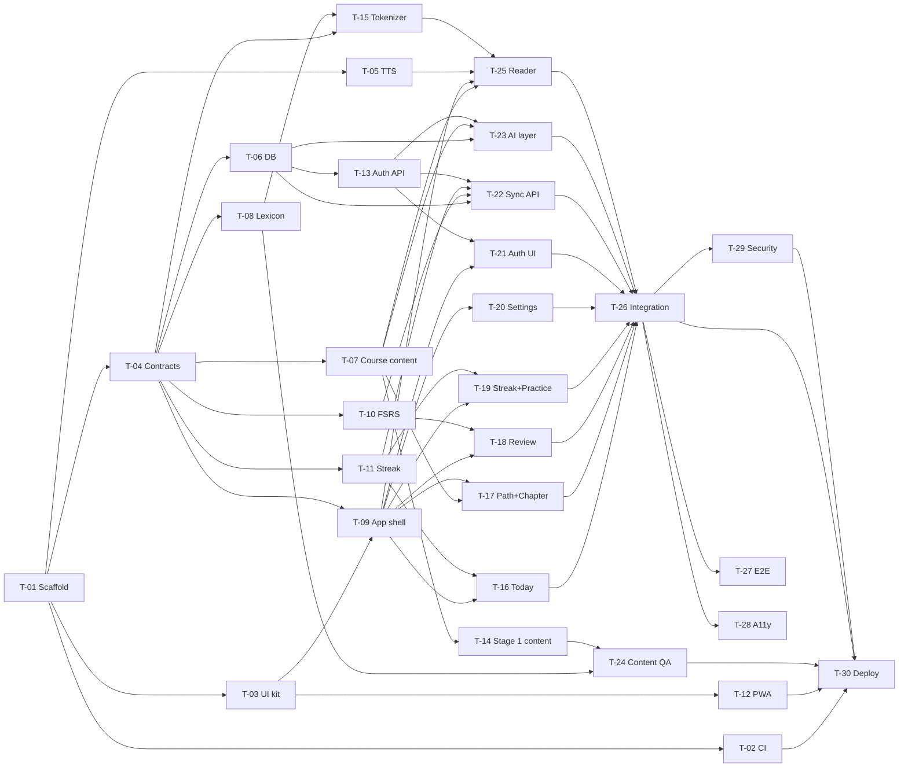

# Frenchy TODO

The single source of truth for what is done, what is next, and what we learned. Every agent reads this before starting and updates it while working (rules in `CLAUDE.md`).

- Spec: `docs/PLAN.md` · Visual spec: `design/README.md` + `design/mockups/` · Live canvas: https://claude.ai/artifact/Hguy86o9nTJ88gJ1Rvvd37
- Sections: [Legend](#legend) · [Orchestration plan](#orchestration-plan) · [DONE](#done) · [NEXT (MVP)](#next-mvp) · [BACKLOG](#backlog) · [KNOWN GAPS](#known-gaps) · [LESSONS](#lessons)

---

## Legend

**Status:** `ready` (all deps done, can start) · `blocked` (waiting on deps or a human) · `in progress` · `in review` (PR open) · `done`

**Priority:** `P0` MVP critical path · `P1` needed for MVP launch · `P2` next phase · `P3` later / nice to have

**Size (agent time, rough):** `S` < 1 h · `M` 1–3 h · `L` 3–6 h · anything bigger gets split

**Model · effort** (recommended for the agent that does the task):

| Pick | Use for |
|---|---|
| Haiku 5.5 | Mechanical edits, renames, doc touch-ups |
| Sonnet 5.5 · Medium | Small, fully specified UI or glue code |
| Sonnet 5.5 · High | Normal feature work with a clear spec: screens, tests, CI, pure logic |
| Opus 5.5 · Medium | Multi-file wiring and integration where the design is settled |
| Opus 5.5 · High | Contract-setting or design-heavy work others depend on; tricky logic; French content |
| Opus 5.5 · Extra | Reviews where a miss is costly (security, content QA), open-ended research |
| Opus 5.5 · Max | Not assigned; use only if an Extra run fails twice |

The **lead / orchestrator** session runs on Opus 5.5 · High.

**Task block format:** every task has an ID, a meta table, `Owns` (files the task may create or change), a goal, a "done when", and checkbox steps. Tick a step (`- [x]`) the moment it is done, in the same commit as the work.

**Finish steps** (the last three steps of every task):
1. `npm run check` is green (lint + typecheck + test + build).
2. TODO.md updated: steps ticked, status set, new lessons logged.
3. PR to `main` merged with CI green.

---

## Orchestration plan

Tasks in the same **wave** have no dependencies on each other and own different files, so they can run **in parallel** (one subagent, worktree or cloud session per task). Start a wave when every task it depends on is merged. A task can start early as soon as its own deps are merged, without waiting for the whole previous wave.

| Wave | Tasks (parallel) | Unblocks |
|---|---|---|
| 0 | T-01 scaffold | everything |
| 1 | T-02 CI · T-03 UI kit · T-04 shared contracts · T-05 TTS helper | 2 |
| 2 | T-06 DB schema · T-07 course content + validator · T-08 lexicon · T-09 app shell · T-10 FSRS · T-11 streak logic · T-12 PWA | 3 |
| 3 | T-13 auth backend · T-14 Stage 1 content (fan-out ×8) · T-15 tokenizer · T-16 Today · T-17 Path + Chapter · T-18 Review · T-19 Streak + Practice · T-20 Settings | 4 |
| 4 | T-21 auth UI + onboarding · T-22 sync API · T-23 AI layer · T-24 content QA · T-25 Reader | 5 |
| 5 | T-26 integration | 6 |
| 6 | T-27 E2E · T-28 a11y QA · T-29 security review | 7 |
| 7 | T-30 deploy (human gate) | MVP live |

Frontend screens (wave 3) are built against **MSW mocks** that use the shared fixtures from T-04, so they don't wait for the backend. T-26 swaps the mocks for the real API.

**Hot files** (several tasks touch them; keep edits to small additive hunks and merge `main` before opening the PR): `package.json`, `vite.config.ts`, `src/worker/index.ts` (one route-mount line per feature), `src/client/routes.tsx`, `src/client/mocks/handlers/index.ts`, `.github/workflows/ci.yml`, `TODO.md`.

**Progress:** DONE 11 · NEXT 25 (7 in progress: T-06 to T-12) · BACKLOG 20

---

## DONE

### D-01 · Learning plan and app spec
| Priority | Model · effort | Size | Depends on |
|---|---|---|---|
| P0 | Opus 5.5 · High | M | — |

**Status:** done · **Output:** `docs/PLAN.md`
- [x] Learner profile, daily loop, beginner route through the book (4 stages)
- [x] App vision, MVP / Phase 2 / Phase 3 features
- [x] Data model sketch and AI provider strategy

### D-02 · Tech stack decision
| Priority | Model · effort | Size | Depends on |
|---|---|---|---|
| P0 | Opus 5.5 · High | S | D-01 |

**Status:** done · **Output:** `docs/PLAN.md` §4, `docs/HANDOFF.md`
- [x] Compared Cloudflare against Vercel + Supabase, Firebase, Convex, PocketBase and local-first options
- [x] Picked Vite + React SPA (PWA) + Hono on Cloudflare Workers, D1 + Drizzle, R2, Better Auth
- [x] Recorded trade-offs: no row-level security in D1, Better Auth added, cli-bridge stays local

### D-03 · Session handoff notes
| Priority | Model · effort | Size | Depends on |
|---|---|---|---|
| P1 | Sonnet 5.5 · Medium | S | D-02 |

**Status:** done · **Output:** `docs/HANDOFF.md`
- [x] Wrote where we are, user decisions, next steps

### D-04 · Read Stage 1 of the book, map chapter pages
| Priority | Model · effort | Size | Depends on |
|---|---|---|---|
| P1 | Opus 5.5 · Medium | M | — |

**Status:** done · **Output:** `docs/PLAN.md` §2 (chapter → PDF page table)
- [x] Read Stage 1 chapters (1, 2, 12, 10, 4, 7, 33, App. A)
- [x] Mapped chapter start pages (PDF page = printed page + 11)

### D-05 · Clickable mockups (15 screens)
| Priority | Model · effort | Size | Depends on |
|---|---|---|---|
| P0 | Opus 5.5 · High | L | D-01 |

**Status:** done · **Output:** canvas https://claude.ai/artifact/Hguy86o9nTJ88gJ1Rvvd37
- [x] Welcome, onboarding, Today, course map, chapter, reader (tap a word), sentence sheet
- [x] Practice hub, SRS review (3 card types, 4 grades), session complete, streak
- [x] My words, conjugation drill, AI tutor, settings
- [x] Original mascot, color palette and type, contrast fixes

### D-06 · Repo setup for orchestration
| Priority | Model · effort | Size | Depends on |
|---|---|---|---|
| P0 | Opus 5.5 · High | M | D-05 |

**Status:** done · **Output:** `TODO.md`, `CLAUDE.md`, `design/README.md`, `design/mockups/`, branch `main`
- [x] Copied the latest mockups from the canvas into `design/mockups/`
- [x] Wrote design tokens and screen index in `design/README.md`
- [x] Wrote this TODO.md (tasks, dependencies, waves, model/effort)
- [x] Wrote CLAUDE.md (always update TODO, log lessons, Karpathy rules, orchestration protocol)
- [x] Created `main` from the working branch
- [ ] Set `main` as the default branch and protect it (human: see H-01)

### T-01 · Scaffold the app
| Priority | Model · effort | Size | Depends on | Blocks | Wave |
|---|---|---|---|---|---|
| P0 | Opus 5.5 · High | M | — | all NEXT tasks | 0 |

**Status:** done · **Claimed by:** local session · **Branch:** `task/T-01-scaffold` · **PR:** https://github.com/MinhTam2773/frenchy/pull/1
**Owns:** `package.json`, `package-lock.json`, `tsconfig*.json`, `vite.config.ts`, `wrangler.jsonc`, `index.html`, `eslint.config.js`, `.prettierrc`, `vitest.config.ts` (or workspace), `.gitignore`, `.dev.vars.example`, `README.md`, `src/client/main.tsx`, `src/client/App.tsx`, `src/client/styles.css`, `src/worker/index.ts`, `src/worker/routes/health.ts`, `src/shared/index.ts`
**Goal:** One repo that runs the React SPA and the Hono API together with one `npm run dev`, with strict TypeScript, lint and tests wired up.
**Done when:** `npm run dev` serves the SPA at `/` (deep links like `/path` too) and `{ "ok": true }` at `/api/health`; `npm run check` is green.

- [x] Create `src/client/`, `src/worker/`, `src/shared/` per PLAN §4 repo layout; `index.html` at the root
- [x] Vite + React + TypeScript (strict) for the client
- [x] Tailwind CSS (current stable, Vite plugin) with an empty theme in `src/client/styles.css` (T-03 fills it)
- [x] Hono app in `src/worker/index.ts` exporting `app` and `type AppType`; `GET /api/health` in `src/worker/routes/health.ts`; each feature later mounts with one line
- [x] `@cloudflare/vite-plugin` + `wrangler.jsonc`: `main` = worker entry, recent `compatibility_date`, static assets with SPA fallback, and `/api/*` always routed to the Worker first (check the current option name in Cloudflare docs; navigation requests to `/api/*` must not get `index.html`)
- [x] Local-only bindings in wrangler config: D1 `DB` (placeholder id), R2 `AUDIO` (placeholder). Do **not** create remote resources
- [x] Path aliases `@client/*`, `@worker/*`, `@shared/*` in tsconfig and Vite
- [x] Separate tsconfigs for client (DOM types) and worker (types from `wrangler types`)
- [x] ESLint (typescript-eslint, react-hooks, jsx-a11y) + Prettier
- [x] Vitest with two projects: `client` (jsdom + Testing Library) and `worker` (`@cloudflare/vitest-pool-workers`); one passing sample test in each
- [x] npm scripts: `dev`, `build`, `preview`, `test`, `test:watch`, `lint`, `typecheck`, `format`, `check` (lint + typecheck + test + build), `cf-typegen`
- [x] `.gitignore`: add `node_modules`, `dist`, `.wrangler`, `.dev.vars`, `coverage`, `playwright-report`; keep `*.pdf` and `book/`
- [x] `.dev.vars.example` listing the secrets later tasks need (names only, no values)
- [x] README: prerequisites, `npm install`, `npm run dev`, `npm run check`
- [x] Manually verify: `/`, `/path` (SPA) and `/api/health` (JSON)
- [x] Finish: `npm run check` green
- [x] Finish: TODO.md updated (steps ticked, status, lessons)
- [x] Finish: PR to `main` merged (CI does not exist yet: paste local `npm run check` output in the PR)

### T-02 · CI on GitHub Actions
| Priority | Model · effort | Size | Depends on | Blocks | Wave |
|---|---|---|---|---|---|
| P0 | Sonnet 5.5 · High | S | T-01 | T-30 (and safe merging for all) | 1 |

**Status:** done · **Claimed by:** local session · **Branch:** `task/T-02-ci` · **PR:** https://github.com/MinhTam2773/frenchy/pull/3
**Owns:** `.github/workflows/ci.yml`, `.github/pull_request_template.md`, `.nvmrc`
**Goal:** Every PR runs lint, typecheck, tests and build; merging requires green CI.
**Done when:** a PR shows a passing `ci` check; a deliberately failing test makes it red.

- [x] `.nvmrc` with the Node LTS used locally
- [x] Workflow on `pull_request` and `push` to `main`: checkout, setup-node from `.nvmrc` with npm cache, `npm ci`, `npm run lint`, `npm run typecheck`, `npm test`, `npm run build`
- [x] Concurrency group that cancels superseded runs on the same branch
- [x] Confirm the workers-pool tests run in CI without Cloudflare credentials
- [x] PR template: task ID, what changed, how it was verified, "TODO.md updated" checkbox
- [x] Prove it: push a commit with a failing test on a scratch branch, see red, revert
- [x] Note in the PR that the user should require the `ci` check on `main` (H-01)
- [x] Finish: `npm run check` green
- [x] Finish: TODO.md updated (steps ticked, status, lessons)
- [x] Finish: PR to `main` merged with CI green

### T-03 · UI kit and design tokens
| Priority | Model · effort | Size | Depends on | Blocks | Wave |
|---|---|---|---|---|---|
| P0 | Sonnet 5.5 · High | M | T-01 | T-09, T-12 | 1 |

**Status:** done · **Claimed by:** T-03 subagent (lead session) · **Branch:** `task/T-03-ui-kit` · **PR:** https://github.com/MinhTam2773/frenchy/pull/7
**Owns:** `src/client/styles.css` (theme), `src/client/ui/**`
**Goal:** Reusable components that match the mockups exactly, so screens are just composition.
**Done when:** every component in the list renders in `Gallery.tsx` in all its states, tests pass, and no component uses raw hex colors.

- [x] Read `design/README.md` and skim the mockups for sizes and states
- [x] Tailwind theme: all color tokens, Fredoka + Nunito (font links in `index.html`), radii, and solid "chunky" bottom-shadow utilities per variant
- [x] `Button` (primary, secondary, success, danger, warn, ghost; renders as a link when given `to`/`href`; press moves 4px down and drops the shadow)
- [x] `IconButton` (required `aria-label` at the type level), `Card`, `Chip` (neutral, masc, fem, new, status), `ProgressBar` (`role="progressbar"`), `Toggle` (`role="switch"`), `SegmentedTabs` (`role="tablist"`), `StreakChip`
- [x] `TopBar` (back/close, title, right slot) and `TabBar` (5 tabs, active pill, `aria-current="page"`)
- [x] `BottomSheet`: drag handle, `aria-modal`, focus trap, Esc closes, focus returns to the trigger
- [x] `Icon` set as inline SVG components covering every icon in the mockups
- [x] `Mascot` component with `mood="happy" | "cheer"` from the mockup SVG
- [x] `Gallery.tsx` showing every component and state (T-09 mounts it at `/dev/ui`)
- [x] Tests: Button as link, BottomSheet Esc + focus return, Toggle flips `aria-checked`, TabBar marks current route
- [x] Contrast test: every text/background token pair used by the kit meets 4.5:1 (small contrast helper + table of pairs)
- [x] Finish: `npm run check` green
- [x] Finish: TODO.md updated (steps ticked, status, lessons)
- [x] Finish: PR to `main` merged with CI green

### T-04 · Shared schemas, fixtures and API contract
| Priority | Model · effort | Size | Depends on | Blocks | Wave |
|---|---|---|---|---|---|
| P0 | Opus 5.5 · High | M | T-01 | T-06, T-07, T-08, T-09, T-10, T-11, T-15 | 1 |

**Status:** done · **Claimed by:** T-04 subagent (lead session) · **Branch:** `task/T-04-contracts` · **PR:** https://github.com/MinhTam2773/frenchy/pull/8
**Owns:** `src/shared/schemas/**`, `src/shared/fixtures/**`, `src/shared/constants.ts`, `docs/api-contract.md`
**Goal:** One typed contract (zod schemas + inferred types) that the client, the worker, the content pipeline and the mocks all import, so parallel tasks agree without talking to each other.
**Done when:** every schema has a valid fixture and a rejected invalid case in tests, and `docs/api-contract.md` lists every MVP endpoint.

- [x] `content.ts`: `Course`, `Stage`, `Chapter` (id, book chapter number, PDF start/end page, title, kind `appendix | grammar | conversation`, week range, sections), `GrammarTag`, `Text` (id, chapterId, title, kind `story | dialogue`, minutes, paragraphs → sentences → tokens `{ t, lemma?, pos?, gender?, form?, isNew? }`, sentence translations, newWords, grammarTags), `DeckCard`, `GrammarNote`
- [x] `lexicon.ts`: `Lexeme` (lemma, pos, gender, glosses, frequency rank), `FormEntry` (form → lemma + features: person, number, tense, mood)
- [x] `user.ts`: `Profile` (currentChapterId, timeZone (IANA), dailyGoalMinutes, settings: voice, rate, playOnTap)
- [x] `srs.ts`: `Card` (id, type `sentence_meaning | meaning_sentence | cloze`, front, back, clozeAnswer, source `{ kind: starter | text | word | tutor, ref }`, FSRS fields: due, stability, difficulty, elapsedDays, scheduledDays, reps, lapses, state, lastReview), `Rating` (1–4), `ReviewInput` (cardId, rating, reviewedAt, durationMs)
- [x] `words.ts` (`WordStatus`: lemma, `new | learning | known`) and `activity.ts` (`DailyActivity`: local date, minutes, reviews, readings, freezeUsed; `StreakSummary`: current, best, freezesLeft, todayDone)
- [x] `ai.ts`: `TranslateRequest/Response`, `ExplainRequest` (sentence, chapterId) / `ExplainResponse` (translation, gloss `[{ fr, en }]`, notes)
- [x] `constants.ts`: card types, grade labels, word statuses, daily goal options (15/30/45/60)
- [x] Fixtures in `src/shared/fixtures/` mirroring the mockups' dummy data: "Le matin de Léa" with full token annotations, 3 review cards (one of each type), profile on Ch 10, 12-day streak with one freeze, word list
- [x] `docs/api-contract.md`: method, path, auth, request schema, response schema for profile, cards (due, stats, create, starter), reviews, words, activity/streak, ai/translate, ai/explain (auth routes come from Better Auth)
- [x] Tests: each schema parses its fixture and rejects a broken copy
- [x] Finish: `npm run check` green
- [x] Finish: TODO.md updated (steps ticked, status, lessons)
- [x] Finish: PR to `main` merged with CI green

QUESTION: Review undo (T-18) has no server endpoint. Default in the contract: the client holds the last grade and posts it when the next card is graded or the session ends. Alternative: an undo route that restores the previous card state (see G-20).
ANSWER (lead, 2026-10-18): keep the default (client holds the last grade). No undo route in MVP.

### T-05 · Text-to-speech helper
| Priority | Model · effort | Size | Depends on | Blocks | Wave |
|---|---|---|---|---|---|
| P1 | Sonnet 5.5 · Medium | S | T-01 | T-25 | 1 |

**Status:** done · **Claimed by:** T-05 subagent (lead session) · **Branch:** `task/T-05-tts` · **PR:** https://github.com/MinhTam2773/frenchy/pull/6
**Owns:** `src/client/lib/tts/**`
**Goal:** One small module that speaks French well on every device that can.
**Done when:** `useTts()` speaks with the best available fr-FR voice, reports `supported=false` cleanly where it can't, and tests pass.

- [x] `speak(text, { rate, voiceURI })` on the Web Speech API; cancels any utterance in progress
- [x] Voice choice: saved voice → best local `fr-FR` → any `fr-*`; handle voices loading late (`voiceschanged`)
- [x] Default rate 0.8; allowed range 0.6–1.0
- [x] `useTts()` hook: `speak`, `stop`, `speaking`, `supported`, `voices`
- [x] Sentence boundary callback (where `onboundary` is supported) so the reader can highlight the spoken sentence
- [x] Tests with a mocked `speechSynthesis`
- [x] Finish: `npm run check` green
- [x] Finish: TODO.md updated (steps ticked, status, lessons)
- [x] Finish: PR to `main` merged with CI green

---

## NEXT (MVP)

Goal: course map + reader + tap-to-translate + SRS + daily streak, with Stage 1 content, installable as a PWA and deployed on Cloudflare.

### Wave 0

T-01 is done (moved to DONE).

### Wave 1

Wave 1 is done (T-02 to T-05 moved to DONE).

### Wave 2

#### T-06 · Database schema, migrations and user scoping
| Priority | Model · effort | Size | Depends on | Blocks | Wave |
|---|---|---|---|---|---|
| P0 | Opus 5.5 · Medium | M | T-04 | T-13, T-22, T-23 | 2 |

**Status:** in review · **Claimed by:** T-06 subagent (lead session) · **Branch:** `task/T-06-db`
**Owns:** `src/worker/db/**`, `migrations/**`, `drizzle.config.ts`, `scripts/db/seed.ts`
**Goal:** D1 tables for all MVP user data, plus one helper that makes cross-user reads impossible by construction.
**Done when:** migrations apply on a fresh local D1, the seed loads mockup-like data, and an isolation test proves user A can't read user B's rows.

- [x] Drizzle ORM + drizzle-kit for D1 (sqlite dialect)
- [x] Tables from PLAN §4: `profiles`, `cards`, `reviews`, `word_status`, `daily_activity`, `translation_cache`, matching the T-04 schemas (ids as text UUIDs, timestamps as integer ms UTC, local dates as `YYYY-MM-DD` text)
- [x] Indexes/uniques: `cards(user_id, due)`, `reviews(user_id, reviewed_at)`, unique `word_status(user_id, lemma)`, unique `daily_activity(user_id, date)`, unique `translation_cache(key)`
- [x] Leave the Better Auth tables to T-13, but use `user_id text` that will reference `user.id`
- [x] `scopedDb(db, userId)` exposing per-table query helpers that always filter by `user_id`; routes never touch raw tables
- [x] Scripts: `db:generate`, `db:migrate:local`, `db:seed:local`
- [x] Seed: a demo profile on Ch 10, 18 due cards, 12 days of activity with one freeze (matches the mockups)
- [x] Tests (workers pool + local D1): migrations apply cleanly; `scopedDb` isolation between two users
- [x] Finish: `npm run check` green
- [x] Finish: TODO.md updated (steps ticked, status, lessons)
- [ ] Finish: PR to `main` merged with CI green

Notes for T-13 / T-22 / T-23:
- Tables: `profiles`, `cards`, `reviews`, `word_status`, `daily_activity`, plus `activity_minutes` (PK user + minute start, for ping dedupe) and `text_reads` (PK user + text + local date; the earliest `finished_at` per text is the first finish). That resolves G-19; `text_reads` is keyed per day because the contract counts a reading once per text per day, not only the first time. `translation_cache` is shared (not user data) and goes through `translationCacheDb(db)`.
- API: `scopedDb(createDb(env.DB), userId)` returns `{ userId, profiles, cards, reviews, wordStatus, dailyActivity, activityMinutes, textReads, batch }`; each table has `select(where?)`, `insert(rows)`, `update(set, where?)`, `delete(where?)`, returning un-awaited drizzle queries pinned to the user (await one, or pass several to `batch([...])`). Column refs for `where` come from `schema` (exported from `src/worker/db`).
- T-13: Better Auth tables are not created. Add your schema file to `schema` in `drizzle.config.ts` (or export it from `src/worker/db/schema.ts`) so `npm run db:generate` writes one migration chain, and add the `user_id` foreign keys then if wanted.
- Worker tests get every migration applied by `src/worker/db/test-setup.ts` (see L-24).

#### T-07 · Course structure, grammar inventory and content validator
| Priority | Model · effort | Size | Depends on | Blocks | Wave |
|---|---|---|---|---|---|
| P0 | Sonnet 5.5 · High | M | T-04 | T-14, T-17, T-23, T-25 | 2 |

**Status:** in review · **Claimed by:** T-07 subagent (lead session) · **Branch:** `task/T-07-course-content`
**Owns:** `content/course.json`, `content/grammar.json`, `scripts/content/check.ts`, `src/shared/content/**` (loaders)
**Goal:** The course map and the "allowed grammar per chapter" list as validated JSON, plus a checker every content task must pass.
**Done when:** `npm run content:check` validates the course and grammar files, rejects the bad fixtures, and runs in CI.

- [x] `content/course.json`: all 4 stages with chapters in the beginner route order from PLAN §2, each with book chapter number, PDF start page, PDF end page (next chapter's start − 1), title, kind and week range
- [x] Chapter sections: if the book is available locally in `book/`, add section labels and PDF pages for Stage 1; otherwise leave `sections: []` and keep G-06 open. Never copy book text
- [x] `content/grammar.json`: ordered grammar tags introduced per chapter (e.g. `articles.definite`, `gender.basic`, `etre.present`, `avoir.present`, `aller.present`, `faire.present`, `er.present`, `numbers.0-100`, `questions.intonation`, `questions.est-ce-que`), including *aller* and *faire* in Stage 1 (L-02)
- [x] Loaders in `src/shared/content/` (typed, used by client and worker): `getCourse()`, `allowedGrammar(chapterId)`, `getText(id)`
- [x] `scripts/content/check.ts` + `npm run content:check`: zod-validates every content file; unique ids; valid route order; each text uses only allowed grammar tags; every word token has a lemma; every sentence has a translation; ≤ 8 new words per text; deck cards point to existing texts
- [x] Add `npm run content:check` to `.github/workflows/ci.yml` (hot file)
- [x] Tests: validator accepts good fixtures and names the exact problem for each bad one
- [x] Finish: `npm run check` green
- [x] Finish: TODO.md updated (steps ticked, status, lessons)
- [ ] Finish: PR to `main` merged with CI green

#### T-08 · Offline lexicon pipeline
| Priority | Model · effort | Size | Depends on | Blocks | Wave |
|---|---|---|---|---|---|
| P1 | Opus 5.5 · High | L | T-04 | T-15, T-24 | 2 |

**Status:** in progress · **Claimed by:** T-08 subagent (lead session) · **Branch:** `task/T-08-lexicon`
**Owns:** `scripts/lexicon/**`, `content/lexicon/**`, `src/shared/lexicon/**`, `docs/LICENSES.md`
**Goal:** Instant, free word taps: a compact French → English lexicon with form → lemma lookup, shipped as static JSON.
**Done when:** `lookupForm('vais')` returns *aller* (1st person singular, present), the shards fit the size budget, and the license and attribution are recorded.

- [ ] Research the source: Wiktionary-derived data (e.g. wiktextract / kaikki.org French entries with English glosses). Record the license (Wiktionary text is CC BY-SA and GFDL) and the attribution needed in `docs/LICENSES.md`; log the decision as a lesson
- [ ] If the license blocks what PLAN wants (sharing the app with others), stop, write a `QUESTION:` under this task and in G-01, and propose alternatives
- [ ] Build script reads the raw dump from a local path (gitignored, never committed) and keeps French entries for the parts of speech we need
- [ ] Frequency: pick a frequency list with a compatible license; keep the top ~10k lemmas plus every lemma used in `content/`
- [ ] Output `content/lexicon/lemmas-<shard>.json` (lemma → pos, gender, ≤ 3 glosses, rank) and `content/lexicon/forms-<shard>.json` (form → candidates with person, number, tense, mood), sharded by first letter; budget ≤ 2 MB gzipped total
- [ ] `src/shared/lexicon/lookup.ts`: `lookupForm(form)` lazy-loads one shard and returns candidates by frequency
- [ ] Coverage report script: % of word tokens in `content/` found; list the misses
- [ ] Tests: *vais* → aller, *préfère* → préférer, *heures* → heure (f, pl), *l'* → le/la, *au* = à + le
- [ ] Finish: `npm run check` green
- [ ] Finish: TODO.md updated (steps ticked, status, lessons)
- [ ] Finish: PR to `main` merged with CI green

#### T-09 · App shell, routing, data layer and mocks
| Priority | Model · effort | Size | Depends on | Blocks | Wave |
|---|---|---|---|---|---|
| P0 | Sonnet 5.5 · High | M | T-03, T-04 | T-16 to T-21, T-25 | 2 |

**Status:** in review · **Claimed by:** T-09 subagent (lead session) · **Branch:** `task/T-09-app-shell`
**Owns:** `src/client/App.tsx`, `src/client/routes.tsx`, `src/client/layouts/**`, `src/client/lib/api.ts`, `src/client/lib/query.ts`, `src/client/lib/session.ts`, `src/client/mocks/**`, placeholder pages in `src/client/features/*/`, `src/client/README.md`
**Goal:** Every MVP route exists with the right layout, typed API calls work, and MSW serves fixture data so screen tasks can run in parallel without a backend.
**Done when:** every route renders its placeholder inside the right layout, `/dev/ui` shows the gallery, and a sample query returns fixture data through MSW.

- [x] React Router (SPA) routes: `/` welcome, `/onboarding`, `/today`, `/path`, `/chapter/:chapterId`, `/read/:textId`, `/practice`, `/review`, `/review/done`, `/streak`, `/me`, `/dev/ui` (dev only, mounts T-03 `Gallery`); plus a `/words` placeholder (the kit's tab bar links to it, G-28) and a not-found page
- [x] One placeholder page per route at `src/client/features/<feature>/<Name>Page.tsx`
- [x] Layouts: tab layout (TabBar) for Today, Path, Practice, Words (Phase 2), Me; full-screen layout for onboarding, chapter, reader, review, streak
- [x] TanStack Query provider with defaults (sensible `staleTime`, retry once)
- [x] Typed API client with normalized errors (`ApiClientError`). Deviation: typed by the shared zod schemas, not `hc<AppType>` (L-32)
- [x] MSW for browser and Node, on when `VITE_USE_MOCKS=true` (default in dev until T-26); `handlers/base.ts` serves every contract endpoint from `src/shared/fixtures`, feature handlers go in `src/client/mocks/handlers/<feature>.ts` and `handlers/index.ts` picks them up by glob (no registration edit)
- [x] `useSession()` stub (mock signed-in user) and a guard that sends signed-out users to `/`
- [x] Lazy-load the reader and review routes
- [x] `src/client/README.md`: how to add a screen (folder, route line, mock handler file)
- [x] Tests: each route renders; TabBar marks the current route
- [x] Finish: `npm run check` green
- [x] Finish: TODO.md updated (steps ticked, status, lessons)
- [ ] Finish: PR to `main` merged with CI green

#### T-10 · FSRS scheduling module
| Priority | Model · effort | Size | Depends on | Blocks | Wave |
|---|---|---|---|---|---|
| P0 | Sonnet 5.5 · High | S | T-04 | T-18, T-22 | 2 |

**Status:** in review · **Claimed by:** T-10 subagent (lead session) · **Branch:** `task/T-10-fsrs`
**Owns:** `src/shared/srs/**`
**Goal:** A thin, tested wrapper around `ts-fsrs` shared by the client (interval previews) and the worker (authoritative scheduling).
**Done when:** grading is deterministic under a fixed clock with fuzz off, and the interval labels match the format in the Review mockup ("1m", "6m", "1d", "4d").

- [x] Add `ts-fsrs`; one config object (target retention 0.9, max interval, fuzz on in production)
- [x] `newCard()`, `previewIntervals(card, now)` → the 4 labels, `grade(card, rating, now)` → next card state + review log
- [x] Mapping between ts-fsrs cards and the shared `Card` FSRS fields (dates as epoch ms)
- [x] Interval label formatter (m, h, d, mo, y)
- [x] Tests: new card + Good is due in the future; Again lowers stability; labels; deterministic with a fixed `now` and fuzz off
- [x] Finish: `npm run check` green
- [x] Finish: TODO.md updated (steps ticked, status, lessons)
- [ ] Finish: PR to `main` merged with CI green

#### T-11 · Streak and freeze logic
| Priority | Model · effort | Size | Depends on | Blocks | Wave |
|---|---|---|---|---|---|
| P0 | Sonnet 5.5 · High | S | T-04 | T-16, T-19, T-22 | 2 |

**Status:** in review · **Claimed by:** T-11 subagent (lead session) · **Branch:** `task/T-11-streak`
**Owns:** `src/shared/streak/**`
**Goal:** A pure function that turns daily activity rows into the streak, best streak, freezes and calendar, in the user's time zone.
**Done when:** the tests cover gaps, freezes, the 2-freeze cap, DST changes and time-zone changes, and all pass.

- [x] Rule (default until H-07 confirms): a day counts when ≥ 1 review is graded or ≥ 1 reading is finished. One freeze is earned per 7 counted days in a row, at most 2 held, and a freeze is spent automatically on a missed day. Implemented as: `current` counts counted days in the run (a freeze day keeps the run alive but adds 0); a freeze is earned on every 7th counted day of a run (7, 14, 21, …); minutes alone don't count; a broken run restarts at 0 with no freezes; today never breaks the streak
- [x] `computeStreak(rows, todayLocalDate)` → `{ current, best, freezesLeft, todayDone, calendar }`, fully derived from the rows (deterministic). `freezeUsed` on the rows is **ignored** (it is an output, not an input; see L-38)
- [x] Local-date helpers using `Intl.DateTimeFormat` with the IANA time zone (no heavy date library)
- [x] Tests: simple run, missed day with and without a freeze, cap of 2, today not done yet doesn't break the streak, DST (America/Toronto in March and November), user changes time zone
- [x] Finish: `npm run check` green
- [x] Finish: TODO.md updated (steps ticked, status, lessons)
- [ ] Finish: PR to `main` merged with CI green

#### T-12 · PWA (installable app)
| Priority | Model · effort | Size | Depends on | Blocks | Wave |
|---|---|---|---|---|---|
| P1 | Sonnet 5.5 · High | S | T-03 | T-30 | 2 |

**Status:** in progress · **Claimed by:** T-12 subagent (lead session) · **Branch:** `task/T-12-pwa`
**Owns:** PWA section of `vite.config.ts` (hot file), `public/icons/**`, `src/client/pwa/**`, PWA meta tags in `index.html`
**Goal:** Frenchy installs to the home screen on iPhone, Android and desktop, and loads fast from cache.
**Done when:** Chrome reports the app as installable, the service worker caches the shell and content, and `/api/*` is never cached.

- [ ] `vite-plugin-pwa`; manifest: name "Frenchy", short name, theme `#2B59F0`, background `#F6F8FF`, display standalone, icons 192/512 + maskable made from the mascot
- [ ] Runtime caching: app shell, fonts, `content/**` and lexicon shards (stale-while-revalidate); `/api/*` network-only
- [ ] "New version available" toast with reload
- [ ] iOS: `apple-touch-icon`, web-app meta tags, a one-time "Add to Home Screen" hint in Safari
- [ ] Run Lighthouse installability locally and paste the result in the PR
- [ ] Finish: `npm run check` green
- [ ] Finish: TODO.md updated (steps ticked, status, lessons)
- [ ] Finish: PR to `main` merged with CI green

### Wave 3

#### T-13 · Auth backend (Better Auth on Workers + D1)
| Priority | Model · effort | Size | Depends on | Blocks | Wave |
|---|---|---|---|---|---|
| P0 | Opus 5.5 · High | M | T-06 | T-21, T-22, T-23 | 3 |

**Status:** blocked · **Claimed by:** — · **Branch:** `task/T-13-auth-api`
**Owns:** `src/worker/auth/**`, `src/worker/middleware/session.ts`, `src/worker/routes/auth.ts`, auth migrations in `migrations/`
**Goal:** Email and Google sign-in with sessions stored in D1, and a `requireUser` middleware every API route uses.
**Done when:** the workers-pool tests cover sign up, sign in, session read, a protected route (401 vs 200) and sign out.

- [ ] First check that the current Better Auth works in the Workers runtime with D1 (Drizzle adapter). If not, stop, log a lesson, and write a `QUESTION:` with an alternative before building
- [ ] Create the auth instance per request from `env`; mount at `/api/auth/*`
- [ ] Email + password (minimum length, rate-limited attempts)
- [ ] Google OAuth when `GOOGLE_CLIENT_ID`/`SECRET` are set (H-03); email-only otherwise, exposed through a small config endpoint the UI can read
- [ ] Generate the Better Auth tables → Drizzle schema → migration; apply locally
- [ ] `requireUser` middleware sets `c.var.user`, otherwise returns a 401 JSON error
- [ ] Create the `profiles` row on first sign-in (onboarding fills it)
- [ ] Cookies: secure, httpOnly, `SameSite=Lax`; trusted origins from env
- [ ] Tests (workers pool) for the flows in "Done when"
- [ ] Finish: `npm run check` green
- [ ] Finish: TODO.md updated (steps ticked, status, lessons)
- [ ] Finish: PR to `main` merged with CI green

#### T-14 · Stage 1 content generation (fan-out per chapter)
| Priority | Model · effort | Size | Depends on | Blocks | Wave |
|---|---|---|---|---|---|
| P0 | Opus 5.5 · High (one agent per chapter) | L total, M per chapter | T-07 | T-24 | 3 |

**Status:** blocked · **Claimed by:** — · **Branch:** `task/T-14-stage1-<chapterId>` (one per chapter)
**Owns:** `scripts/content/prompts/**` (lead only), `content/chapters/<chapterId>/**` (each sub-agent owns exactly one chapter folder)
**Goal:** Original, leveled Stage 1 lessons: 3–5 texts per chapter, a grammar note and a starter deck, with every token annotated so the reader is exact.
**Done when:** all 8 Stage 1 chapters pass `npm run content:check` and are handed to T-24 for QA.

- [ ] Lead writes the generation brief `scripts/content/prompts/text.md`: original French only (the book sets topic order, never copy its sentences), only grammar tags allowed up to the chapter, ≤ 8 new words per text, 60–120 words per A1 text, stories and dialogues, natural everyday topics, per-token annotations (lemma, pos, gender, form), English translation per sentence
- [ ] Lead writes the deck brief: 20–30 cards per chapter mixing `sentence_meaning`, `meaning_sentence` and `cloze`, clozes with one unambiguous answer
- [ ] Fan out, one sub-agent per chapter (tick when that chapter passes `content:check`):
  - [ ] App. A · Pronunciation (short texts focused on sounds, plus a sound-pairs note)
  - [ ] Ch 1 · Articles
  - [ ] Ch 2 · Basic gender endings
  - [ ] Ch 12 · *Être*, *avoir*, irregular verbs (also *aller* and *faire*, L-02)
  - [ ] Ch 10 · Present tense of -er verbs
  - [ ] Ch 4 · Numbers
  - [ ] Ch 7 · Asking questions
  - [ ] Ch 33 · Conversation: meeting people (dialogues)
- [ ] Each chapter folder holds `texts/*.json`, `note.json` (a pattern card like the Chapter mockup) and `deck.json`
- [ ] `npm run content:check` green for all chapters
- [ ] Do not self-approve: hand over to T-24 (a different agent)
- [ ] Finish: `npm run check` green
- [ ] Finish: TODO.md updated (steps ticked, status, lessons)
- [ ] Finish: PR(s) to `main` merged with CI green

#### T-15 · French tokenizer and word annotation
| Priority | Model · effort | Size | Depends on | Blocks | Wave |
|---|---|---|---|---|---|
| P0 | Opus 5.5 · High | M | T-04, T-08 | T-25 | 3 |

**Status:** blocked · **Claimed by:** — · **Branch:** `task/T-15-tokenizer`
**Owns:** `src/shared/text/**`
**Goal:** Turn any French text into tappable tokens and sentences, and give each word the best lemma and form info available.
**Done when:** a table-driven test of tricky inputs passes (elision, hyphenated inversion, French punctuation, compounds, abbreviations).

- [ ] `tokenize(text)` → word, punctuation and space tokens with offsets
- [ ] Elision with both `'` and `’`: l', d', j', m', t', s', n', c', qu', jusqu', lorsqu', puisqu'
- [ ] Hyphens: inversions split (*parles-tu*, *a-t-il*); fixed compounds kept whole (*aujourd'hui*, *peut-être*, *est-ce que* as a phrase)
- [ ] French punctuation spacing (« », non-breaking spaces before ? ! : ;) and numbers
- [ ] `splitSentences(text)` that respects abbreviations (M., Mme, etc.) and ellipses
- [ ] `annotate(token, context)`: content annotation first; otherwise lexicon candidates with simple context rules (*a* vs *à*, *est* as a verb after a subject, verb readings after subject pronouns); otherwise unknown
- [ ] `describeForm()` for the word sheet, e.g. "il / elle · present · -er verb"
- [ ] Table-driven tests
- [ ] Finish: `npm run check` green
- [ ] Finish: TODO.md updated (steps ticked, status, lessons)
- [ ] Finish: PR to `main` merged with CI green

#### T-16 · Today screen
| Priority | Model · effort | Size | Depends on | Blocks | Wave |
|---|---|---|---|---|---|
| P0 | Sonnet 5.5 · High | M | T-09, T-11 | T-26 | 3 |

**Status:** blocked · **Claimed by:** — · **Branch:** `task/T-16-today`
**Owns:** `src/client/features/today/**`, `src/client/lib/activity/**`, `src/client/mocks/handlers/today.ts`
**Goal:** The daily screen from `Today.dc.html`: review first, then the book, reading and output.
**Done when:** it matches the mockup at 390 px with fixture data, the edge states work, and tests pass.

- [ ] Header: wordmark, streak chip, freeze chip (both link to `/streak`)
- [ ] Greeting and daily minutes progress against the goal
- [ ] Review card: due count, estimated minutes (≈ 35 s per card), Start review → `/review`
- [ ] Book card: current chapter, current section, PDF page → `/chapter/:id`
- [ ] Reading card: next unread text of the current chapter → `/read/:id`
- [ ] Output card: "Write 3–5 sentences" (links to the tutor once B-03 lands; until then a simple notes prompt or hidden, decide in the PR)
- [ ] `useToday()` combining profile, due count, streak summary and next text; MSW handler
- [ ] Edge states: 0 due ("All caught up", next due time), streak at risk, no chapter set → onboarding
- [ ] `useActiveMinutes()`: visibility-aware minute tracking that pings the activity API (mocked for now)
- [ ] Tests: due count, links, empty state, at-risk state
- [ ] Finish: `npm run check` green
- [ ] Finish: TODO.md updated (steps ticked, status, lessons)
- [ ] Finish: PR to `main` merged with CI green

#### T-17 · Course map and chapter screens
| Priority | Model · effort | Size | Depends on | Blocks | Wave |
|---|---|---|---|---|---|
| P0 | Sonnet 5.5 · High | M | T-09, T-07 | T-26 | 3 |

**Status:** blocked · **Claimed by:** — · **Branch:** `task/T-17-path-chapter`
**Owns:** `src/client/features/path/**`, `src/client/features/chapter/**`, `src/client/mocks/handlers/path.ts`
**Goal:** `Path.dc.html` and `Chapter.dc.html`: the winding stage path and the chapter page that sits next to the book.
**Done when:** both match their mockups with the real `course.json`, setting the current chapter works (mocked), and tests pass.

- [ ] Path: stage banner with stage switcher, winding node path (done / current / locked / conversation node styles), labels, "You're here" bubble, mascot
- [ ] States from `course.json` + `profile.currentChapterId`: before current = done, current, after = locked (locked chapters still open read-only; see G-07)
- [ ] Chapter: header, title, PDF page range, section progress, pattern / grammar note card, readings list, starter deck "Add to reviews" (calls the starter-deck endpoint)
- [ ] "Make this my current chapter" action
- [ ] Hide the drill button until B-01
- [ ] Desktop: centered column, max width ~480 px
- [ ] Tests: node states, current-chapter change, readings links
- [ ] Finish: `npm run check` green
- [ ] Finish: TODO.md updated (steps ticked, status, lessons)
- [ ] Finish: PR to `main` merged with CI green

#### T-18 · Review session and session complete
| Priority | Model · effort | Size | Depends on | Blocks | Wave |
|---|---|---|---|---|---|
| P0 | Sonnet 5.5 · High | M | T-09, T-10 | T-26 | 3 |

**Status:** blocked · **Claimed by:** — · **Branch:** `task/T-18-review`
**Owns:** `src/client/features/review/**`, `src/client/mocks/handlers/review.ts`
**Goal:** `Review.dc.html` and `ReviewDone.dc.html`: a fast SRS session with the 3 card types and FSRS interval previews.
**Done when:** a mocked session can be completed end to end, the stats math is tested, and the screens match the mockups.

- [ ] Load due cards (cap per session, cap new cards per day from settings); progress bar and count
- [ ] Card renderers: `sentence_meaning` (with TTS button), `meaning_sentence`, `cloze` (blank → filled on reveal)
- [ ] Show answer → 4 grade buttons labelled with `previewIntervals` (T-10)
- [ ] On grade: next state from T-10, optimistic update, POST the review (mocked), next card; one-step undo
- [ ] Desktop keys inside the screen only: Space reveals, 1–4 grade
- [ ] Session complete: cards, correct % (Good + Easy share), time, streak message, "Up next" link
- [ ] Tests: reveal → grade → advance; undo; completion stats
- [ ] Finish: `npm run check` green
- [ ] Finish: TODO.md updated (steps ticked, status, lessons)
- [ ] Finish: PR to `main` merged with CI green

#### T-19 · Streak and Practice hub screens
| Priority | Model · effort | Size | Depends on | Blocks | Wave |
|---|---|---|---|---|---|
| P1 | Sonnet 5.5 · Medium | S | T-09, T-11 | T-26 | 3 |

**Status:** blocked · **Claimed by:** — · **Branch:** `task/T-19-streak-practice`
**Owns:** `src/client/features/streak/**`, `src/client/features/practice/**`, `src/client/mocks/handlers/streak.ts`
**Goal:** `Streak.dc.html` and `Practice.dc.html`.
**Done when:** both match their mockups with fixture data and tests pass.

- [ ] Streak: hero (current, best), at-risk banner, month calendar (practiced, freeze used, today, missed, future) with previous/next month, freeze card
- [ ] Practice hub: flashcards card (due, new, learning, review counts) → `/review`; drills, tutor, speaking and import shown as "Coming later"
- [ ] Tests: calendar cell states from T-11 output; hub counts
- [ ] Finish: `npm run check` green
- [ ] Finish: TODO.md updated (steps ticked, status, lessons)
- [ ] Finish: PR to `main` merged with CI green

#### T-20 · Me / settings screen
| Priority | Model · effort | Size | Depends on | Blocks | Wave |
|---|---|---|---|---|---|
| P1 | Sonnet 5.5 · Medium | S | T-09 | T-26 | 3 |

**Status:** blocked · **Claimed by:** — · **Branch:** `task/T-20-settings`
**Owns:** `src/client/features/settings/**`, `src/client/mocks/handlers/settings.ts`
**Goal:** The MVP subset of `Settings.dc.html`.
**Done when:** changing a setting persists through the (mocked) profile API and tests pass.

- [ ] Profile row (name, sync status, streak chip)
- [ ] Learning: book chapter (opens the chapter picker), daily goal, time zone (auto-detected, editable)
- [ ] Audio: voice picker (from T-05 voices), speed 0.6–1.0, "Play words when tapped"
- [ ] Sign out (mocked until T-26)
- [ ] Not in MVP, so not rendered: daily reminder (B-12), AI providers (B-13)
- [ ] Tests: settings round-trip through the profile mock
- [ ] Finish: `npm run check` green
- [ ] Finish: TODO.md updated (steps ticked, status, lessons)
- [ ] Finish: PR to `main` merged with CI green

### Wave 4

#### T-21 · Welcome, sign-in and onboarding UI
| Priority | Model · effort | Size | Depends on | Blocks | Wave |
|---|---|---|---|---|---|
| P0 | Sonnet 5.5 · High | M | T-09, T-13 | T-26 | 4 |

**Status:** blocked · **Claimed by:** — · **Branch:** `task/T-21-auth-ui`
**Owns:** `src/client/features/auth/**`, `src/client/features/onboarding/**`, `src/client/lib/session.ts` (replaces the T-09 stub)
**Goal:** `Main.dc.html` and `Onboarding.dc.html` working with the real Better Auth client.
**Done when:** a new user can sign up with email locally, pick a chapter and goal, and land on `/today`; tests pass.

- [ ] Welcome: Continue with email, Continue with Google (hidden when Google isn't configured), I already have an account
- [ ] Email sign-up and sign-in forms: labels, validation, errors announced to screen readers
- [ ] Onboarding: Stage 1 chapter list (plus "show later stages"), daily goal, save profile, go to `/today`
- [ ] Replace the `useSession()` stub with the real session; keep the guard
- [ ] Password reset is not in MVP (G-08): show "Forgot password?" only once B-18 lands
- [ ] Tests: form validation, onboarding saves the profile, guard redirects
- [ ] Finish: `npm run check` green
- [ ] Finish: TODO.md updated (steps ticked, status, lessons)
- [ ] Finish: PR to `main` merged with CI green

#### T-22 · Sync API (profile, cards, reviews, words, activity)
| Priority | Model · effort | Size | Depends on | Blocks | Wave |
|---|---|---|---|---|---|
| P0 | Opus 5.5 · High | L | T-06, T-10, T-11, T-13 | T-26 | 4 |

**Status:** blocked · **Claimed by:** — · **Branch:** `task/T-22-sync-api`
**Owns:** `src/worker/routes/profile.ts`, `cards.ts`, `reviews.ts`, `words.ts`, `activity.ts` (+ one mount line each in `src/worker/index.ts`)
**Goal:** Every MVP endpoint from `docs/api-contract.md`, user-scoped and validated.
**Done when:** each endpoint has tests, including one proving cross-user isolation, and responses match the shared schemas.

- [ ] `GET /api/profile`, `PATCH /api/profile`
- [ ] `GET /api/cards/due?limit=`, `GET /api/cards/stats` (new / learning / review counts)
- [ ] `POST /api/cards` (from a saved word or sentence; dedupe on type + front)
- [ ] `POST /api/cards/starter/:chapterId` (adds the chapter's starter deck; idempotent)
- [ ] `POST /api/reviews`: validate the rating, recompute the next state on the server with T-10 (the client's preview is not trusted), update the card and insert the review in one D1 batch
- [ ] `PUT /api/words/:lemma` (status)
- [ ] `POST /api/activity/ping` (minute deltas, idempotent per minute) and `GET /api/streak` (T-11 over about the last 400 days)
- [ ] Every route uses `requireUser` + `scopedDb` + zod validation; one error JSON shape
- [ ] Tests per endpoint, including cross-user isolation
- [ ] Finish: `npm run check` green
- [ ] Finish: TODO.md updated (steps ticked, status, lessons)
- [ ] Finish: PR to `main` merged with CI green

#### T-23 · AI layer: translate and explain
| Priority | Model · effort | Size | Depends on | Blocks | Wave |
|---|---|---|---|---|---|
| P1 | Opus 5.5 · High | M | T-06, T-07, T-13 | T-26 | 4 |

**Status:** blocked · **Claimed by:** — · **Branch:** `task/T-23-ai`
**Owns:** `src/worker/ai/**`, `src/worker/routes/ai.ts`
**Goal:** Sentence translation and explanation for any text through one provider-agnostic interface, cached so each sentence costs at most once.
**Done when:** the tests show a cache hit skips the provider, invalid JSON is retried once, and the rate limit works, all with the mock driver.

- [ ] Load the `claude-api` skill before writing any Anthropic API code and use the model ids it gives
- [ ] `AiProvider` interface: `translate()`, `explain()`, plus a `chat()` signature for B-03
- [ ] Drivers: `anthropic`, `openai-compatible` (base URL + key + model), `mock` (tests and local dev without keys)
- [ ] Routing by env (`AI_TRANSLATE_PROVIDER`, `AI_EXPLAIN_PROVIDER`); keys only as Worker secrets (H-04)
- [ ] Explain prompt returns strict JSON (translation, word gloss, ≤ 2 notes) pitched at the learner's chapter (from `allowedGrammar`); validate with zod; one retry on invalid JSON
- [ ] `translation_cache` key = hash of task + normalized text + level
- [ ] Per-user rate limit (start at 60 requests/hour)
- [ ] User text is treated as data inside the prompt, never as instructions
- [ ] Tests for the "Done when" cases
- [ ] Finish: `npm run check` green
- [ ] Finish: TODO.md updated (steps ticked, status, lessons)
- [ ] Finish: PR to `main` merged with CI green

#### T-24 · Stage 1 content QA
| Priority | Model · effort | Size | Depends on | Blocks | Wave |
|---|---|---|---|---|---|
| P0 | Opus 5.5 · Extra | M | T-14, T-08 | T-30 | 4 |

**Status:** blocked · **Claimed by:** — · **Branch:** `task/T-24-content-qa`
**Owns:** fixes in `content/chapters/**`, `docs/content-qa.md`
**Goal:** An independent check (fresh agent, not the T-14 author) that every Stage 1 text and card is correct, natural and at the right level.
**Done when:** `docs/content-qa.md` lists every finding with its fix, lexicon coverage is ≥ 98%, and `content:check` is green.

- [ ] For each text: only allowed grammar, natural French, correct gender, agreement and elision, accurate English translation, correct token annotations
- [ ] For each deck: one unambiguous cloze answer, correct translations, no duplicates
- [ ] Run the T-08 coverage report; fix misses (annotations or lexicon additions)
- [ ] Write `docs/content-qa.md` (finding, location, fix); apply the fixes
- [ ] List anything a native speaker should still check under G-02
- [ ] Finish: `npm run check` green
- [ ] Finish: TODO.md updated (steps ticked, status, lessons)
- [ ] Finish: PR to `main` merged with CI green

#### T-25 · Reader with tap-to-translate
| Priority | Model · effort | Size | Depends on | Blocks | Wave |
|---|---|---|---|---|---|
| P0 | Opus 5.5 · Medium | M | T-05, T-07, T-09, T-15 | T-26 | 4 |

**Status:** blocked · **Claimed by:** — · **Branch:** `task/T-25-reader`
**Owns:** `src/client/features/reader/**`, `src/client/mocks/handlers/reader.ts`
**Goal:** `Reader.dc.html` and `Sentence.dc.html`: every French word is tappable, sentences can be long-pressed, and anything can be saved to SRS.
**Done when:** tapping a word shows the right sheet, long-press selects the sentence, saving creates a card (mocked), and it all works with the keyboard.

- [ ] Top bar and audio bar (TTS for the whole text with sentence highlight where supported, speed control)
- [ ] Paragraphs of token buttons (keyboard reachable), new-word highlight, selected-word style
- [ ] Word sheet: word + play, pos / lemma / gender / new chips, translation, form, "Save word" (creates a card and sets the word to learning), "Sentence" button
- [ ] Sentence selection: long-press (~500 ms) selects the sentence; drag selects a range; desktop click-drag or Shift+click
- [ ] Sentence sheet: translation (from content for lessons, `/api/ai/explain` otherwise), word-by-word gloss, grammar note, "Save sentence" (sentence or cloze card)
- [ ] "Finish reading" marks the text read (activity) and returns to Today
- [ ] Performance: memoized tokens; lexicon shards loaded lazily
- [ ] Tests: tap → sheet data, long-press → sentence, save → card request
- [ ] Finish: `npm run check` green
- [ ] Finish: TODO.md updated (steps ticked, status, lessons)
- [ ] Finish: PR to `main` merged with CI green

### Wave 5

#### T-26 · Integration: swap mocks for the real API
| Priority | Model · effort | Size | Depends on | Blocks | Wave |
|---|---|---|---|---|---|
| P0 | Opus 5.5 · Medium | M | T-16 to T-23, T-25 | T-27, T-28, T-29, T-30 | 5 |

**Status:** blocked · **Claimed by:** — · **Branch:** `task/T-26-integration`
**Owns:** cross-cutting fixes; `src/client/mocks/` config; contract fixes in `src/shared/schemas/` (both sides in the same PR)
**Goal:** The whole MVP runs against the local Worker and local D1 with no mocks.
**Done when:** the full flow works locally on a fresh database: sign up → onboarding → Today → review → reader save word → review that card → streak updates.

- [ ] Dev default `VITE_USE_MOCKS=false` when the Worker runs; mocks stay for tests
- [ ] Walk every screen against the real API with seed data
- [ ] Fix contract mismatches by changing the shared schema and both sides together
- [ ] Loading skeletons, error + retry, offline banner on every screen
- [ ] Remove leftover placeholders and dead mock code
- [ ] Finish: `npm run check` green
- [ ] Finish: TODO.md updated (steps ticked, status, lessons)
- [ ] Finish: PR to `main` merged with CI green

### Wave 6

#### T-27 · End-to-end tests (Playwright)
| Priority | Model · effort | Size | Depends on | Blocks | Wave |
|---|---|---|---|---|---|
| P1 | Sonnet 5.5 · High | M | T-26 | — | 6 |

**Status:** blocked · **Claimed by:** — · **Branch:** `task/T-27-e2e`
**Owns:** `e2e/**`, `playwright.config.ts`, an e2e job in `.github/workflows/ci.yml`
**Goal:** The core flows are protected by browser tests at phone and desktop sizes.
**Done when:** the specs pass locally and in CI.

- [ ] Playwright using the preinstalled Chromium in cloud sessions (never run `playwright install` there); projects for 390×844 and 1280×800
- [ ] Specs: full happy path, word tap in the reader, review session to completion, settings change persists
- [ ] Each run uses a fresh local D1
- [ ] CI job (no Cloudflare login needed)
- [ ] Finish: `npm run check` green
- [ ] Finish: TODO.md updated (steps ticked, status, lessons)
- [ ] Finish: PR to `main` merged with CI green

#### T-28 · Accessibility and mobile QA
| Priority | Model · effort | Size | Depends on | Blocks | Wave |
|---|---|---|---|---|---|
| P1 | Sonnet 5.5 · High | S | T-26 | — | 6 |

**Status:** blocked · **Claimed by:** — · **Branch:** `task/T-28-a11y`
**Owns:** a11y fixes across `src/client/**`, `e2e/a11y.spec.ts`
**Goal:** WCAG 2.1 AA on every screen, on real phone widths.
**Done when:** axe reports no violations on any route and the manual checks below pass.

- [ ] Automated axe check on every route
- [ ] Keyboard-only walkthrough: visible focus, sheets trap focus, no traps elsewhere
- [ ] Icon buttons have labels; French text has `lang="fr"`
- [ ] Contrast audit against the tokens; touch targets ≥ 44 px; `prefers-reduced-motion` respected
- [ ] Layout at 320, 390, 430, 768 and 1280 px
- [ ] Finish: `npm run check` green
- [ ] Finish: TODO.md updated (steps ticked, status, lessons)
- [ ] Finish: PR to `main` merged with CI green

#### T-29 · Security review
| Priority | Model · effort | Size | Depends on | Blocks | Wave |
|---|---|---|---|---|---|
| P0 | Opus 5.5 · Extra | M | T-26 | T-30 | 6 |

**Status:** blocked · **Claimed by:** — · **Branch:** `task/T-29-security`
**Owns:** `docs/security-review.md`, fixes anywhere
**Goal:** No cross-user data access, no leaked secrets and no abusable endpoints before anything is public.
**Done when:** `docs/security-review.md` lists the findings and every P0/P1 finding is fixed.

- [ ] Every database access goes through `scopedDb` (search routes for raw table access)
- [ ] Auth: cookie flags, CSRF posture (SameSite + origin check), session expiry, password policy, rate limits
- [ ] No secrets in the client bundle (inspect `dist/`); `.dev.vars` is gitignored
- [ ] AI endpoints: user text handled as data, output validated, rate limits and a daily cost cap
- [ ] Input validation on every endpoint; errors don't leak internals
- [ ] `npm audit`; lexicon license attribution present (G-01)
- [ ] Write the report; fix P0/P1 findings
- [ ] Finish: `npm run check` green
- [ ] Finish: TODO.md updated (steps ticked, status, lessons)
- [ ] Finish: PR to `main` merged with CI green

### Wave 7

#### T-30 · Deploy to Cloudflare
| Priority | Model · effort | Size | Depends on | Blocks | Wave |
|---|---|---|---|---|---|
| P0 | Opus 5.5 · Medium | M | T-02, T-12, T-24, T-26, T-29 + H-02, H-05, H-06 | MVP launch | 7 |

**Status:** blocked (human gate) · **Claimed by:** — · **Branch:** `task/T-30-deploy`
**Owns:** `wrangler.jsonc` (production ids), `.github/workflows/deploy.yml`, deploy section of `README.md`
**Goal:** Frenchy is live on Cloudflare and deploys on every push to `main`.
**Done when:** the production URL passes the smoke test and the deploy workflow runs green.

- [ ] Get the user's explicit go-ahead before creating any Cloudflare resource (H-05); the user has run `wrangler login` (H-02)
- [ ] Create the production D1 database (and an R2 bucket only if something uses it); put the ids in `wrangler.jsonc`
- [ ] Apply migrations to production D1
- [ ] Set secrets with `wrangler secret put`: `BETTER_AUTH_SECRET`, Google OAuth (H-03), AI keys (H-04)
- [ ] `wrangler deploy`; smoke test: `/api/health`, sign up, one review, reader word tap
- [ ] Add the production redirect URI to the Google OAuth client
- [ ] `deploy.yml` on push to `main` with `CLOUDFLARE_API_TOKEN` and `CLOUDFLARE_ACCOUNT_ID` repo secrets (H-06)
- [ ] README: how to deploy and how to roll back
- [ ] Finish: `npm run check` green
- [ ] Finish: TODO.md updated (steps ticked, status, lessons)
- [ ] Finish: PR to `main` merged with CI green

---

## BACKLOG

Phase 2 and 3 and later work. A backlog task moves to NEXT when its deps are done and the user agrees on priority.

#### B-01 · Conjugation drills (Phase 2)
| Priority | Model · effort | Size | Depends on | Blocks |
|---|---|---|---|---|
| P2 | Opus 5.5 · Medium | M | T-26, T-08 | — |

**Status:** blocked · **Owns:** `src/client/features/drills/**`, `src/shared/drills/**`, `content/verbs.json`
**Goal:** `Drills.dc.html`: typed and audio conjugation drills by tense and verb group, unlocked by stage.
**Done when:** a drill session works end to end, accent-only mistakes are flagged as "almost", and tests pass.

- [ ] `content/verbs.json`: the verb set per stage from `grammar.json`, with conjugations generated from lexicon forms and checked by a QA pass
- [ ] Drill engine: pick prompts weighted toward recent mistakes; compare answers as exact, accent-only mistake ("almost", show the difference), or wrong
- [ ] Typed drill UI with accent keys (é è ê à ç ô) and feedback panel per the mockup
- [ ] Audio drill: hear the form, type it
- [ ] Optionally turn missed forms into cloze cards
- [ ] Show the drill button on the chapter page (T-17) and the Practice tile
- [ ] Tests: engine selection, accent-tolerant compare, UI flow
- [ ] Finish: `npm run check` green
- [ ] Finish: TODO.md updated (steps ticked, status, lessons)
- [ ] Finish: PR to `main` merged with CI green

#### B-02 · Known-word tracking and My words (Phase 2)
| Priority | Model · effort | Size | Depends on | Blocks |
|---|---|---|---|---|
| P2 | Opus 5.5 · Medium | M | T-22, T-25 | B-07 |

**Status:** blocked · **Owns:** `src/client/features/words/**`, `src/worker/routes/words.ts` (extend), reader highlight changes
**Goal:** LingQ-style new → learning → known, visible in the reader and in `Words.dc.html`.
**Done when:** statuses update from reading and reviewing, the reader highlights unknown words, and the Words screen filters and searches.

- [ ] Rules: new on first encounter; learning when saved or a card exists; known when the card's stability ≥ 21 days or the user marks it known; manual override
- [ ] Batch status upsert endpoint
- [ ] Reader: highlight new and learning words differently; "Mark as known" in the word sheet
- [ ] Words screen per the mockup: totals bar, search, All / New / Learning / Known tabs, list with gender colors
- [ ] Known-word count on the Path and Chapter screens
- [ ] Tests: status transitions, filters
- [ ] Finish: `npm run check` green
- [ ] Finish: TODO.md updated (steps ticked, status, lessons)
- [ ] Finish: PR to `main` merged with CI green

#### B-03 · AI tutor text chat (Phase 3)
| Priority | Model · effort | Size | Depends on | Blocks |
|---|---|---|---|---|
| P2 | Opus 5.5 · High | L | T-23, T-07, T-26 | B-06 |

**Status:** blocked · **Owns:** `src/client/features/tutor/**`, `src/worker/routes/tutor.ts`, `src/worker/ai/prompts/tutor.ts`, migration for `tutor_messages`
**Goal:** `Tutor.dc.html`: a chat that only uses grammar up to the learner's chapter and corrects mistakes inline.
**Done when:** a chat streams replies, corrections render as in the mockup, a correction can be saved to SRS, and daily cost caps hold.

- [ ] Load the `claude-api` skill first
- [ ] `POST /api/tutor/chat` streaming (SSE) through `AiProvider.chat()`
- [ ] System prompt built from `allowedGrammar(currentChapter)`; replies stay inside it
- [ ] Structured corrections (original, corrected, short explanation) parsed and validated
- [ ] UI: bubbles with translation lines, correction cards, "Save to reviews", text input + mic placeholder
- [ ] `tutor_messages` table with retention limit; conversation reset
- [ ] Per-user daily token cap
- [ ] Tests with the mock driver
- [ ] Finish: `npm run check` green
- [ ] Finish: TODO.md updated (steps ticked, status, lessons)
- [ ] Finish: PR to `main` merged with CI green

#### B-04 · `cli-bridge` driver (local, personal use only)
| Priority | Model · effort | Size | Depends on | Blocks |
|---|---|---|---|---|
| P3 | Sonnet 5.5 · High | M | T-23 | — |

**Status:** blocked · **Owns:** `scripts/cli-bridge/**`, `src/worker/ai/drivers/cli-bridge.ts`
**Goal:** Use your own Claude Code / Codex subscription for the tutor and content generation when running locally (PLAN §5).
**Done when:** with `DEV_CLI_BRIDGE_URL` set locally, the tutor works through the bridge, and a production build can't enable it.

- [ ] Local Node server bound to localhost with a random token; endpoints for translate, explain and chat that run `claude -p` or `codex exec` with JSON output
- [ ] Timeouts, one request at a time, clear errors when the CLI isn't logged in
- [ ] Worker driver enabled only when `DEV_CLI_BRIDGE_URL` is set and the environment is development; a test asserts it can't load in production
- [ ] README section with the personal-use warning
- [ ] Tests with a fake CLI
- [ ] Finish: `npm run check` green
- [ ] Finish: TODO.md updated (steps ticked, status, lessons)
- [ ] Finish: PR to `main` merged with CI green

#### B-05 · Ollama driver (local)
| Priority | Model · effort | Size | Depends on | Blocks |
|---|---|---|---|---|
| P3 | Sonnet 5.5 · Medium | S | T-23 | — |

**Status:** blocked · **Owns:** `src/worker/ai/drivers/ollama.ts`
**Goal:** Free offline experiments with a local model.
**Done when:** with `OLLAMA_URL` set locally, translate and explain work through Ollama.

- [ ] Driver using Ollama's HTTP API; model from env
- [ ] JSON-mode prompts reused from T-23; zod validation
- [ ] Dev-only, like B-04
- [ ] Tests with a mocked HTTP server
- [ ] Finish: `npm run check` green
- [ ] Finish: TODO.md updated (steps ticked, status, lessons)
- [ ] Finish: PR to `main` merged with CI green

#### B-06 · Speaking: speech-to-text, pronunciation, voice mode (Phase 3)
| Priority | Model · effort | Size | Depends on | Blocks |
|---|---|---|---|---|
| P3 | Opus 5.5 · Extra (research), then Opus 5.5 · High (build) | L | B-03 | — |

**Status:** blocked · **Owns:** `docs/speaking-research.md`, `src/client/features/speaking/**`, related worker routes
**Goal:** Answer by voice, get pronunciation feedback, and hold a voice conversation (Speak / Praktika style).
**Done when:** the research doc has a decision the user approved, and answering a review card by voice works on iPhone and Android Chrome.

- [ ] Research: Web Speech recognition support (Safari, Chrome, Firefox, Android), server STT options and cost, pronunciation scoring approaches; write `docs/speaking-research.md` with a recommendation
- [ ] User approves the approach (and any paid service)
- [ ] Voice answers in review and drills
- [ ] Pronunciation feedback for single sentences
- [ ] Voice conversation mode on top of the tutor with TTS replies
- [ ] Tests for the parts that can be tested without a microphone
- [ ] Finish: `npm run check` green
- [ ] Finish: TODO.md updated (steps ticked, status, lessons)
- [ ] Finish: PR to `main` merged with CI green

#### B-07 · Import any text into the reader (Phase 3)
| Priority | Model · effort | Size | Depends on | Blocks |
|---|---|---|---|---|
| P3 | Opus 5.5 · Medium | M | T-15, T-23, T-25, B-02 | — |

**Status:** blocked · **Owns:** `src/client/features/import/**`, `src/worker/routes/import.ts`, migration for `user_texts`
**Goal:** Paste text, a URL, lyrics or subtitles (.srt / .vtt) and read it with tap-to-translate.
**Done when:** all four input types import and open in the reader, with unknown words falling back to cached AI translation.

- [ ] Paste and subtitle file import (strip timestamps)
- [ ] URL import through the Worker with SSRF protection (block private IPs, size and time limits) and readable-text extraction
- [ ] `user_texts` table, list and delete
- [ ] Reader uses lexicon lookup, then cached AI translation for unknown words
- [ ] Tests: parsers, SSRF guard
- [ ] Finish: `npm run check` green
- [ ] Finish: TODO.md updated (steps ticked, status, lessons)
- [ ] Finish: PR to `main` merged with CI green

#### B-08 · Offline reviews
| Priority | Model · effort | Size | Depends on | Blocks |
|---|---|---|---|---|
| P2 | Opus 5.5 · High | M | T-26, T-12 | — |

**Status:** blocked · **Owns:** `src/client/lib/offline/**`, review sync changes in `src/worker/routes/reviews.ts`
**Goal:** Review on the subway: queue reviews offline and sync later without losing or double-counting any.
**Done when:** a session done offline syncs correctly on reconnect, with tests for duplicates and out-of-order replays.

- [ ] IndexedDB store for due cards and pending reviews
- [ ] Each review gets an idempotency key; the server ignores repeats
- [ ] Server replays queued reviews in `reviewed_at` order
- [ ] Offline banner and pending-count indicator
- [ ] Tests: offline → online sync, duplicates, ordering
- [ ] Finish: `npm run check` green
- [ ] Finish: TODO.md updated (steps ticked, status, lessons)
- [ ] Finish: PR to `main` merged with CI green

#### B-09 · Pre-generated TTS audio in R2
| Priority | Model · effort | Size | Depends on | Blocks |
|---|---|---|---|---|
| P3 | Opus 5.5 · Medium | M | T-24, T-30 + user approval of a TTS provider and cost | — |

**Status:** blocked · **Owns:** `scripts/audio/**`, audio fields in content JSON, player in `src/client/features/reader/audio/**`
**Goal:** Natural audio for lesson texts on every device, independent of browser voices (G-03).
**Done when:** Stage 1 texts play R2 audio with sentence highlighting, falling back to Web Speech.

- [ ] Compare TTS providers (fr-FR quality, price, right to redistribute audio); user picks one
- [ ] Script generates per-sentence audio + timestamps and uploads to R2
- [ ] Audio keys stored in the text JSON
- [ ] Player with sentence highlighting; fallback to T-05
- [ ] Finish: `npm run check` green
- [ ] Finish: TODO.md updated (steps ticked, status, lessons)
- [ ] Finish: PR to `main` merged with CI green

#### B-10 · Stage 2 content (fan-out per chapter)
| Priority | Model · effort | Size | Depends on | Blocks |
|---|---|---|---|---|
| P2 | Opus 5.5 · High per chapter + Opus 5.5 · Extra QA | L | T-24 | B-11 |

**Status:** blocked · **Owns:** `content/chapters/<chapterId>/**` per chapter, `docs/content-qa.md`
**Goal:** Stage 2 "Getting around" (A1 → A2) lessons using the T-14 pipeline.
**Done when:** every Stage 2 chapter passes `content:check` and an independent QA pass.

- [ ] Extend `grammar.json` for Stage 2 if needed
- [ ] One sub-agent per chapter:
  - [ ] Ch 11 · Present of -ir / -re verbs
  - [ ] Ch 28 · Adjectives
  - [ ] Ch 6 · Building sentences
  - [ ] Ch 13 · Immediate future / past (*aller* + infinitive, *venir de*)
  - [ ] Ch 14 · Pronominal verbs
  - [ ] Ch 21 · Prepositions
  - [ ] Ch 15 · Passé composé
  - [ ] Ch 34 · Conversation: making plans
  - [ ] Ch 3 · More nouns and gender
- [ ] Independent QA pass (as in T-24) with findings in `docs/content-qa.md`
- [ ] Finish: `npm run check` green
- [ ] Finish: TODO.md updated (steps ticked, status, lessons)
- [ ] Finish: PR(s) to `main` merged with CI green

#### B-11 · Stage 3 and 4 content (fan-out per chapter)
| Priority | Model · effort | Size | Depends on | Blocks |
|---|---|---|---|---|
| P3 | Opus 5.5 · High per chapter + Opus 5.5 · Extra QA | L | B-10 | — |

**Status:** blocked · **Owns:** `content/chapters/<chapterId>/**` per chapter
**Goal:** Stage 3 "Telling stories" (A2 → B1) and Stage 4 "Nuance" (B1+) lessons.
**Done when:** every chapter below passes `content:check` and QA.

- [ ] Stage 3: Ch 16 Imparfait & plus-que-parfait · Ch 26 Pronouns · Ch 27 Relative pronouns · Ch 17 Future · Ch 23 Imperative · Ch 8 Exclamations & commands · Ch 29 Adverbs · Ch 18 Conditional · Ch 5 Vocabulary themes · Ch 9 Clauses · Ch 36 Asking for help
- [ ] Stage 4: Ch 20 Subjunctive · Ch 19 Could / should / would · Ch 22 Infinitive · Ch 24 Participle & gerund · Ch 31 Confusing verbs · Ch 30 Written French · Ch 35 Current events · Ch 32 Oddities · Ch 25 Passé simple / passive / indirect speech · Ch 37 Literature
- [ ] Independent QA pass per stage
- [ ] Finish: `npm run check` green
- [ ] Finish: TODO.md updated (steps ticked, status, lessons)
- [ ] Finish: PR(s) to `main` merged with CI green

#### B-12 · Daily reminders (web push)
| Priority | Model · effort | Size | Depends on | Blocks |
|---|---|---|---|---|
| P3 | Opus 5.5 · Medium | M | T-30, T-12 | — |

**Status:** blocked · **Owns:** `src/worker/push/**`, `src/client/features/settings/reminders/**`, Cron Trigger config
**Goal:** "8:00 pm, if you haven't practiced" reminders from the Settings mockup.
**Done when:** a subscribed device gets one reminder at the chosen local time only on days without activity.

- [ ] Web Push with VAPID keys (secrets); subscription storage table
- [ ] Cron Trigger every 15 min that sends due reminders in each user's time zone
- [ ] Settings toggle and time picker; explain the iPhone "install first" requirement (G-04)
- [ ] Tests for the scheduling logic
- [ ] Finish: `npm run check` green
- [ ] Finish: TODO.md updated (steps ticked, status, lessons)
- [ ] Finish: PR to `main` merged with CI green

#### B-13 · AI provider settings page
| Priority | Model · effort | Size | Depends on | Blocks |
|---|---|---|---|---|
| P3 | Sonnet 5.5 · High | S | T-23, T-20 | — |

**Status:** blocked · **Owns:** `src/client/features/settings/ai/**`, settings fields in the profile
**Goal:** Choose which provider handles translation and the tutor from the app (PLAN §5), not only through env vars.
**Done when:** changing a provider in Settings changes which driver serves the next request.

- [ ] Settings section per the mockup (task → provider)
- [ ] Only providers configured on the server are offered; keys never reach the client
- [ ] Worker reads the user's choice and falls back to the env default
- [ ] Tests
- [ ] Finish: `npm run check` green
- [ ] Finish: TODO.md updated (steps ticked, status, lessons)
- [ ] Finish: PR to `main` merged with CI green

#### B-14 · Book exercise mistake log and weekly redo
| Priority | Model · effort | Size | Depends on | Blocks |
|---|---|---|---|---|
| P3 | Sonnet 5.5 · Medium | S | T-17, T-22 | — |

**Status:** blocked · **Owns:** `src/client/features/chapter/mistakes/**`, a `book_mistakes` table
**Goal:** PLAN's weekly routine: note which book exercises went wrong and get them back once a week.
**Done when:** a logged exercise shows up in a weekly "Redo these" card on Today.

- [ ] "Log a mistake" on the chapter page (exercise number + note)
- [ ] Weekly "Redo these" card on Today; mark as redone
- [ ] Tests
- [ ] Finish: `npm run check` green
- [ ] Finish: TODO.md updated (steps ticked, status, lessons)
- [ ] Finish: PR to `main` merged with CI green

#### B-15 · Stats screen
| Priority | Model · effort | Size | Depends on | Blocks |
|---|---|---|---|---|
| P3 | Sonnet 5.5 · Medium | S | T-22 | — |

**Status:** blocked · **Owns:** `src/client/features/stats/**`, `GET /api/stats`
**Goal:** Reviews per day, retention, minutes and words learned over time.
**Done when:** the screen shows the last 30 days from real data.

- [ ] Load the `dataviz` skill before drawing charts
- [ ] `/api/stats` aggregates from reviews and daily activity
- [ ] Screen with charts for reviews per day, retention and minutes
- [ ] Tests for the aggregation
- [ ] Finish: `npm run check` green
- [ ] Finish: TODO.md updated (steps ticked, status, lessons)
- [ ] Finish: PR to `main` merged with CI green

#### B-16 · Account data export and deletion
| Priority | Model · effort | Size | Depends on | Blocks |
|---|---|---|---|---|
| P2 (before sharing the app with others) | Sonnet 5.5 · High | S | T-13, T-22 | — |

**Status:** blocked · **Owns:** `src/worker/routes/account.ts`, account section in Settings
**Goal:** Users can download their data and delete their account.
**Done when:** export returns all of the user's rows as JSON, and delete removes every row and session for that user.

- [ ] `GET /api/account/export` (JSON of all user tables)
- [ ] `DELETE /api/account` with confirmation; removes every user row and session
- [ ] Settings UI with a confirm dialog
- [ ] Tests: export completeness, delete leaves no rows
- [ ] Finish: `npm run check` green
- [ ] Finish: TODO.md updated (steps ticked, status, lessons)
- [ ] Finish: PR to `main` merged with CI green

#### B-17 · App store apps with Capacitor (only if needed)
| Priority | Model · effort | Size | Depends on | Blocks |
|---|---|---|---|---|
| P3 | Opus 5.5 · Medium | L | T-30 | — |

**Status:** blocked · **Owns:** `capacitor.config.ts`, `ios/`, `android/`
**Goal:** Wrap the same React app as iOS and Android store apps with native notifications (PLAN §4 Platforms).
**Done when:** debug builds run on a simulator and emulator against production.

- [ ] User confirms it's needed (store accounts cost money)
- [ ] Add Capacitor; configure the server URL / bundled assets
- [ ] Native push plugin replacing web push on devices
- [ ] Simulator and emulator runs
- [ ] Finish: `npm run check` green
- [ ] Finish: TODO.md updated (steps ticked, status, lessons)
- [ ] Finish: PR to `main` merged with CI green

#### B-18 · Password reset and email verification
| Priority | Model · effort | Size | Depends on | Blocks |
|---|---|---|---|---|
| P2 | Opus 5.5 · Medium | S | T-13, T-21 + H-09 | — |

**Status:** blocked · **Owns:** email driver in `src/worker/auth/email.ts`, reset screens in `src/client/features/auth/**`
**Goal:** Close G-08 so email users can recover their accounts.
**Done when:** a reset email arrives and the new password works.

- [ ] User picks an email provider (H-09)
- [ ] Better Auth reset and verification hooks sending through it
- [ ] "Forgot password?" flow and screens
- [ ] Tests with a mock email driver
- [ ] Finish: `npm run check` green
- [ ] Finish: TODO.md updated (steps ticked, status, lessons)
- [ ] Finish: PR to `main` merged with CI green

#### B-19 · Tap-to-translate inside review cards
| Priority | Model · effort | Size | Depends on | Blocks |
|---|---|---|---|---|
| P2 | Sonnet 5.5 · High | S | T-18, T-25 | — |

**Status:** blocked · **Owns:** shared word-sheet component extraction, review card renderer changes
**Goal:** PLAN says tap-to-translate works on every surface; MVP covers only the reader.
**Done when:** French words on review cards open the same word sheet as the reader.

- [ ] Move the word sheet into a shared component used by reader and review
- [ ] Tokenize card text with T-15; tap opens the sheet without revealing the answer early
- [ ] Tests
- [ ] Finish: `npm run check` green
- [ ] Finish: TODO.md updated (steps ticked, status, lessons)
- [ ] Finish: PR to `main` merged with CI green

#### B-20 · Self-host fonts for offline use
| Priority | Model · effort | Size | Depends on | Blocks |
|---|---|---|---|---|
| P3 | Haiku 5.5 | S | T-12 | — |

**Status:** blocked · **Owns:** `public/fonts/**`, font CSS
**Goal:** Fredoka and Nunito load with no network.
**Done when:** the app renders with the right fonts in airplane mode after the first visit.

- [ ] Add the WOFF2 files (check the OFL license notice) and `@font-face` rules; remove the Google Fonts link
- [ ] Precache them in the service worker
- [ ] Finish: `npm run check` green
- [ ] Finish: TODO.md updated (steps ticked, status, lessons)
- [ ] Finish: PR to `main` merged with CI green

---

## KNOWN GAPS

### Needs you (human gates)

Agents can't do these. A task that needs one stays `blocked` until it's done.

| ID | What | Needed by | Status |
|---|---|---|---|
| H-01 | Make `main` the default branch on GitHub and require the `ci` check before merging. `main` is now the default branch (done); T-02 has landed, so the `ci` check can now be required | T-02 onward | open |
| H-02 | Install wrangler and run `wrangler login` once | T-30 | open |
| H-03 | Create a Google OAuth client (client id/secret, redirect URIs) | T-13 (optional locally), T-30 | open |
| H-04 | Provide AI API keys (Anthropic and/or an OpenAI-compatible provider) | T-23 (real calls), T-30 | open |
| H-05 | Approve creating Cloudflare resources (D1, R2, Worker) | T-30 | open |
| H-06 | Add `CLOUDFLARE_API_TOKEN` and `CLOUDFLARE_ACCOUNT_ID` to GitHub repo secrets | T-30 | open |
| H-07 | Confirm the streak rule (what counts as a practiced day; default in T-11) | T-11 (can proceed with the default) | open |
| H-08 | Decide whether to pay for a native-speaker content review | T-24 follow-up | open |
| H-09 | Pick an email provider for password reset | B-18 | open |

### Open gaps and risks

| ID | Gap / risk | Impact | Owner task |
|---|---|---|---|
| G-01 | Lexicon source license and attribution not verified (Wiktionary text is CC BY-SA / GFDL) | Can't ship the lexicon publicly until checked | T-08, T-29 |
| G-02 | French content correctness relies on AI QA; nobody on the team is a native speaker | Learner could learn mistakes | T-24, H-08 |
| G-03 | Web Speech fr-FR voice quality and availability vary by device (weak on some Android and Linux) | Bad audio for some users | T-05, B-09 |
| G-04 | iOS PWA limits: storage can be cleared after inactivity; push only for installed apps | Server must stay the source of truth | T-12, B-12 |
| G-05 | Better Auth on Workers + D1 not yet proven in this repo | Auth plan may change | T-13 |
| G-06 | Book section page ranges need the private PDF, which is not in the repo | Chapter sections may start empty | T-07 |
| G-07 | Locking rules undecided. MVP default: every chapter viewable; current chapter's texts all unlocked | UX may change | T-17 |
| G-08 | No password reset in MVP | Locked-out email users | B-18 |
| G-09 | Mockups (`.dc.html`) render only on the canvas runtime | Read the markup or open the canvas link | design/README.md |
| G-10 | AI cost control is a simple rate limit until a daily cap exists | Possible surprise bills | T-23, T-29 |
| G-11 | FSRS runs on default parameters, with no per-user optimization | Slightly less efficient reviews | later |
| G-12 | Reviews need a connection in MVP | No subway reviews | B-08 |
| G-13 | ESLint is held at 9 (npm marks it unsupported) because `eslint-plugin-jsx-a11y` hasn't released ESLint 10 support since 2024 | No ESLint security fixes; a11y lint may need a replacement | later (re-check before T-28) |
| G-14 | Local Node 22.15 is below jsdom 30's minimum (22.22.2), so jsdom stays at 29 | Can't take jsdom updates until Node is upgraded | T-02 (`.nvmrc`) |
| G-15 | npm 11 (Node 24) warns on `npm ci` that `esbuild` and `workerd` have install scripts "not yet covered by allowScripts"; a later npm major may skip them unless allowed | Installs could silently lack the workerd binary after an npm upgrade | re-check on npm major bumps |
| G-16 | ~~The UI kit has no router, so links render plain `<a href>` until the app provides `<LinkProvider value={RouterLink}>`~~ **Resolved in T-09:** `App.tsx` wraps the app in `AppProviders`, and a test checks a tab link navigates without a reload | none | T-09 |
| G-17 | `BottomSheet` is `aria-modal` with a scrim and a focus trap (as T-03 specifies), but the Reader mockup keeps words tappable behind the word sheet. With the scrim, a tap outside closes the sheet instead of selecting the next word | Reader needs two taps to switch words | T-25 (decide: keep modal, or add a non-modal mode) |
| G-18 | Some mockup targets are under 44 px (streak chip 40, sheet buttons 40, toggle 32, calendar arrows 36) and the Path "done" node is a white check on gold `#FFB020` (about 1.9:1, below the 3:1 for icons). The kit uses 44 px targets; the Path node is not built yet | Screens that copy the mockup literally fail the touch-target and contrast rules | T-17, T-19, T-28 |
| G-19 | The contract (T-04) adds read-text tracking and per-minute ping dedupe that PLAN §4's data model lacks: T-06 needs a `text_reads` table (`user_id`, `text_id`, `finished_at`, unique per user + text) and a way to count at most one active minute per clock minute in `daily_activity` | Today's "next unread text" and the streak's reading rule need them | T-06, T-22 (resolved by T-06: `text_reads` per user + text + day, `activity_minutes`) |
| G-20 | Review undo (T-18) has no server endpoint. Contract default: the client keeps the last grade and posts it when the next card is graded or the session ends (QUESTION under T-04) | A closed tab can lose the last grade; an undo route would need the previous card state | T-18, T-22 (decided: client-held default) |
| G-27 | `public/mockServiceWorker.js` (MSW) is copied into production `dist/client`, and it uses scope `/`, the same as the T-12 PWA service worker; a page can only have one service worker per scope. Mocks are off in production builds, so today it is dead weight, but a build with `VITE_USE_MOCKS=true` plus the PWA worker would fight | Confusing offline behavior in a mock build; a stray script in the deploy | T-12, T-26 (keep the PWA worker off in `vite dev`; drop the file from the build when mocks go) |
| G-28 | `MAIN_TABS` in the UI kit includes a Words tab, but the Words screen is Phase 2 (B-02). T-09 routes `/words` to a placeholder so the tab doesn't 404 | MVP users see a dead tab | B-02, or pass `items` without Words to `TabBar` in `TabLayout` before launch (T-26) |
| G-23 | The grammar inventory (`content/grammar.json`, 98 tags) and the chapter week ranges for Stages 2 to 4 are my proposal, not read from the book. Stage 1 has a few tags the book may introduce later, added so A1 texts can exist: `phrases.greetings`, `phrases.c-est`, `phrases.introductions`, `negation.ne-pas`, `adjectives.basic`, `prepositions.basic`. `appC` (verb tables) sits last in Stage 4 as a reference node; PLAN only says "use throughout" | Texts may use grammar the learner hasn't met in the book yet; T-17 must show `kind: "appendix"` as a reference, not a step to finish | T-14, T-17, T-24 (re-check against the book when G-06 closes) |
| G-24 | `getText` is synchronous and `import.meta.glob` is eager, so every text ships in the main bundle (about 37 chapters x 4 texts x annotated tokens could reach several hundred KB) | Slower first load and a bigger service-worker precache | T-29 (measure; move to per-chapter lazy chunks if over budget) |
| G-31 | `computeStreak` derives freezes from the whole run, so a window shorter than the run (T-22's "about the last 400 days") can show wrong `freezesLeft`, `current` and `best` for runs longer than the window | T-22 should pass every `daily_activity` row (one row per active day, so small) or store a checkpoint | T-22 |
| G-32 | The H-07 default leaves choices the user hasn't confirmed: a freeze day adds nothing to `current`; freezes are earned at 7, 14, 21 counted days of one run (not 7 since the last spend); minutes alone don't count; travelling east can skip a local date and spend a freeze | Streak numbers may differ from what the user expects | T-11, H-07 |
| G-29 | `previewIntervals` and `grade` use fuzz, and ts-fsrs seeds it from the review time, card reps and difficulty x stability. The client's preview at time A and the server's grade at time B give different day counts (usually off by a day or so for intervals beyond about a week) | A grade button can say "8d" and the stored due can be 7d or 9d | T-18, T-22 (the server should grade at `ReviewInput.reviewedAt`; the client should preview at the same `now` it later posts) |
| G-30 | `ts-fsrs` is on `^5.4.2`; 6.0 is only in beta. 6 removes `elapsed_days` (L-19) and the max interval (365 days), default weights and learning steps (1m, 10m) are product defaults nobody has confirmed | Moving to 6 needs a `Card` schema change and a D1 migration; the interval cap may feel short or long | later (re-check when 6.0 is stable) |
| G-21 | T-23's per-user AI rate limit (60 requests/hour) has no storage: T-06 made no table for it, and T-23 doesn't own `migrations/` | T-23 must add a migration (minimal out-of-Owns hunk) or use the Workers Rate Limiting binding | T-23 |
| G-22 | `scripts/**` is in no tsconfig, so `tsc -b` doesn't typecheck scripts (only ESLint sees them). T-06 keeps the seed logic in `src/worker/db/seed.ts` and `scripts/db/seed.ts` as thin glue | Type errors in scripts (T-07, T-08 too) show up only at run time | T-07, T-08 (add `scripts` to `tsconfig.node.json`) (resolved: T-07 added `scripts` to `tsconfig.node.json`; `scripts/db` is checked by `tsconfig.worker.json` because it uses D1 types) |

---

## LESSONS

Add a lesson whenever something surprised you, an assumption was wrong, you found a bug's root cause, you needed a non-obvious workaround, or the user corrected you. Newest at the bottom. Format:

`L-NN · YYYY-MM-DD · area · task` — **What happened.** → **Rule from now on.**

- `L-01 · 2026-10-16 · content · D-04` — **The book is ordered by topic, not difficulty, and Ch 1's examples already use the passé composé.** → The book only sets the syllabus order; the app writes its own leveled texts.
- `L-02 · 2026-10-16 · content · D-04` — **Ch 12 doesn't cover *aller* or *faire*, but the Ch 33 dialogues use both.** → Teach *aller* and *faire* in Stage 1 (`grammar.json`, T-07/T-14).
- `L-03 · 2026-10-16 · tooling · D-04` — **`pdftotext` without `-enc UTF-8` breaks accents on Windows; the text layer drops fi/fl/Th ligatures and mixes two-column layouts.** → Use `pdftotext -enc UTF-8 -layout` and treat the extracted text as a reference only. Never commit it.
- `L-04 · 2026-10-17 · design · D-05` — **White text failed WCAG AA on the bright flame orange `#FF7A1A`, mid green `#178A4C` and amber `#B86E00`.** → White text only on the dark tokens (`#13804A`, `#9A5B00`, `#D6335B`, `#2B59F0`); dark text on bright fills. T-03 has a contrast test.
- `L-05 · 2026-10-16 · ai · D-02` — **Coding-agent subscriptions are licensed to you, not to the app's users, and each call takes seconds to start.** → `cli-bridge` is local and personal only (B-04), never for tap-to-translate or deployed users.
- `L-06 · 2026-10-17 · design · D-05` — **Exact word taps need to know each word's lemma and form, and generic lookup is ambiguous (*a* / *à*, *est*).** → Lesson texts carry per-token annotations generated at build time (T-14); the lexicon lookup (T-08/T-15) is the fallback for imported text.
- `L-07 · 2026-10-16 · testing · T-01` — **`@cloudflare/vitest-pool-workers` is deprecated on npm and renamed `@cloudflare/vitest-plugin` (1.x, supports Vitest 4 and 5). Its config is the `cloudflareTest()` Vite plugin (`defineWorkersConfig` is gone), and `SELF`/`env` from `cloudflare:test` are deprecated.** → Use `@cloudflare/vitest-plugin`. Worker tests call `exports.default.fetch()` and read `env` from `cloudflare:workers`, as `src/worker/index.test.ts` does.
- `L-08 · 2026-10-16 · tooling · T-01` — **"Latest" doesn't always install together. `typescript-eslint` caps TypeScript at `<6.1`, so TS 7 is out. `eslint-plugin-jsx-a11y` (last release 2024) caps ESLint at 9, which npm now marks as unsupported. jsdom 30 needs Node ≥ 22.22.2, so npm quietly picks jsdom 29 on Node 22.15.** → Run `npm view <pkg> peerDependencies engines` before a major bump. Current holds: TypeScript 6.0, ESLint 9, jsdom 29 (see G-13, G-14).
- `L-09 · 2026-10-16 · worker · T-01` — **Any `compatibility_date` on or after 2026-08-04 turns on `nodejs_compat` (v2) by default, even without the flag in `wrangler.jsonc`. Wrangler then asks for `@types/node`.** → Don't add the flag. Node built-ins are available in the Worker, and `@types/node` is in the worker tsconfig.
- `L-10 · 2026-10-16 · tooling · T-01` — **`wrangler types` writes `GlobalProps.mainModule` (which types `exports.default` in worker tests) only if the `main` file exists when it runs. The first run, before `src/worker/index.ts` existed, broke typecheck.** → Run `npm run cf-typegen` after changing `wrangler.jsonc` or the worker entry, and commit `worker-configuration.d.ts`.
- `L-11 · 2026-10-16 · worker · T-01` — **By default, a browser navigation (`Sec-Fetch-Mode: navigate`) to an unmatched path gets the SPA `index.html` without running the Worker, so `/api/*` typed in the address bar would return HTML. The array form `assets.run_worker_first: ["/api/*"]` turns that off for matching paths.** → Keep `/api/*` in `run_worker_first`. Anything else that needs the Worker on navigation (OAuth callbacks outside `/api`) must be added there too.
- `L-12 · 2026-10-17 · ci · T-02` — **A workflow triggered by `pull_request` plus `push` to `main` never runs for a plain push to another branch, so the "prove it" red run needs a (draft) PR.** → To test CI, push a scratch branch and open a draft PR, then close it with `gh pr close --delete-branch`.
- `L-13 · 2026-10-17 · ci · T-02` — **`actions/checkout` and `actions/setup-node` are at v7 (node24 runtime), and `.nvmrc` = `24` resolved to Node 24.21.0 on the first run. The worker tests pass in workerd on the runner with no Cloudflare credentials. `ubuntu-latest` moves to Ubuntu 26 on 2026-10-19.** → Keep the job id `ci` (it is the required-check name for H-01). Upgrade local Node to match `.nvmrc` (at least 22.22.2) before taking jsdom 30 (G-14).
- `L-14 · 2026-10-17 · tooling · lead` — **In cloud sessions the git proxy lets you push new branches but hangs up on branch deletes (`git push --delete`), so a scratch branch can't be removed from the session.** → Don't push throwaway branches from a cloud session; delete leftovers in the GitHub UI (or with `gh` locally).
- `L-15 · 2026-10-17 · client · T-05` — **`speechSynthesis.cancel()` fires `error` (not `end`) on the interrupted utterance, after the next one has started, so a naive `speaking` flag flips to false mid-speech. Browsers also rarely emit `onboundary` with `name: "sentence"` (mostly `word`).** → `useTts` guards state with a per-call id, so only the latest `speak()` clears `speaking`. T-25 must treat sentence highlighting as optional and keep a no-highlight path.
- `L-16 · 2026-10-18 · testing · T-03` — **Vitest replaces every CSS import with an empty string, even `?raw`, so a test that parses `styles.css` for tokens got `""`. `new URL(..., import.meta.url)` also throws under jsdom ("URL must be of scheme file").** → To read the theme in a client test, use `readFileSync(join(import.meta.dirname, '../styles.css'))` with `/// <reference types="node" />` at the top of that test file (the app tsconfig does not load Node types otherwise). `src/client/ui/contrast.test.ts` is the example.
- `L-17 · 2026-10-18 · tooling · T-03` — **`eslint-plugin-react-hooks` 7 (`static-components`) rejects `const C = useContext(X); return <C />`, and `jsx-a11y/anchor-has-content` cannot see children passed through `{...rest}`.** → Render a context-supplied component with `createElement(useContext(X), props)`, and pass `children` explicitly inside `<a>`. Don't add `eslint-disable` for these.
- `L-18 · 2026-10-18 · design · T-03` — **Several mockup controls are smaller than the 44 px touch rule (streak chip 40, sheet icon buttons 40, toggle 32), and the Path "done" node is white on gold (about 1.9:1).** → The kit follows the CLAUDE.md rule (44 px hit areas; the toggle keeps its 52x32 track inside a 44 px button). When a mockup and a rule disagree, the rule wins and the PR says so (see G-18).
- `L-19 · 2026-10-18 · srs · T-04` — **ts-fsrs 5's `Card` has a `learning_steps` field the T-04 spec didn't list, and marks `elapsed_days` deprecated (removed in 6.0) while still requiring it.** → The shared `Card` carries `learningSteps` and `elapsedDays`; check `npm pack ts-fsrs` types before mapping (T-10) and drop `elapsedDays` only when moving to ts-fsrs 6.
- `L-20 · 2026-10-18 · content · T-04` — **The mockups' dummy data breaks the app's own rules: the Streak calendar can't come from the T-11 default rule (a freeze on Oct 11 after 6 days, missed Oct 3–4 with no freeze), "Au café" claims 9 new words (cap is 8), and "Le matin de Léa" uses a number (Ch 4) in a Ch 10 text.** → Fixtures copy the mockup values as drawn and say so; T-11 tests and T-14 content must follow the rules, not the mockups' numbers.
- `L-21 · 2026-10-18 · tooling · T-04` — **`@cloudflare/vitest-plugin` pins `zod` to an exact version (4.6.5), so adding current `zod` (4.6.7) leaves a second, dev-only copy nested under the plugin. zod 4's `z.uuid()` also accepts the nil UUID.** → Harmless; don't try to dedupe by pinning our zod down. Don't use the nil UUID as an "invalid id" test case.
- `L-22 · 2026-10-18 · orchestration · lead` — **All three Wave 1 agents numbered their lessons and gaps from the same "next free" L-NN / G-NN, so every parallel PR collided (and also conflicted at the same append point in TODO.md).** → When dispatching a wave, the lead reserves a block of L- and G- numbers for each task (written in the agent's brief). To merge a wave, chain the branches (each PR merges the one ahead of it) so CI runs once per PR and every merge is clean.
- `L-32 · 2026-10-18 · client · T-09` — **`import type { AppType } from '@worker/index'` breaks `tsc -b` in the app project: the Worker's `Env` (and later D1 and auth types) aren't visible there, and adding Worker typings next to the DOM lib would clash. `AppType` also only lists `/api/health` until T-13 and T-22 mount their routes.** → `lib/api.ts` is typed by the shared zod schemas (one function per contract endpoint, responses parsed, errors normalized to `ApiClientError`), not by `hc<AppType>`. Revisit in T-26 only if the worker types can be shared safely (for example a tsconfig project reference).
- `L-33 · 2026-10-18 · testing · T-09` — **MSW 3 renamed `onUnhandledRequest` to `onUnhandledFrame`. Vitest doesn't type-check, so with the old name the tests passed while unhandled requests only warned; `tsc` caught it. React Router 8's `RouterProvider` comes from `react-router/dom`, and a lazy route on a direct visit logs "No `HydrateFallback`" unless the root route has one.** → Use `onUnhandledFrame: 'error'` in test setup (so a missing handler fails the test), and keep the root `HydrateFallback` in `routes.tsx`. Run `npm run typecheck` before trusting a green test run after an API change.
- `L-34 · 2026-10-18 · tooling · T-09` — **`prettier --write src/client` reformatted T-05's `lib/tts/*` files, which weren't Prettier-clean, and swept them into my diff.** → Run Prettier only on the files you own (`prettier --check <your files>`), and check `git status` before committing. The TTS files should get their own cleanup.
- `L-26 · 2026-10-18 · content · T-07` — **Ch 1 and Ch 2 come before any verb chapter in the route, so the grammar allowed in App. A, Ch 1 and Ch 2 contains no verb at all (not even *être*).** → Texts for those three chapters are labels, captions and fixed phrases. `grammar.json` gives them `phrases.greetings` and `phrases.c-est` (*c'est*, *voici*, *il y a*) so there is something to write; T-14 must not use *est* or *a* there.
- `L-27 · 2026-10-18 · tooling · T-07` — **Node 22's `--experimental-strip-types` cannot run our TypeScript scripts: the shared modules import each other without file extensions (`./common`), which Node does not resolve. Shared code that uses `import.meta.glob` also needs `/// <reference types="vite/client" />`, because the worker tsconfig does not load `vite/client`.** → Run TS scripts with `tsx` (devDependency, `npm run content:check`); keep shared imports extensionless. Add `scripts` to `tsconfig.node.json` so scripts are typechecked.
- `L-28 · 2026-10-18 · content · T-07` — **zod 4 reports a word token without a `lemma` as three unrelated issues (gap token with letters, unrecognized keys, ...) because tokens are a union. The same file also cascaded: an invalid text made its deck cards "point to a missing text".** → `validate.ts` says "word token X has no lemma" in plain words and drops zod's noise under that path, and deck cards check text *file names*, not parsed texts. When adding a check, write the test with the exact message and assert there are no extra problems.
- `L-38 · 2026-10-18 · streak · T-11` — **`DailyActivity.freezeUsed` is redundant with the rule: a freeze is spent on any missed day while one is held, so storing it as input can disagree with the derivation (the October fixture has a freeze day the rule would not give).** → `computeStreak` derives everything from `reviews` and `readings` and ignores `freezeUsed`. T-22 should not read it back as truth; if the column is kept, treat it as a cache of the calendar's `freeze` days.
- `L-39 · 2026-10-18 · streak · T-11` — **Freezes are path-dependent (earned and spent along the whole run), so a streak computed from a truncated window can be wrong, not just shorter.** → Pass all rows to `computeStreak` (see G-31).
- `L-40 · 2026-10-18 · streak · T-11` — **Local dates are stored as they were when the activity happened, so changing time zone is handled by only changing "today": west repeats a date (merged, counted once), east can skip one (a missed day that spends a freeze).** → Don't re-derive old rows' dates from the current zone. `localDateOf(epochMs, tz)` in `src/shared/streak` is the one place to convert.
- `L-35 · 2026-10-18 · srs · T-10` — **ts-fsrs forces Hard < Good < Easy in days *after* clamping to `maximum_interval`, so at the cap Hard is 365 but Good is 366 and Easy 367.** → Don't assert `scheduledDays <= maximumInterval` for every rating; the max interval is a soft cap by up to 2 days. `srs.test.ts` pins this.
- `L-36 · 2026-10-18 · srs · T-10` — **The Review mockup's grade intervals ("1m 6m 1d 3d", "1m 10m 2d 5d") are illustrative and don't come out of FSRS with the default steps: a new card gives 1m / 6m / 10m / 8d, and a card on its first learning step gives about 10m / 8d / 11d / 19d after the second Good.** → Match only the label format (m, h, d, mo, y), never the mockup's numbers. T-18 tests should assert labels from `previewIntervals`, not hard-coded mockup strings.
- `L-37 · 2026-10-18 · srs · T-10` — **ts-fsrs's `ReviewLog.due` is the previous review time (the due time only for a new card), not the card's due date, and its fuzz is seeded from the review time, so grading the same card twice at the same `now` is repeatable but at a different `now` is not.** → `ReviewLogEntry.due` keeps ts-fsrs's meaning (T-22: don't use it as "was due at"; store the card's own `due` if that is needed). Pass the same `now` to `grade` when you need the same result.
- `L-23 · 2026-10-18 · db · T-06` — **D1 allows at most 100 bound parameters per statement, so a multi-row drizzle insert of 18 cards (22 columns) failed with "too many SQL variables".** → Insert one row per statement and send them together in `batch([...])` (still one transaction); never `insert(manyRows)` for wide tables.
- `L-24 · 2026-10-18 · testing · T-06` — **Worker tests start with an empty D1. `@cloudflare/vitest-plugin` reads migrations in Node (`readD1Migrations('./migrations')`) and applies them in workerd (`applyD1Migrations` from `cloudflare:test`).** → `vitest.config.ts` passes them as the `TEST_MIGRATIONS` binding and `src/worker/db/test-setup.ts` applies them before every worker test file. New migrations need no test changes; use a fresh random user id per test instead of relying on per-test storage reset.
- `L-25 · 2026-10-18 · tooling · T-06` — **Latest stable Drizzle is `drizzle-orm` 0.45 / `drizzle-kit` 0.31 (1.0 is still rc). drizzle-kit 0.31 depends on the deprecated `@esbuild-kit/*` loaders, which make `npm audit` report 4 moderate esbuild advisories (dev-server only, dev dependency).** → Ignore those advisories (don't run `npm audit fix --force`, it downgrades drizzle-kit to 0.18); re-check when drizzle-kit 1.0 is stable.
- `L-44 · 2026-10-18 · tooling · lead` — **T-07 added `scripts` to `tsconfig.node.json`, which pulled T-06's `scripts/db/seed.ts` (it imports Worker code with `D1Database`) into the Node project and broke `tsc -b` only after both merged.** → A script that imports `src/worker/**` belongs to `tsconfig.worker.json` (`scripts/db` is excluded from the Node project). Re-run `npm run check` after every merge of `main`, not just before it.
