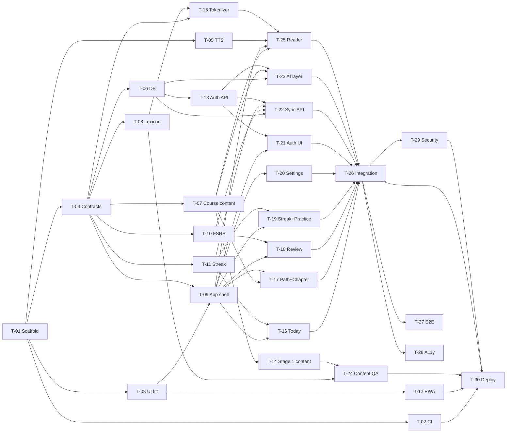

# Frenchy TODO

The single source of truth for what is done, what is next, and what we learned. Every agent reads this before starting and updates it while working (rules in `CLAUDE.md`).

- Spec: `docs/PLAN.md` · Visual spec: `design/README.md` + `design/mockups/` · Live canvas: https://claude.ai/artifact/Hguy86o9nTJ88gJ1Rvvd37
- Sections: [Legend](#legend) · [Orchestration plan](#orchestration-plan) · [DONE](#done) · [NEXT (MVP)](#next-mvp) · [BACKLOG](#backlog) · [KNOWN GAPS](#known-gaps) · [LESSONS](#lessons)

---

## Legend

**Status:** `ready` (all deps done, can start) · `blocked` (waiting on deps or a human) · `in progress` · `in review` (PR open) · `done`

**Priority:** `P0` MVP critical path · `P1` needed for MVP launch · `P2` next phase · `P3` later / nice to have

**Size (agent time, rough):** `S` < 1 h · `M` 1–3 h · `L` 3–6 h · anything bigger gets split

**Model · effort** (recommended for the agent that does the task):

| Pick | Use for |
|---|---|
| Haiku 5.5 | Mechanical edits, renames, doc touch-ups |
| Sonnet 5.5 · Medium | Small, fully specified UI or glue code |
| Sonnet 5.5 · High | Normal feature work with a clear spec: screens, tests, CI, pure logic |
| Opus 5.5 · Medium | Multi-file wiring and integration where the design is settled |
| Opus 5.5 · High | Contract-setting or design-heavy work others depend on; tricky logic; French content |
| Opus 5.5 · Extra | Reviews where a miss is costly (security, content QA), open-ended research |
| Opus 5.5 · Max | Not assigned; use only if an Extra run fails twice |

The **lead / orchestrator** session runs on Opus 5.5 · High.

**Task block format:** every task has an ID, a meta table, `Owns` (files the task may create or change), a goal, a "done when", and checkbox steps. Tick a step (`- [x]`) the moment it is done, in the same commit as the work.

**Finish steps** (the last three steps of every task):
1. `npm run check` is green (lint + typecheck + test + build).
2. TODO.md updated: steps ticked, status set, new lessons logged.
3. PR to `main` merged with CI green.

---

## Orchestration plan

Tasks in the same **wave** have no dependencies on each other and own different files, so they can run **in parallel** (one subagent, worktree or cloud session per task). Start a wave when every task it depends on is merged. A task can start early as soon as its own deps are merged, without waiting for the whole previous wave.

| Wave | Tasks (parallel) | Unblocks |
|---|---|---|
| 0 | T-01 scaffold | everything |
| 1 | T-02 CI · T-03 UI kit · T-04 shared contracts · T-05 TTS helper | 2 |
| 2 | T-06 DB schema · T-07 course content + validator · T-08 lexicon · T-09 app shell · T-10 FSRS · T-11 streak logic · T-12 PWA | 3 |
| 3 | T-13 auth backend · T-14 Stage 1 content (fan-out ×8) · T-15 tokenizer · T-16 Today · T-17 Path + Chapter · T-18 Review · T-19 Streak + Practice · T-20 Settings | 4 |
| 4 | T-21 auth UI + onboarding · T-22 sync API · T-23 AI layer · T-24 content QA · T-25 Reader | 5 |
| 5 | T-26 integration | 6 |
| 6 | T-27 E2E · T-28 a11y QA · T-29 security review | 7 |
| 7 | T-30 deploy (human gate) | MVP live |

Frontend screens (wave 3) are built against **MSW mocks** that use the shared fixtures from T-04, so they don't wait for the backend. T-26 swaps the mocks for the real API.

**Hot files** (several tasks touch them; keep edits to small additive hunks and merge `main` before opening the PR): `package.json`, `vite.config.ts`, `src/worker/index.ts` (one route-mount line per feature), `src/client/routes.tsx`, `src/client/mocks/handlers/index.ts`, `.github/workflows/ci.yml`, `TODO.md`.

**Progress:** DONE 33 · NEXT 4 (3 ready: T-27 to T-29; T-30 blocked on human gates) · BACKLOG 29

---

## DONE

### D-01 · Learning plan and app spec
| Priority | Model · effort | Size | Depends on |
|---|---|---|---|
| P0 | Opus 5.5 · High | M | — |

**Status:** done · **Output:** `docs/PLAN.md`
- [x] Learner profile, daily loop, beginner route through the book (4 stages)
- [x] App vision, MVP / Phase 2 / Phase 3 features
- [x] Data model sketch and AI provider strategy

### D-02 · Tech stack decision
| Priority | Model · effort | Size | Depends on |
|---|---|---|---|
| P0 | Opus 5.5 · High | S | D-01 |

**Status:** done · **Output:** `docs/PLAN.md` §4, `docs/HANDOFF.md`
- [x] Compared Cloudflare against Vercel + Supabase, Firebase, Convex, PocketBase and local-first options
- [x] Picked Vite + React SPA (PWA) + Hono on Cloudflare Workers, D1 + Drizzle, R2, Better Auth
- [x] Recorded trade-offs: no row-level security in D1, Better Auth added, cli-bridge stays local

### D-03 · Session handoff notes
| Priority | Model · effort | Size | Depends on |
|---|---|---|---|
| P1 | Sonnet 5.5 · Medium | S | D-02 |

**Status:** done · **Output:** `docs/HANDOFF.md`
- [x] Wrote where we are, user decisions, next steps

### D-04 · Read Stage 1 of the book, map chapter pages
| Priority | Model · effort | Size | Depends on |
|---|---|---|---|
| P1 | Opus 5.5 · Medium | M | — |

**Status:** done · **Output:** `docs/PLAN.md` §2 (chapter → PDF page table)
- [x] Read Stage 1 chapters (1, 2, 12, 10, 4, 7, 33, App. A)
- [x] Mapped chapter start pages (PDF page = printed page + 11)

### D-05 · Clickable mockups (15 screens)
| Priority | Model · effort | Size | Depends on |
|---|---|---|---|
| P0 | Opus 5.5 · High | L | D-01 |

**Status:** done · **Output:** canvas https://claude.ai/artifact/Hguy86o9nTJ88gJ1Rvvd37
- [x] Welcome, onboarding, Today, course map, chapter, reader (tap a word), sentence sheet
- [x] Practice hub, SRS review (3 card types, 4 grades), session complete, streak
- [x] My words, conjugation drill, AI tutor, settings
- [x] Original mascot, color palette and type, contrast fixes

### D-06 · Repo setup for orchestration
| Priority | Model · effort | Size | Depends on |
|---|---|---|---|
| P0 | Opus 5.5 · High | M | D-05 |

**Status:** done · **Output:** `TODO.md`, `CLAUDE.md`, `design/README.md`, `design/mockups/`, branch `main`
- [x] Copied the latest mockups from the canvas into `design/mockups/`
- [x] Wrote design tokens and screen index in `design/README.md`
- [x] Wrote this TODO.md (tasks, dependencies, waves, model/effort)
- [x] Wrote CLAUDE.md (always update TODO, log lessons, Karpathy rules, orchestration protocol)
- [x] Created `main` from the working branch
- [ ] Set `main` as the default branch and protect it (human: see H-01)

### T-01 · Scaffold the app
| Priority | Model · effort | Size | Depends on | Blocks | Wave |
|---|---|---|---|---|---|
| P0 | Opus 5.5 · High | M | — | all NEXT tasks | 0 |

**Status:** done · **Claimed by:** local session · **Branch:** `task/T-01-scaffold` · **PR:** https://github.com/MinhTam2773/frenchy/pull/1
**Owns:** `package.json`, `package-lock.json`, `tsconfig*.json`, `vite.config.ts`, `wrangler.jsonc`, `index.html`, `eslint.config.js`, `.prettierrc`, `vitest.config.ts` (or workspace), `.gitignore`, `.dev.vars.example`, `README.md`, `src/client/main.tsx`, `src/client/App.tsx`, `src/client/styles.css`, `src/worker/index.ts`, `src/worker/routes/health.ts`, `src/shared/index.ts`
**Goal:** One repo that runs the React SPA and the Hono API together with one `npm run dev`, with strict TypeScript, lint and tests wired up.
**Done when:** `npm run dev` serves the SPA at `/` (deep links like `/path` too) and `{ "ok": true }` at `/api/health`; `npm run check` is green.

- [x] Create `src/client/`, `src/worker/`, `src/shared/` per PLAN §4 repo layout; `index.html` at the root
- [x] Vite + React + TypeScript (strict) for the client
- [x] Tailwind CSS (current stable, Vite plugin) with an empty theme in `src/client/styles.css` (T-03 fills it)
- [x] Hono app in `src/worker/index.ts` exporting `app` and `type AppType`; `GET /api/health` in `src/worker/routes/health.ts`; each feature later mounts with one line
- [x] `@cloudflare/vite-plugin` + `wrangler.jsonc`: `main` = worker entry, recent `compatibility_date`, static assets with SPA fallback, and `/api/*` always routed to the Worker first (check the current option name in Cloudflare docs; navigation requests to `/api/*` must not get `index.html`)
- [x] Local-only bindings in wrangler config: D1 `DB` (placeholder id), R2 `AUDIO` (placeholder). Do **not** create remote resources
- [x] Path aliases `@client/*`, `@worker/*`, `@shared/*` in tsconfig and Vite
- [x] Separate tsconfigs for client (DOM types) and worker (types from `wrangler types`)
- [x] ESLint (typescript-eslint, react-hooks, jsx-a11y) + Prettier
- [x] Vitest with two projects: `client` (jsdom + Testing Library) and `worker` (`@cloudflare/vitest-pool-workers`); one passing sample test in each
- [x] npm scripts: `dev`, `build`, `preview`, `test`, `test:watch`, `lint`, `typecheck`, `format`, `check` (lint + typecheck + test + build), `cf-typegen`
- [x] `.gitignore`: add `node_modules`, `dist`, `.wrangler`, `.dev.vars`, `coverage`, `playwright-report`; keep `*.pdf` and `book/`
- [x] `.dev.vars.example` listing the secrets later tasks need (names only, no values)
- [x] README: prerequisites, `npm install`, `npm run dev`, `npm run check`
- [x] Manually verify: `/`, `/path` (SPA) and `/api/health` (JSON)
- [x] Finish: `npm run check` green
- [x] Finish: TODO.md updated (steps ticked, status, lessons)
- [x] Finish: PR to `main` merged (CI does not exist yet: paste local `npm run check` output in the PR)

### T-02 · CI on GitHub Actions
| Priority | Model · effort | Size | Depends on | Blocks | Wave |
|---|---|---|---|---|---|
| P0 | Sonnet 5.5 · High | S | T-01 | T-30 (and safe merging for all) | 1 |

**Status:** done · **Claimed by:** local session · **Branch:** `task/T-02-ci` · **PR:** https://github.com/MinhTam2773/frenchy/pull/3
**Owns:** `.github/workflows/ci.yml`, `.github/pull_request_template.md`, `.nvmrc`
**Goal:** Every PR runs lint, typecheck, tests and build; merging requires green CI.
**Done when:** a PR shows a passing `ci` check; a deliberately failing test makes it red.

- [x] `.nvmrc` with the Node LTS used locally
- [x] Workflow on `pull_request` and `push` to `main`: checkout, setup-node from `.nvmrc` with npm cache, `npm ci`, `npm run lint`, `npm run typecheck`, `npm test`, `npm run build`
- [x] Concurrency group that cancels superseded runs on the same branch
- [x] Confirm the workers-pool tests run in CI without Cloudflare credentials
- [x] PR template: task ID, what changed, how it was verified, "TODO.md updated" checkbox
- [x] Prove it: push a commit with a failing test on a scratch branch, see red, revert
- [x] Note in the PR that the user should require the `ci` check on `main` (H-01)
- [x] Finish: `npm run check` green
- [x] Finish: TODO.md updated (steps ticked, status, lessons)
- [x] Finish: PR to `main` merged with CI green

### T-03 · UI kit and design tokens
| Priority | Model · effort | Size | Depends on | Blocks | Wave |
|---|---|---|---|---|---|
| P0 | Sonnet 5.5 · High | M | T-01 | T-09, T-12 | 1 |

**Status:** done · **Claimed by:** T-03 subagent (lead session) · **Branch:** `task/T-03-ui-kit` · **PR:** https://github.com/MinhTam2773/frenchy/pull/7
**Owns:** `src/client/styles.css` (theme), `src/client/ui/**`
**Goal:** Reusable components that match the mockups exactly, so screens are just composition.
**Done when:** every component in the list renders in `Gallery.tsx` in all its states, tests pass, and no component uses raw hex colors.

- [x] Read `design/README.md` and skim the mockups for sizes and states
- [x] Tailwind theme: all color tokens, Fredoka + Nunito (font links in `index.html`), radii, and solid "chunky" bottom-shadow utilities per variant
- [x] `Button` (primary, secondary, success, danger, warn, ghost; renders as a link when given `to`/`href`; press moves 4px down and drops the shadow)
- [x] `IconButton` (required `aria-label` at the type level), `Card`, `Chip` (neutral, masc, fem, new, status), `ProgressBar` (`role="progressbar"`), `Toggle` (`role="switch"`), `SegmentedTabs` (`role="tablist"`), `StreakChip`
- [x] `TopBar` (back/close, title, right slot) and `TabBar` (5 tabs, active pill, `aria-current="page"`)
- [x] `BottomSheet`: drag handle, `aria-modal`, focus trap, Esc closes, focus returns to the trigger
- [x] `Icon` set as inline SVG components covering every icon in the mockups
- [x] `Mascot` component with `mood="happy" | "cheer"` from the mockup SVG
- [x] `Gallery.tsx` showing every component and state (T-09 mounts it at `/dev/ui`)
- [x] Tests: Button as link, BottomSheet Esc + focus return, Toggle flips `aria-checked`, TabBar marks current route
- [x] Contrast test: every text/background token pair used by the kit meets 4.5:1 (small contrast helper + table of pairs)
- [x] Finish: `npm run check` green
- [x] Finish: TODO.md updated (steps ticked, status, lessons)
- [x] Finish: PR to `main` merged with CI green

### T-04 · Shared schemas, fixtures and API contract
| Priority | Model · effort | Size | Depends on | Blocks | Wave |
|---|---|---|---|---|---|
| P0 | Opus 5.5 · High | M | T-01 | T-06, T-07, T-08, T-09, T-10, T-11, T-15 | 1 |

**Status:** done · **Claimed by:** T-04 subagent (lead session) · **Branch:** `task/T-04-contracts` · **PR:** https://github.com/MinhTam2773/frenchy/pull/8
**Owns:** `src/shared/schemas/**`, `src/shared/fixtures/**`, `src/shared/constants.ts`, `docs/api-contract.md`
**Goal:** One typed contract (zod schemas + inferred types) that the client, the worker, the content pipeline and the mocks all import, so parallel tasks agree without talking to each other.
**Done when:** every schema has a valid fixture and a rejected invalid case in tests, and `docs/api-contract.md` lists every MVP endpoint.

- [x] `content.ts`: `Course`, `Stage`, `Chapter` (id, book chapter number, PDF start/end page, title, kind `appendix | grammar | conversation`, week range, sections), `GrammarTag`, `Text` (id, chapterId, title, kind `story | dialogue`, minutes, paragraphs → sentences → tokens `{ t, lemma?, pos?, gender?, form?, isNew? }`, sentence translations, newWords, grammarTags), `DeckCard`, `GrammarNote`
- [x] `lexicon.ts`: `Lexeme` (lemma, pos, gender, glosses, frequency rank), `FormEntry` (form → lemma + features: person, number, tense, mood)
- [x] `user.ts`: `Profile` (currentChapterId, timeZone (IANA), dailyGoalMinutes, settings: voice, rate, playOnTap)
- [x] `srs.ts`: `Card` (id, type `sentence_meaning | meaning_sentence | cloze`, front, back, clozeAnswer, source `{ kind: starter | text | word | tutor, ref }`, FSRS fields: due, stability, difficulty, elapsedDays, scheduledDays, reps, lapses, state, lastReview), `Rating` (1–4), `ReviewInput` (cardId, rating, reviewedAt, durationMs)
- [x] `words.ts` (`WordStatus`: lemma, `new | learning | known`) and `activity.ts` (`DailyActivity`: local date, minutes, reviews, readings, freezeUsed; `StreakSummary`: current, best, freezesLeft, todayDone)
- [x] `ai.ts`: `TranslateRequest/Response`, `ExplainRequest` (sentence, chapterId) / `ExplainResponse` (translation, gloss `[{ fr, en }]`, notes)
- [x] `constants.ts`: card types, grade labels, word statuses, daily goal options (15/30/45/60)
- [x] Fixtures in `src/shared/fixtures/` mirroring the mockups' dummy data: "Le matin de Léa" with full token annotations, 3 review cards (one of each type), profile on Ch 10, 12-day streak with one freeze, word list
- [x] `docs/api-contract.md`: method, path, auth, request schema, response schema for profile, cards (due, stats, create, starter), reviews, words, activity/streak, ai/translate, ai/explain (auth routes come from Better Auth)
- [x] Tests: each schema parses its fixture and rejects a broken copy
- [x] Finish: `npm run check` green
- [x] Finish: TODO.md updated (steps ticked, status, lessons)
- [x] Finish: PR to `main` merged with CI green

QUESTION: Review undo (T-18) has no server endpoint. Default in the contract: the client holds the last grade and posts it when the next card is graded or the session ends. Alternative: an undo route that restores the previous card state (see G-20).
ANSWER (lead, 2026-10-18): keep the default (client holds the last grade). No undo route in MVP.

### T-05 · Text-to-speech helper
| Priority | Model · effort | Size | Depends on | Blocks | Wave |
|---|---|---|---|---|---|
| P1 | Sonnet 5.5 · Medium | S | T-01 | T-25 | 1 |

**Status:** done · **Claimed by:** T-05 subagent (lead session) · **Branch:** `task/T-05-tts` · **PR:** https://github.com/MinhTam2773/frenchy/pull/6
**Owns:** `src/client/lib/tts/**`
**Goal:** One small module that speaks French well on every device that can.
**Done when:** `useTts()` speaks with the best available fr-FR voice, reports `supported=false` cleanly where it can't, and tests pass.

- [x] `speak(text, { rate, voiceURI })` on the Web Speech API; cancels any utterance in progress
- [x] Voice choice: saved voice → best local `fr-FR` → any `fr-*`; handle voices loading late (`voiceschanged`)
- [x] Default rate 0.8; allowed range 0.6–1.0
- [x] `useTts()` hook: `speak`, `stop`, `speaking`, `supported`, `voices`
- [x] Sentence boundary callback (where `onboundary` is supported) so the reader can highlight the spoken sentence
- [x] Tests with a mocked `speechSynthesis`
- [x] Finish: `npm run check` green
- [x] Finish: TODO.md updated (steps ticked, status, lessons)
- [x] Finish: PR to `main` merged with CI green

### T-06 · Database schema, migrations and user scoping
| Priority | Model · effort | Size | Depends on | Blocks | Wave |
|---|---|---|---|---|---|
| P0 | Opus 5.5 · Medium | M | T-04 | T-13, T-22, T-23 | 2 |

**Status:** done · **Claimed by:** T-06 subagent (lead session) · **Branch:** `task/T-06-db` · **PR:** https://github.com/MinhTam2773/frenchy/pull/14
**Owns:** `src/worker/db/**`, `migrations/**`, `drizzle.config.ts`, `scripts/db/seed.ts`
**Goal:** D1 tables for all MVP user data, plus one helper that makes cross-user reads impossible by construction.
**Done when:** migrations apply on a fresh local D1, the seed loads mockup-like data, and an isolation test proves user A can't read user B's rows.

- [x] Drizzle ORM + drizzle-kit for D1 (sqlite dialect)
- [x] Tables from PLAN §4: `profiles`, `cards`, `reviews`, `word_status`, `daily_activity`, `translation_cache`, matching the T-04 schemas (ids as text UUIDs, timestamps as integer ms UTC, local dates as `YYYY-MM-DD` text)
- [x] Indexes/uniques: `cards(user_id, due)`, `reviews(user_id, reviewed_at)`, unique `word_status(user_id, lemma)`, unique `daily_activity(user_id, date)`, unique `translation_cache(key)`
- [x] Leave the Better Auth tables to T-13, but use `user_id text` that will reference `user.id`
- [x] `scopedDb(db, userId)` exposing per-table query helpers that always filter by `user_id`; routes never touch raw tables
- [x] Scripts: `db:generate`, `db:migrate:local`, `db:seed:local`
- [x] Seed: a demo profile on Ch 10, 18 due cards, 12 days of activity with one freeze (matches the mockups)
- [x] Tests (workers pool + local D1): migrations apply cleanly; `scopedDb` isolation between two users
- [x] Finish: `npm run check` green
- [x] Finish: TODO.md updated (steps ticked, status, lessons)
- [x] Finish: PR to `main` merged with CI green

Notes for T-13 / T-22 / T-23:
- Tables: `profiles`, `cards`, `reviews`, `word_status`, `daily_activity`, plus `activity_minutes` (PK user + minute start, for ping dedupe) and `text_reads` (PK user + text + local date; the earliest `finished_at` per text is the first finish). That resolves G-19; `text_reads` is keyed per day because the contract counts a reading once per text per day, not only the first time. `translation_cache` is shared (not user data) and goes through `translationCacheDb(db)`.
- API: `scopedDb(createDb(env.DB), userId)` returns `{ userId, profiles, cards, reviews, wordStatus, dailyActivity, activityMinutes, textReads, batch }`; each table has `select(where?)`, `insert(rows)`, `update(set, where?)`, `delete(where?)`, returning un-awaited drizzle queries pinned to the user (await one, or pass several to `batch([...])`). Column refs for `where` come from `schema` (exported from `src/worker/db`).
- T-13: Better Auth tables are not created. Add your schema file to `schema` in `drizzle.config.ts` (or export it from `src/worker/db/schema.ts`) so `npm run db:generate` writes one migration chain, and add the `user_id` foreign keys then if wanted.
- Worker tests get every migration applied by `src/worker/db/test-setup.ts` (see L-24).

### T-07 · Course structure, grammar inventory and content validator
| Priority | Model · effort | Size | Depends on | Blocks | Wave |
|---|---|---|---|---|---|
| P0 | Sonnet 5.5 · High | M | T-04 | T-14, T-17, T-23, T-25 | 2 |

**Status:** done · **Claimed by:** T-07 subagent (lead session) · **Branch:** `task/T-07-course-content` · **PR:** https://github.com/MinhTam2773/frenchy/pull/13
**Owns:** `content/course.json`, `content/grammar.json`, `scripts/content/check.ts`, `src/shared/content/**` (loaders)
**Goal:** The course map and the "allowed grammar per chapter" list as validated JSON, plus a checker every content task must pass.
**Done when:** `npm run content:check` validates the course and grammar files, rejects the bad fixtures, and runs in CI.

- [x] `content/course.json`: all 4 stages with chapters in the beginner route order from PLAN §2, each with book chapter number, PDF start page, PDF end page (next chapter's start − 1), title, kind and week range
- [x] Chapter sections: if the book is available locally in `book/`, add section labels and PDF pages for Stage 1; otherwise leave `sections: []` and keep G-06 open. Never copy book text
- [x] `content/grammar.json`: ordered grammar tags introduced per chapter (e.g. `articles.definite`, `gender.basic`, `etre.present`, `avoir.present`, `aller.present`, `faire.present`, `er.present`, `numbers.0-100`, `questions.intonation`, `questions.est-ce-que`), including *aller* and *faire* in Stage 1 (L-02)
- [x] Loaders in `src/shared/content/` (typed, used by client and worker): `getCourse()`, `allowedGrammar(chapterId)`, `getText(id)`
- [x] `scripts/content/check.ts` + `npm run content:check`: zod-validates every content file; unique ids; valid route order; each text uses only allowed grammar tags; every word token has a lemma; every sentence has a translation; ≤ 8 new words per text; deck cards point to existing texts
- [x] Add `npm run content:check` to `.github/workflows/ci.yml` (hot file)
- [x] Tests: validator accepts good fixtures and names the exact problem for each bad one
- [x] Finish: `npm run check` green
- [x] Finish: TODO.md updated (steps ticked, status, lessons)
- [x] Finish: PR to `main` merged with CI green

### T-09 · App shell, routing, data layer and mocks
| Priority | Model · effort | Size | Depends on | Blocks | Wave |
|---|---|---|---|---|---|
| P0 | Sonnet 5.5 · High | M | T-03, T-04 | T-16 to T-21, T-25 | 2 |

**Status:** done · **Claimed by:** T-09 subagent (lead session) · **Branch:** `task/T-09-app-shell` · **PR:** https://github.com/MinhTam2773/frenchy/pull/12
**Owns:** `src/client/App.tsx`, `src/client/routes.tsx`, `src/client/layouts/**`, `src/client/lib/api.ts`, `src/client/lib/query.ts`, `src/client/lib/session.ts`, `src/client/mocks/**`, placeholder pages in `src/client/features/*/`, `src/client/README.md`
**Goal:** Every MVP route exists with the right layout, typed API calls work, and MSW serves fixture data so screen tasks can run in parallel without a backend.
**Done when:** every route renders its placeholder inside the right layout, `/dev/ui` shows the gallery, and a sample query returns fixture data through MSW.

- [x] React Router (SPA) routes: `/` welcome, `/onboarding`, `/today`, `/path`, `/chapter/:chapterId`, `/read/:textId`, `/practice`, `/review`, `/review/done`, `/streak`, `/me`, `/dev/ui` (dev only, mounts T-03 `Gallery`); plus a `/words` placeholder (the kit's tab bar links to it, G-28) and a not-found page
- [x] One placeholder page per route at `src/client/features/<feature>/<Name>Page.tsx`
- [x] Layouts: tab layout (TabBar) for Today, Path, Practice, Words (Phase 2), Me; full-screen layout for onboarding, chapter, reader, review, streak
- [x] TanStack Query provider with defaults (sensible `staleTime`, retry once)
- [x] Typed API client with normalized errors (`ApiClientError`). Deviation: typed by the shared zod schemas, not `hc<AppType>` (L-32)
- [x] MSW for browser and Node, on when `VITE_USE_MOCKS=true` (default in dev until T-26); `handlers/base.ts` serves every contract endpoint from `src/shared/fixtures`, feature handlers go in `src/client/mocks/handlers/<feature>.ts` and `handlers/index.ts` picks them up by glob (no registration edit)
- [x] `useSession()` stub (mock signed-in user) and a guard that sends signed-out users to `/`
- [x] Lazy-load the reader and review routes
- [x] `src/client/README.md`: how to add a screen (folder, route line, mock handler file)
- [x] Tests: each route renders; TabBar marks the current route
- [x] Finish: `npm run check` green
- [x] Finish: TODO.md updated (steps ticked, status, lessons)
- [x] Finish: PR to `main` merged with CI green

### T-10 · FSRS scheduling module
| Priority | Model · effort | Size | Depends on | Blocks | Wave |
|---|---|---|---|---|---|
| P0 | Sonnet 5.5 · High | S | T-04 | T-18, T-22 | 2 |

**Status:** done · **Claimed by:** T-10 subagent (lead session) · **Branch:** `task/T-10-fsrs` · **PR:** https://github.com/MinhTam2773/frenchy/pull/11
**Owns:** `src/shared/srs/**`
**Goal:** A thin, tested wrapper around `ts-fsrs` shared by the client (interval previews) and the worker (authoritative scheduling).
**Done when:** grading is deterministic under a fixed clock with fuzz off, and the interval labels match the format in the Review mockup ("1m", "6m", "1d", "4d").

- [x] Add `ts-fsrs`; one config object (target retention 0.9, max interval, fuzz on in production)
- [x] `newCard()`, `previewIntervals(card, now)` → the 4 labels, `grade(card, rating, now)` → next card state + review log
- [x] Mapping between ts-fsrs cards and the shared `Card` FSRS fields (dates as epoch ms)
- [x] Interval label formatter (m, h, d, mo, y)
- [x] Tests: new card + Good is due in the future; Again lowers stability; labels; deterministic with a fixed `now` and fuzz off
- [x] Finish: `npm run check` green
- [x] Finish: TODO.md updated (steps ticked, status, lessons)
- [x] Finish: PR to `main` merged with CI green

### T-11 · Streak and freeze logic
| Priority | Model · effort | Size | Depends on | Blocks | Wave |
|---|---|---|---|---|---|
| P0 | Sonnet 5.5 · High | S | T-04 | T-16, T-19, T-22 | 2 |

**Status:** done · **Claimed by:** T-11 subagent (lead session) · **Branch:** `task/T-11-streak` · **PR:** https://github.com/MinhTam2773/frenchy/pull/10
**Owns:** `src/shared/streak/**`
**Goal:** A pure function that turns daily activity rows into the streak, best streak, freezes and calendar, in the user's time zone.
**Done when:** the tests cover gaps, freezes, the 2-freeze cap, DST changes and time-zone changes, and all pass.

- [x] Rule (default until H-07 confirms): a day counts when ≥ 1 review is graded or ≥ 1 reading is finished. One freeze is earned per 7 counted days in a row, at most 2 held, and a freeze is spent automatically on a missed day. Implemented as: `current` counts counted days in the run (a freeze day keeps the run alive but adds 0); a freeze is earned on every 7th counted day of a run (7, 14, 21, …); minutes alone don't count; a broken run restarts at 0 with no freezes; today never breaks the streak
- [x] `computeStreak(rows, todayLocalDate)` → `{ current, best, freezesLeft, todayDone, calendar }`, fully derived from the rows (deterministic). `freezeUsed` on the rows is **ignored** (it is an output, not an input; see L-38)
- [x] Local-date helpers using `Intl.DateTimeFormat` with the IANA time zone (no heavy date library)
- [x] Tests: simple run, missed day with and without a freeze, cap of 2, today not done yet doesn't break the streak, DST (America/Toronto in March and November), user changes time zone
- [x] Finish: `npm run check` green
- [x] Finish: TODO.md updated (steps ticked, status, lessons)
- [x] Finish: PR to `main` merged with CI green

### T-12 · PWA (installable app)
| Priority | Model · effort | Size | Depends on | Blocks | Wave |
|---|---|---|---|---|---|
| P1 | Sonnet 5.5 · High | S | T-03 | T-30 | 2 |

**Status:** done · **Claimed by:** T-12 subagent (lead session) · **Branch:** `task/T-12-pwa` · **PR:** https://github.com/MinhTam2773/frenchy/pull/15
**Owns:** PWA section of `vite.config.ts` (hot file), `public/icons/**`, `src/client/pwa/**`, PWA meta tags in `index.html`
**Goal:** Frenchy installs to the home screen on iPhone, Android and desktop, and loads fast from cache.
**Done when:** Chrome reports the app as installable, the service worker caches the shell and content, and `/api/*` is never cached.

- [x] `vite-plugin-pwa`; manifest: name "Frenchy", short name, theme `#2B59F0`, background `#F6F8FF`, display standalone, icons 192/512 + maskable made from the mascot
- [x] Runtime caching: app shell, fonts, `content/**` and lexicon shards (stale-while-revalidate); `/api/*` network-only
- [x] "New version available" toast with reload (`<PwaPrompts />`, mounted in `main.tsx`)
- [x] iOS: `apple-touch-icon`, web-app meta tags, a one-time "Add to Home Screen" hint in Safari
- [x] Installability checked without Lighthouse (Lighthouse not installed here): Chrome DevTools Protocol `Page.getInstallabilityErrors` is empty in a persistent profile, the manifest parses with no errors, `navigator.serviceWorker.ready` resolves, the page is controlled after reload, the shell loads offline, `/api/*` is never cached. Paste in the PR (G-34)
- [x] Finish: `npm run check` green
- [x] Finish: TODO.md updated (steps ticked, status, lessons)
- [x] Finish: PR to `main` merged with CI green

### T-13 · Auth backend (Better Auth on Workers + D1)
| Priority | Model · effort | Size | Depends on | Blocks | Wave |
|---|---|---|---|---|---|
| P0 | Opus 5.5 · High | M | T-06 | T-21, T-22, T-23 | 3 |

**Status:** done · **Claimed by:** T-13 subagent (lead session) · **Branch:** `task/T-13-auth-api` · **PR:** https://github.com/MinhTam2773/frenchy/pull/25
**Owns:** `src/worker/auth/**`, `src/worker/middleware/session.ts`, `src/worker/routes/auth.ts`, auth migrations in `migrations/`
**Goal:** Email and Google sign-in with sessions stored in D1, and a `requireUser` middleware every API route uses.
**Done when:** the workers-pool tests cover sign up, sign in, session read, a protected route (401 vs 200) and sign out.

- [x] First check that the current Better Auth works in the Workers runtime with D1 (Drizzle adapter). If not, stop, log a lesson, and write a `QUESTION:` with an alternative before building
- [x] Create the auth instance per request from `env`; mount at `/api/auth/*`
- [x] Email + password (minimum length, rate-limited attempts)
- [x] Google OAuth when `GOOGLE_CLIENT_ID`/`SECRET` are set (H-03); email-only otherwise, exposed through a small config endpoint the UI can read
- [x] Generate the Better Auth tables → Drizzle schema → migration; apply locally
- [x] `requireUser` middleware sets `c.var.user`, otherwise returns a 401 JSON error
- [x] Create the `profiles` row on first sign-in (onboarding fills it)
- [x] Cookies: secure, httpOnly, `SameSite=Lax`; trusted origins from env
- [x] Tests (workers pool) for the flows in "Done when"
- [x] Finish: `npm run check` green
- [x] Finish: TODO.md updated (steps ticked, status, lessons)
- [x] Finish: PR to `main` merged with CI green

Notes for T-21 / T-22 / T-23:
- Go: Better Auth 1.7.10 runs in workerd with D1 through the Drizzle adapter (sign-up, sign-in, session, sign-out, rate limit and Google start all tested). Caveat G-35 (password hashing CPU).
- `requireUser` (`src/worker/middleware/session.ts`) with `Hono<UserEnv>`: sets `c.var.user` (Better Auth user: `id`, `email`, `name`, `image`, `emailVerified`, `createdAt`, `updatedAt`) and `c.var.session`; 401 `{ error: { code: 'unauthorized' } }` otherwise. Use `scopedDb(createDb(c.env.DB), c.var.user.id)`.
- `GET /api/auth/config` → `AuthConfig` `{ google }` (`@shared/schemas`). Client: `better-auth/react` `createAuthClient()` with the default `/api/auth` base path. Cookie `better-auth.session_token` (`__Secure-` prefixed over https).
- The profile row is created on every session create if missing (`onConflictDoNothing`), so `GET /api/profile` always finds one. Time zone defaults to Cloudflare's `request.cf.timezone` or `UTC`; T-21 onboarding should PATCH the device's `Intl.DateTimeFormat().resolvedOptions().timeZone`.
- QUESTION: password hashing (scrypt) needs more CPU than the Workers Free plan's 10 ms per request (G-35). Default kept: Better Auth's scrypt, which assumes Workers Paid. Alternative: a custom `password.hash/verify` with cheaper parameters (weaker against offline cracking). Decide before T-30.

### T-14 · Stage 1 content generation (fan-out per chapter)
| Priority | Model · effort | Size | Depends on | Blocks | Wave |
|---|---|---|---|---|---|
| P0 | Opus 5.5 · High (one agent per chapter) | L total, M per chapter | T-07 | T-24 | 3 |

**Status:** done · **Claimed by:** lead (briefs) + one T-14 subagent per chapter · **Branch:** `task/T-14-stage1-<chapterId>` (one per chapter) · **PR:** https://github.com/MinhTam2773/frenchy/pull/20 and https://github.com/MinhTam2773/frenchy/pull/27
**Owns:** `scripts/content/prompts/**` (lead only), `content/chapters/<chapterId>/**` (each sub-agent owns exactly one chapter folder)
**Goal:** Original, leveled Stage 1 lessons: 3–5 texts per chapter, a grammar note and a starter deck, with every token annotated so the reader is exact.
**Done when:** all 8 Stage 1 chapters pass `npm run content:check` and are handed to T-24 for QA.

- [x] Lead writes the generation brief `scripts/content/prompts/text.md`: original French only (the book sets topic order, never copy its sentences), only grammar tags allowed up to the chapter, ≤ 8 new words per text, 60–120 words per A1 text, stories and dialogues, natural everyday topics, per-token annotations (lemma, pos, gender, form), English translation per sentence
- [x] Lead writes the deck brief: 20–30 cards per chapter mixing `sentence_meaning`, `meaning_sentence` and `cloze`, clozes with one unambiguous answer
- [x] Fan out, one sub-agent per chapter (tick when that chapter passes `content:check`):
  - [x] App. A · Pronunciation (short texts focused on sounds, plus a sound-pairs note)
  - [x] Ch 1 · Articles
  - [x] Ch 2 · Basic gender endings
  - [x] Ch 12 · *Être*, *avoir*, irregular verbs (also *aller* and *faire*, L-02)
  - [x] Ch 10 · Present tense of -er verbs
  - [x] Ch 4 · Numbers
  - [x] Ch 7 · Asking questions
  - [x] Ch 33 · Conversation: meeting people (dialogues)
- [x] Each chapter folder holds `texts/*.json`, `note.json` (a pattern card like the Chapter mockup) and `deck.json`
- [x] `npm run content:check` green for all chapters
- [x] Do not self-approve: hand over to T-24 (a different agent). Each chapter agent's doubts are in its PR (#20, this PR) for T-24
- [x] Finish: `npm run check` green
- [x] Finish: TODO.md updated (steps ticked, status, lessons)
- [x] Finish: PR(s) to `main` merged with CI green

### T-15 · French tokenizer and word annotation
| Priority | Model · effort | Size | Depends on | Blocks | Wave |
|---|---|---|---|---|---|
| P0 | Opus 5.5 · High | M | T-04, T-08 | T-25 | 3 |

**Status:** done · **Claimed by:** T-15 subagent (lead session) · **Branch:** `task/T-15-tokenizer` · **PR:** https://github.com/MinhTam2773/frenchy/pull/26
**Owns:** `src/shared/text/**`
**Notes (decisions, see PR):** tokens are `word` / `gap` (a gap is a run of spaces and punctuation), exactly like content `WordToken` / `GapToken`, so the reader treats both alike; a test checks `tokenize()` reproduces annotated lesson sentences token for token. `annotate(tokens, index)` takes the sentence's tokens instead of `(token, context)`. *est-ce que* is three word tokens (as in `text.md`) and each one carries `phrase`. Titles keep their period (`M.`), clock times (`8 h 30`) and numbers (`12,50`) are one token (G-55).
**Goal:** Turn any French text into tappable tokens and sentences, and give each word the best lemma and form info available.
**Done when:** a table-driven test of tricky inputs passes (elision, hyphenated inversion, French punctuation, compounds, abbreviations).

- [x] `tokenize(text)` → word, punctuation and space tokens with offsets
- [x] Elision with both `'` and `’`: l', d', j', m', t', s', n', c', qu', jusqu', lorsqu', puisqu'
- [x] Hyphens: inversions split (*parles-tu*, *a-t-il*); fixed compounds kept whole (*aujourd'hui*, *peut-être*, *est-ce que* as a phrase)
- [x] French punctuation spacing (« », non-breaking spaces before ? ! : ;) and numbers
- [x] `splitSentences(text)` that respects abbreviations (M., Mme, etc.) and ellipses
- [x] `annotate(token, context)`: content annotation first; otherwise lexicon candidates with simple context rules (*a* vs *à*, *est* as a verb after a subject, verb readings after subject pronouns); otherwise unknown
- [x] `describeForm()` for the word sheet, e.g. "il / elle · present · -er verb"
- [x] Table-driven tests
- [x] Finish: `npm run check` green
- [x] Finish: TODO.md updated (steps ticked, status, lessons)
- [x] Finish: PR to `main` merged with CI green

### T-16 · Today screen
| Priority | Model · effort | Size | Depends on | Blocks | Wave |
|---|---|---|---|---|---|
| P0 | Sonnet 5.5 · High | M | T-09, T-11 | T-26 | 3 |

**Status:** done · **Claimed by:** T-16 subagent (lead session) · **Branch:** `task/T-16-today` · **PR:** https://github.com/MinhTam2773/frenchy/pull/23
**Owns:** `src/client/features/today/**`, `src/client/lib/activity/**`, `src/client/mocks/handlers/today.ts`
**Goal:** The daily screen from `Today.dc.html`: review first, then the book, reading and output.
**Done when:** it matches the mockup at 390 px with fixture data, the edge states work, and tests pass.

- [x] Header: wordmark, streak chip, freeze chip (both link to `/streak`). Chips are the kit's 44 px high, not the mockup's 40 (L-18)
- [x] Greeting and daily minutes progress against the goal
- [x] Review card: due count, estimated minutes (≈ 35 s per card), Start review → `/review`
- [x] Book card: current chapter, PDF pages → `/chapter/:id`. "Current section" is not shown: nothing tracks which section the learner is on (G-37)
- [x] Reading card: next unread text of the current chapter → `/read/:id`; also "all texts read" and "no texts yet" states (content has none until T-14)
- [x] Output card: "Write 3–5 sentences" (links to the tutor once B-03 lands; until then a simple notes prompt or hidden, decide in the PR). Decision: a static prompt card with no link and no chevron, detail "Use today’s new words in your own notes"; B-03 turns it into a link to the tutor
- [x] `useToday()` combining profile, due count, streak summary and next text; MSW handler (no `mocks/handlers/today.ts`: `base.ts` already serves every endpoint, and tests override with `server.use`)
- [x] Edge states: 0 due ("All caught up", next due time), streak at risk, no chapter set → onboarding; also no cards at all, loading and error with retry
- [x] `useActiveMinutes()`: visibility-aware minute tracking that pings the activity API (mocked for now). Mounted by the Today page only (G-38)
- [x] Tests: due count, links, empty state, at-risk state
- [x] Finish: `npm run check` green
- [x] Finish: TODO.md updated (steps ticked, status, lessons)
- [x] Finish: PR to `main` merged with CI green

### T-17 · Course map and chapter screens
| Priority | Model · effort | Size | Depends on | Blocks | Wave |
|---|---|---|---|---|---|
| P0 | Sonnet 5.5 · High | M | T-09, T-07 | T-26 | 3 |

**Status:** done · **Claimed by:** T-17 subagent (lead session) · **Branch:** `task/T-17-path-chapter` · **PR:** https://github.com/MinhTam2773/frenchy/pull/22
**Owns:** `src/client/features/path/**`, `src/client/features/chapter/**`, `src/client/mocks/handlers/path.ts`
**Goal:** `Path.dc.html` and `Chapter.dc.html`: the winding stage path and the chapter page that sits next to the book.
**Done when:** both match their mockups with the real `course.json`, setting the current chapter works (mocked), and tests pass.

**Decisions:** appendices are reference nodes (book icon, never done or locked, left out of "n of m chapters done"; G-23); the done node is ink on gold (about 8.6:1) because white on gold is 1.8:1 (L-51); all chapters open from every node (G-07); the mockup's "§2 now" has no data behind it (G-39); `routes.test.tsx` lost its `/path` and `/chapter/ch10` rows because those screens have their own tests now (L-53).

- [x] Path: stage banner with stage switcher, winding node path (done / current / locked / conversation node styles), labels, "You're here" bubble, mascot
- [x] States from `course.json` + `profile.currentChapterId`: before current = done, current, after = locked (locked chapters still open read-only; see G-07)
- [x] Chapter: header, title, PDF page range, section progress, pattern / grammar note card, readings list, starter deck "Add to reviews" (calls the starter-deck endpoint)
- [x] "Make this my current chapter" action
- [x] Hide the drill button until B-01
- [x] Desktop: centered column, max width ~480 px
- [x] Tests: node states, current-chapter change, readings links
- [x] Finish: `npm run check` green (CI)
- [x] Finish: TODO.md updated (steps ticked, status, lessons)
- [x] Finish: PR to `main` merged with CI green

### T-18 · Review session and session complete
| Priority | Model · effort | Size | Depends on | Blocks | Wave |
|---|---|---|---|---|---|
| P0 | Sonnet 5.5 · High | M | T-09, T-10 | T-26 | 3 |

**Status:** done · **Claimed by:** T-18 subagent (lead session) · **Branch:** `task/T-18-review` · **PR:** https://github.com/MinhTam2773/frenchy/pull/24
**Owns:** `src/client/features/review/**`, `src/client/mocks/handlers/review.ts`
**Goal:** `Review.dc.html` and `ReviewDone.dc.html`: a fast SRS session with the 3 card types and FSRS interval previews.
**Done when:** a mocked session can be completed end to end, the stats math is tested, and the screens match the mockups.

- [x] Load due cards (cap per session `DUE_LIMIT.default`, cap new cards per day `NEW_CARDS_PER_DAY`: the contract has no settings field for it); progress bar and count
- [x] Card renderers: `sentence_meaning` (with TTS button), `meaning_sentence`, `cloze` (blank → filled on reveal)
- [x] Show answer → 4 grade buttons labelled with `previewIntervals` (T-10)
- [x] On grade: next state from T-10, optimistic update, POST the review (mocked), next card; one-step undo (the card advances before any POST; the server recomputes the state, and the last grade is held and posted when the next card is graded or the session ends, per G-20)
- [x] Desktop keys inside the screen only: Space reveals, 1–4 grade
- [x] Session complete: cards, correct % (Good + Easy share), time, streak message, "Up next" link
- [x] Tests: reveal → grade → advance; undo; completion stats
- [x] Finish: `npm run check` green (CI)
- [x] Finish: TODO.md updated (steps ticked, status, lessons)
- [x] Finish: PR to `main` merged with CI green

### T-19 · Streak and Practice hub screens
| Priority | Model · effort | Size | Depends on | Blocks | Wave |
|---|---|---|---|---|---|
| P1 | Sonnet 5.5 · Medium | S | T-09, T-11 | T-26 | 3 |

**Status:** done · **Claimed by:** T-19 subagent (lead session) · **Branch:** `task/T-19-streak-practice` · **PR:** https://github.com/MinhTam2773/frenchy/pull/21
**Owns:** `src/client/features/streak/**`, `src/client/features/practice/**`, `src/client/mocks/handlers/streak.ts`
**Goal:** `Streak.dc.html` and `Practice.dc.html`.
**Done when:** both match their mockups with fixture data and tests pass.

- [x] Streak: hero (current, best), at-risk banner, month calendar (practiced, freeze used, today, missed, future) with previous/next month, freeze card
- [x] Practice hub: flashcards card (due, new, learning, review counts) → `/review`; drills, tutor, speaking and import shown as "Coming later"
- [x] Tests: calendar cell states from T-11 output; hub counts
- [x] Finish: `npm run check` green
- [x] Finish: TODO.md updated (steps ticked, status, lessons)
- [x] Finish: PR to `main` merged with CI green

### T-20 · Me / settings screen
| Priority | Model · effort | Size | Depends on | Blocks | Wave |
|---|---|---|---|---|---|
| P1 | Sonnet 5.5 · Medium | S | T-09 | T-26 | 3 |

**Status:** done · **Claimed by:** T-20 subagent (lead session) · **Branch:** `task/T-20-settings` · **PR:** https://github.com/MinhTam2773/frenchy/pull/18
**Owns:** `src/client/features/settings/**`, `src/client/mocks/handlers/settings.ts`
**Goal:** The MVP subset of `Settings.dc.html`.
**Done when:** changing a setting persists through the (mocked) profile API and tests pass.

- [x] Profile row (name, sync status, streak chip)
- [x] Learning: book chapter (opens the chapter picker), daily goal, time zone (auto-detected, editable)
- [x] Audio: voice picker (from T-05 voices), speed 0.6–1.0, "Play words when tapped"
- [x] Sign out (mocked until T-26)
- [x] Not in MVP, so not rendered: daily reminder (B-12), AI providers (B-13)
- [x] Tests: settings round-trip through the profile mock
- [x] Finish: `npm run check` green
- [x] Finish: TODO.md updated (steps ticked, status, lessons)
- [x] Finish: PR to `main` merged with CI green

### T-08 · Offline lexicon pipeline
| Priority | Model · effort | Size | Depends on | Blocks | Wave |
|---|---|---|---|---|---|
| P1 | Opus 5.5 · High | L | T-04 | T-15, T-24 | 2 |

**Status:** done · **Claimed by:** T-08 subagent (lead session) · **Branch:** `task/T-08-lexicon` · **PR:** https://github.com/MinhTam2773/frenchy/pull/17
**Owns:** `scripts/lexicon/**`, `content/lexicon/**`, `src/shared/lexicon/**`, `docs/LICENSES.md`
**Goal:** Instant, free word taps: a compact French → English lexicon with form → lemma lookup, shipped as static JSON.
**Done when:** `lookupForm('vais')` returns *aller* (1st person singular, present), the shards fit the size budget, and the license and attribution are recorded.

- [x] Research the source: Wiktionary-derived data (e.g. wiktextract / kaikki.org French entries with English glosses). Record the license (Wiktionary text is CC BY-SA and GFDL) and the attribution needed in `docs/LICENSES.md`; log the decision as a lesson (kaikki.org French extract of 2026-10-03, used under CC BY-SA 4.0; L-29)
- [x] If the license blocks what PLAN wants (sharing the app with others), stop, write a `QUESTION:` under this task and in G-01, and propose alternatives (not needed: the owner accepts CC BY-SA attribution + share-alike on the lexicon data; the remaining duty is a credits screen, B-21, see G-25)
- [x] Build script reads the raw dump from a local path (gitignored, never committed) and keeps French entries for the parts of speech we need (`npm run lexicon:build`; dumps in `scripts/lexicon/raw/`, URLs in the script header)
- [x] Frequency: pick a frequency list with a compatible license; keep the top ~10k lemmas plus every lemma used in `content/` (Lexique 3.83 lemma frequencies, CC BY-SA 4.0; top 10,000 lemma + pos pairs)
- [x] Output `content/lexicon/lemmas-<shard>.json` (lemma → pos, gender, ≤ 3 glosses, rank) and `content/lexicon/forms-<shard>.json` (form → candidates with person, number, tense, mood), sharded by first letter; budget ≤ 2 MB gzipped total (27 shards each, a–z + `other`; 10,102 lexemes, 97,544 forms; 14.1 MB raw, 1.04 MB gzipped)
- [x] `src/shared/lexicon/lookup.ts`: `lookupForm(form)` lazy-loads one shard and returns candidates by frequency (also `lookupLemma(lemma)` for glosses; keys via `formKey()` in `key.ts`)
- [x] Coverage report script: % of word tokens in `content/` found; list the misses (`npm run lexicon:coverage`; 0 tokens until T-14)
- [x] Tests: *vais* → aller, *préfère* → préférer, *heures* → heure (f, pl), *l'* → le/la, *au* = à + le (`lookup.test.ts`; `shards.test.ts` checks every shard against the zod schemas and the budget)
- [x] Finish: `npm run check` green
- [x] Finish: TODO.md updated (steps ticked, status, lessons; L-29 to L-31, G-25, G-26, B-21)
- [x] Finish: PR to `main` merged with CI green

### T-21 · Welcome, sign-in and onboarding UI
| Priority | Model · effort | Size | Depends on | Blocks | Wave |
|---|---|---|---|---|---|
| P0 | Sonnet 5.5 · High | M | T-09, T-13 | T-26 | 4 |

**Status:** done · **Claimed by:** T-21 agent (wave 4 lead session) · **Branch:** `task/T-21-auth-ui` · **PR:** https://github.com/MinhTam2773/frenchy/pull/30
**Owns:** `src/client/features/auth/**`, `src/client/features/onboarding/**`, `src/client/lib/session.ts` (replaces the T-09 stub)
**Goal:** `Main.dc.html` and `Onboarding.dc.html` working with the real Better Auth client.
**Done when:** a new user can sign up with email locally, pick a chapter and goal, and land on `/today`; tests pass.

- [x] Welcome: Continue with email, Continue with Google (hidden when Google isn't configured), I already have an account
- [x] Email sign-up and sign-in forms: labels, validation, errors announced to screen readers
- [x] Onboarding: Stage 1 chapter list (plus "show later stages"), daily goal, save profile, go to `/today`
- [x] Replace the `useSession()` stub with the real session; keep the guard
- [x] Password reset is not in MVP (G-08): show "Forgot password?" only once B-18 lands
- [x] Tests: form validation, onboarding saves the profile, guard redirects
- [x] Finish: `npm run check` green
- [x] Finish: TODO.md updated (steps ticked, status, lessons)
- [x] Finish: PR to `main` merged with CI green

### T-22 · Sync API (profile, cards, reviews, words, activity)
| Priority | Model · effort | Size | Depends on | Blocks | Wave |
|---|---|---|---|---|---|
| P0 | Opus 5.5 · High | L | T-06, T-10, T-11, T-13 | T-26 | 4 |

**Status:** done · **Claimed by:** T-22 agent (wave 4 lead session) · **Branch:** `task/T-22-sync-api` · **PR:** https://github.com/MinhTam2773/frenchy/pull/32
**Owns:** `src/worker/routes/profile.ts`, `cards.ts`, `reviews.ts`, `words.ts`, `activity.ts` (+ one mount line each in `src/worker/index.ts`)
**Goal:** Every MVP endpoint from `docs/api-contract.md`, user-scoped and validated.
**Done when:** each endpoint has tests, including one proving cross-user isolation, and responses match the shared schemas.

- [x] `GET /api/profile`, `PATCH /api/profile`
- [x] `GET /api/cards/due?limit=`, `GET /api/cards/stats` (new / learning / review counts)
- [x] `POST /api/cards` (from a saved word or sentence; dedupe on type + front)
- [x] `POST /api/cards/starter/:chapterId` (adds the chapter's starter deck; idempotent)
- [x] `POST /api/reviews`: validate the rating, recompute the next state on the server with T-10 (the client's preview is not trusted), update the card and insert the review in one D1 batch
- [x] `PUT /api/words/:lemma` (status), plus `GET /api/words` (in the contract)
- [x] `POST /api/activity/ping` (minute deltas, idempotent per minute), `GET`/`POST /api/activity/readings` (in the contract) and `GET /api/streak` (T-11 over every `daily_activity` row, not 400 days: G-31)
- [x] Every route uses `requireUser` + `scopedDb` + zod validation; one error JSON shape
- [x] Tests per endpoint, including cross-user isolation
- [x] Finish: `npm run check` green
- [x] Finish: TODO.md updated (steps ticked, status, lessons)
- [x] Finish: PR to `main` merged with CI green

Notes for T-26:
- Outside `Owns`: two new files, `src/worker/routes/sync-common.ts` (shared router, errors, validation, row mapping) and `sync-test-helpers.ts` (test-only `newUser()`). Routers: `profile`, `cardsRoute`, `reviewsRoute`, `wordsRoute`, `activityRoute`, `streakRoute`, one mount line each.
- Where the MSW mocks (`mocks/handlers/base.ts`, `review.ts`) differ from the real API (not edited, T-26 owns them): `POST /api/cards` always answers 201 (real: 200 with the existing card for the same type + front); `POST /api/cards/starter/:chapterId` ignores the chapter and always adds the fixture deck (real: 404 unknown chapter, `{ added: 0, total: 0 }` for a chapter without a deck, `added: 0` the second time); base `POST /api/reviews` returns the card ungraded (`review.ts` grades like the server, but doesn't clamp `reviewedAt` to the last 24 h or to now); `PATCH /api/profile` doesn't 404 an unknown chapter; `POST /api/activity/readings` doesn't 404 an unknown text; ping always answers the fixture's 8 minutes (L-49); mock 400s have no `issues`; the 24 h / 5 min window on client instants (G-61) is mock-free.
- `GET /api/cards/due` mixes new and started cards, most overdue first; new cards are capped by `NEW_CARDS_PER_DAY` minus cards first graded today (G-62).

### T-23 · AI layer: translate and explain
| Priority | Model · effort | Size | Depends on | Blocks | Wave |
|---|---|---|---|---|---|
| P1 | Opus 5.5 · High | M | T-06, T-07, T-13 | T-26 | 4 |

**Status:** done · **Claimed by:** T-23 agent (wave 4 lead session) · **Branch:** `task/T-23-ai` · **PR:** https://github.com/MinhTam2773/frenchy/pull/29
**Owns:** `src/worker/ai/**`, `src/worker/routes/ai.ts`
**Goal:** Sentence translation and explanation for any text through one provider-agnostic interface, cached so each sentence costs at most once.
**Done when:** the tests show a cache hit skips the provider, invalid JSON is retried once, and the rate limit works, all with the mock driver.

- [x] Load the `claude-api` skill before writing any Anthropic API code and use the model ids it gives
- [x] `AiProvider` interface: `translate()`, `explain()`, plus a `chat()` signature for B-03
- [x] Drivers: `anthropic`, `openai-compatible` (base URL + key + model), `mock` (tests and local dev without keys)
- [x] Routing by env (`AI_TRANSLATE_PROVIDER`, `AI_EXPLAIN_PROVIDER`); keys only as Worker secrets (H-04)
- [x] Explain prompt returns strict JSON (translation, word gloss, ≤ 2 notes) pitched at the learner's chapter (from `allowedGrammar`); validate with zod; one retry on invalid JSON
- [x] `translation_cache` key = hash of task + normalized text + level
- [x] Per-user rate limit (start at 60 requests/hour)
- [x] User text is treated as data inside the prompt, never as instructions
- [x] Tests for the "Done when" cases
- [x] Finish: `npm run check` green
- [x] Finish: TODO.md updated (steps ticked, status, lessons)
- [x] Finish: PR to `main` merged with CI green

Notes for T-25 / T-26 / T-29 / B-03:
- `POST /api/ai/translate` and `POST /api/ai/explain` (behind `requireUser`) match the T-04 contract. Errors use `ApiError`: 400 `bad_request` (body or unknown chapter), 401, 429 `rate_limited` with `Retry-After` (seconds to the next clock hour), 502 `upstream_error` (provider failed or invalid JSON twice), 500 `internal` (bad AI env).
- Results are cached in `translation_cache` (shared) under SHA-256 of prompt version + task + normalized text (NFC, apostrophes, spacing) + level (`''` for translate, `chapterId` for explain). Cache hits don't count toward the 60 per hour.
- Env: `AI_TRANSLATE_PROVIDER` / `AI_EXPLAIN_PROVIDER` = `anthropic` | `openai-compatible` | `mock` (unset: `mock`, G-63); secrets `ANTHROPIC_API_KEY`, `OPENAI_COMPATIBLE_BASE_URL` / `_API_KEY` / `_MODEL`. The Anthropic model is `claude-haiku-5-5` (L-90).
- `AiProvider.chat(messages, chapterId)` exists for B-03 but has no route.

### T-24 · Stage 1 content QA
| Priority | Model · effort | Size | Depends on | Blocks | Wave |
|---|---|---|---|---|---|
| P0 | Opus 5.5 · Extra | M | T-14, T-08 | T-30 | 4 |

**Status:** done · **Claimed by:** T-24 agent (wave 4 lead session) · **Branch:** `task/T-24-content-qa` · **PR:** https://github.com/MinhTam2773/frenchy/pull/33
**Owns:** fixes in `content/chapters/**`, `docs/content-qa.md`
**Goal:** An independent check (fresh agent, not the T-14 author) that every Stage 1 text and card is correct, natural and at the right level.
**Notes (decisions, see `docs/content-qa.md`):** `isNew` means new to the course: one text per lemma, the first along the route (L-94). Fixed phrases are a closed list in `text.md`, and the brief's *est-ce que* line now says its tokens are phrase tokens (L-95). Out-of-Owns hunks: `scripts/content/prompts/text.md` (brief), `scripts/lexicon/build.ts` and `coverage.ts` (G-58 fixes, phrase-aware coverage), and `content/lexicon/**`, rebuilt from the same raw dumps as T-08. Coverage went from 87.8 % to 99.2 %.
**Done when:** `docs/content-qa.md` lists every finding with its fix, lexicon coverage is ≥ 98%, and `content:check` is green.

- [x] For each text: only allowed grammar, natural French, correct gender, agreement and elision, accurate English translation, correct token annotations
- [x] For each deck: one unambiguous cloze answer, correct translations, no duplicates
- [x] Run the T-08 coverage report; fix misses (annotations or lexicon additions)
- [x] Write `docs/content-qa.md` (finding, location, fix); apply the fixes
- [x] List anything a native speaker should still check under G-02
- [x] Finish: `npm run check` green
- [x] Finish: TODO.md updated (steps ticked, status, lessons)
- [x] Finish: PR to `main` merged with CI green

### T-25 · Reader with tap-to-translate
| Priority | Model · effort | Size | Depends on | Blocks | Wave |
|---|---|---|---|---|---|
| P0 | Opus 5.5 · Medium | M | T-05, T-07, T-09, T-15 | T-26 | 4 |

**Status:** done · **Claimed by:** T-25 agent (wave 4 lead session) · **Branch:** `task/T-25-reader` · **PR:** https://github.com/MinhTam2773/frenchy/pull/31
**Owns:** `src/client/features/reader/**`, `src/client/mocks/handlers/reader.ts`
**Goal:** `Reader.dc.html` and `Sentence.dc.html`: every French word is tappable, sentences can be long-pressed, and anything can be saved to SRS.
**Done when:** tapping a word shows the right sheet, long-press selects the sentence, saving creates a card (mocked), and it all works with the keyboard.

- [x] Top bar and audio bar (TTS for the whole text with sentence highlight where supported, speed control)
- [x] Paragraphs of token buttons (keyboard reachable), new-word highlight, selected-word style
- [x] Word sheet: word + play, pos / lemma / gender / new chips, translation, form, "Save word" (creates a card and sets the word to learning), "Sentence" button
- [x] Sentence selection: long-press (~500 ms) selects the sentence; drag selects a range; desktop click-drag or Shift+click
- [x] Sentence sheet: translation (from content for lessons, `/api/ai/explain` otherwise), word-by-word gloss, grammar note, "Save sentence" (sentence or cloze card)
- [x] "Finish reading" marks the text read (activity) and returns to Today
- [x] Performance: memoized tokens; lexicon shards loaded lazily
- [x] Tests: tap → sheet data, long-press → sentence, save → card request
QUESTION: the mockup's "Aa" text-settings button and the audio time ("0:41") have no spec; left out (B-31). The bar shows sentences read ("2/6") instead.

- [x] Finish: `npm run check` green
- [x] Finish: TODO.md updated (steps ticked, status, lessons)
- [x] Finish: PR to `main` merged with CI green

### T-26 · Integration: swap mocks for the real API
| Priority | Model · effort | Size | Depends on | Blocks | Wave |
|---|---|---|---|---|---|
| P0 | Opus 5.5 · Medium | M | T-16 to T-23, T-25 | T-27, T-28, T-29, T-30 | 5 |

**Status:** done · **Claimed by:** T-26 agent (wave 4/5 lead session) · **Branch:** `task/T-26-integration` · **PR:** https://github.com/MinhTam2773/frenchy/pull/35
**Owns:** cross-cutting fixes; `src/client/mocks/` config; contract fixes in `src/shared/schemas/` (both sides in the same PR)
**Goal:** The whole MVP runs against the local Worker and local D1 with no mocks.
**Done when:** the full flow works locally on a fresh database: sign up → onboarding → Today → review → reader save word → review that card → streak updates.

- [x] Dev default `VITE_USE_MOCKS=false` when the Worker runs; mocks stay for tests (`npm run dev` always runs the Worker through the Cloudflare Vite plugin, so MSW now starts only with `VITE_USE_MOCKS=true`)
- [x] Walk every screen against the real API with seed data (the seed now makes a Better Auth login, `demo@frenchy.local` / `frenchy-demo`, L-107; every screen as the demo user and as a new account, 0 failed API calls or console errors; the sentence sheet's grammar note loads from the real `/api/ai/explain`, G-68; Google sign-in skipped, G-60)
- [x] Fix contract mismatches by changing the shared schema and both sides together (every T-22 "Notes for T-26" item except the ping's fixed minutes, kept so page tests don't depend on the clock; G-61 window as `CLIENT_INSTANT_WINDOW` + `clampClientInstant` in `src/shared`, used by the Worker and the mocks, in `docs/api-contract.md`; saved cards before starter cards under the daily cap, L-106)
- [x] Loading skeletons, error + retry, offline banner on every screen (audited every page: each data screen already had a `role="status"` loading line and an error + retry except Practice, which now has one; there is no skeleton spec in `design/`, so the text loaders stay; an offline banner in both layouts, `OfflineBanner.tsx`)
- [x] Remove leftover placeholders and dead mock code (the Words placeholder and `layouts/Placeholder.tsx`, G-28; `mockServiceWorker.js` dropped from real builds, G-27; Session complete's copy of the next-unread rule, G-42)
- [x] Finish: `npm run check` green (65 files, 1,029 tests; build `precache 12 entries (1028.04 KiB)`), after merging `main`
- [x] Finish: TODO.md updated (steps ticked, status, lessons; L-104 to L-108, G-70 to G-72, B-33)
- [x] Finish: PR to `main` merged with CI green

QUESTION: a word saved in the reader now starts before starter-deck cards, but still counts against `NEW_CARDS_PER_DAY` (L-106), so after a full 10-card session it waits until tomorrow. Should saved cards skip the cap? Default: no (reversible: one `orderBy`/limit in `cards.ts`).

---

## NEXT (MVP)

Goal: course map + reader + tap-to-translate + SRS + daily streak, with Stage 1 content, installable as a PWA and deployed on Cloudflare.

### Wave 0

T-01 is done (moved to DONE).

### Wave 1

Wave 1 is done (T-02 to T-05 moved to DONE).

### Wave 2

Wave 2 is done (T-06 to T-12 moved to DONE).

### Wave 3

Wave 3 is done (T-13 to T-20 moved to DONE).

### Wave 4

Wave 4 is done (T-21 to T-25 moved to DONE).

### Wave 5

Wave 5 is done (T-26 moved to DONE).

### Wave 6

#### T-27 · End-to-end tests (Playwright)
| Priority | Model · effort | Size | Depends on | Blocks | Wave |
|---|---|---|---|---|---|
| P1 | Sonnet 5.5 · High | M | T-26 | — | 6 |

**Status:** ready · **Claimed by:** — · **Branch:** `task/T-27-e2e`
**Owns:** `e2e/**`, `playwright.config.ts`, an e2e job in `.github/workflows/ci.yml`
**Goal:** The core flows are protected by browser tests at phone and desktop sizes.
**Done when:** the specs pass locally and in CI.

- [ ] Playwright using the preinstalled Chromium in cloud sessions (never run `playwright install` there); projects for 390×844 and 1280×800
- [ ] Specs: full happy path, word tap in the reader, review session to completion, settings change persists
- [ ] Each run uses a fresh local D1
- [ ] CI job (no Cloudflare login needed)
- [ ] Finish: `npm run check` green
- [ ] Finish: TODO.md updated (steps ticked, status, lessons)
- [ ] Finish: PR to `main` merged with CI green

#### T-28 · Accessibility and mobile QA
| Priority | Model · effort | Size | Depends on | Blocks | Wave |
|---|---|---|---|---|---|
| P1 | Sonnet 5.5 · High | S | T-26 | — | 6 |

**Status:** ready · **Claimed by:** — · **Branch:** `task/T-28-a11y`
**Owns:** a11y fixes across `src/client/**`, `e2e/a11y.spec.ts`
**Goal:** WCAG 2.1 AA on every screen, on real phone widths.
**Done when:** axe reports no violations on any route and the manual checks below pass.

- [ ] Automated axe check on every route
- [ ] Keyboard-only walkthrough: visible focus, sheets trap focus, no traps elsewhere
- [ ] Icon buttons have labels; French text has `lang="fr"`
- [ ] Contrast audit against the tokens; touch targets ≥ 44 px; `prefers-reduced-motion` respected
- [ ] Layout at 320, 390, 430, 768 and 1280 px
- [ ] Finish: `npm run check` green
- [ ] Finish: TODO.md updated (steps ticked, status, lessons)
- [ ] Finish: PR to `main` merged with CI green

#### T-29 · Security review
| Priority | Model · effort | Size | Depends on | Blocks | Wave |
|---|---|---|---|---|---|
| P0 | Opus 5.5 · Extra | M | T-26 | T-30 | 6 |

**Status:** in progress · **Claimed by:** Wave 6 agent (T-29) · **Branch:** `task/T-29-security`
**Owns:** `docs/security-review.md`, fixes anywhere
**Goal:** No cross-user data access, no leaked secrets and no abusable endpoints before anything is public.
**Done when:** `docs/security-review.md` lists the findings and every P0/P1 finding is fixed.

- [x] Every database access goes through `scopedDb` (search routes for raw table access). Every route reaches user rows only through `userDb`/`scopedDb`; `routes/ai.ts` uses the raw `Db` only for the shared `translationCacheDb`. New guard in `src/worker/index.test.ts`: every route in `app.routes` except `/api/health` and `/api/auth/*` answers 401 without a session
- [x] Auth: cookie flags, CSRF posture (SameSite + origin check), session expiry, password policy, rate limits. HttpOnly + Secure (https) + SameSite=Lax, Better Auth's origin check on `/api/auth/*`, 7-day sessions refreshed daily and revoked on sign-out, 8 to 128 characters, 5 sign-in/sign-up attempts per IP per minute (all tested in T-13). Added: Hono `csrf()` on `/api`, so a form-type write from another origin is a 403 even if a browser sent the cookie (`index.test.ts`; checked in `vite dev`: same-origin body-less POSTs still 200)
- [x] No secrets in the client bundle (inspect `dist/`); `.dev.vars` is gitignored (G-72: `vite build` copies `.dev.vars` into `dist/frenchy/`; fix it before T-30). Fixed: a `keep-local-secrets-out-of-dist` plugin in `vite.config.ts` drops the file from every build (preview reads the root `.dev.vars`); `npm run check:dist` fails on a secrets file or any local secret value in `dist/`, and CI runs it after building with a canary `.dev.vars`; `.env*` and `.dev.vars.*` are gitignored too
- [x] AI endpoints: user text handled as data, output validated, rate limits and a daily cost cap. Text goes in as a JSON data field with a "never follow instructions in it" rule, input is capped at 500 characters, explain output is zod-checked (one retry), React renders it as text, and a cache row is only served for the exact same text. Added the app-wide daily cap (G-10, B-27's scope): `ai_daily_usage` (migration 0003), `AI_DAILY_LIMIT` var (default 1,000 provider calls per UTC day), checked after the per-user hourly limit, 429 `rate_limited` with `Retry-After` until the next UTC day, cache hits still served, one warning at 80 %
- [x] Input validation on every endpoint; errors don't leak internals. Every body, query and path parameter goes through a shared zod schema with length bounds (fixed the one unbounded field: `settings.voiceURI`, now at most 500 characters); responses are schema-checked too. Unexpected errors answer a generic `internal` body (ours), an empty 500 (Better Auth) or `Internal Server Error` (Hono) and are only logged
- [x] `npm audit`; lexicon license attribution present (G-01). `npm audit`: 4 moderate, all one chain (drizzle-kit → @esbuild-kit → esbuild ≤ 0.24.2, GHSA-67mh-4wv8-2f99, esbuild's dev server); drizzle-kit is a CLI (Better Auth's optional peer) and none of it is in the Worker or client bundle, so accepted until drizzle-kit drops @esbuild-kit. Attribution: **not present** in the app (the 54 lexicon shards ship as public JS chunks), so B-21 is a launch blocker for any public deploy
- [ ] Write the report; fix P0/P1 findings
- [ ] Finish: `npm run check` green
- [ ] Finish: TODO.md updated (steps ticked, status, lessons)
- [ ] Finish: PR to `main` merged with CI green

QUESTION: the app-wide AI cap (G-10) needs a number from you. Default: 1,000 provider calls per UTC day (`AI_DAILY_LIMIT`, a Worker var; cache hits are free, so lesson sentences cost once for everyone). Worst case per day is the cap × (500 characters in + `max_tokens` 8,000 out). Also set a monthly spend limit in the provider's console (H-04).

### Wave 7

#### T-30 · Deploy to Cloudflare
| Priority | Model · effort | Size | Depends on | Blocks | Wave |
|---|---|---|---|---|---|
| P0 | Opus 5.5 · Medium | M | T-02, T-12, T-24, T-26, T-29 + H-02, H-05, H-06 | MVP launch | 7 |

**Status:** blocked (human gate) · **Claimed by:** — · **Branch:** `task/T-30-deploy`
**Owns:** `wrangler.jsonc` (production ids), `.github/workflows/deploy.yml`, deploy section of `README.md`
**Goal:** Frenchy is live on Cloudflare and deploys on every push to `main`.
**Done when:** the production URL passes the smoke test and the deploy workflow runs green.

- [ ] Get the user's explicit go-ahead before creating any Cloudflare resource (H-05); the user has run `wrangler login` (H-02)
- [ ] Create the production D1 database (and an R2 bucket only if something uses it); put the ids in `wrangler.jsonc`
- [ ] Apply migrations to production D1
- [ ] Set secrets with `wrangler secret put`: `BETTER_AUTH_SECRET`, Google OAuth (H-03), AI keys (H-04)
- [ ] `wrangler deploy`; smoke test: `/api/health`, sign up, one review, reader word tap
- [ ] Add the production redirect URI to the Google OAuth client
- [ ] `deploy.yml` on push to `main` with `CLOUDFLARE_API_TOKEN` and `CLOUDFLARE_ACCOUNT_ID` repo secrets (H-06)
- [ ] README: how to deploy and how to roll back
- [ ] Finish: `npm run check` green
- [ ] Finish: TODO.md updated (steps ticked, status, lessons)
- [ ] Finish: PR to `main` merged with CI green

---

## BACKLOG

Phase 2 and 3 and later work. A backlog task moves to NEXT when its deps are done and the user agrees on priority.

#### B-01 · Conjugation drills (Phase 2)
| Priority | Model · effort | Size | Depends on | Blocks |
|---|---|---|---|---|
| P2 | Opus 5.5 · Medium | M | T-26, T-08 | — |

**Status:** blocked · **Owns:** `src/client/features/drills/**`, `src/shared/drills/**`, `content/verbs.json`
**Goal:** `Drills.dc.html`: typed and audio conjugation drills by tense and verb group, unlocked by stage.
**Done when:** a drill session works end to end, accent-only mistakes are flagged as "almost", and tests pass.

- [ ] `content/verbs.json`: the verb set per stage from `grammar.json`, with conjugations generated from lexicon forms and checked by a QA pass
- [ ] Drill engine: pick prompts weighted toward recent mistakes; compare answers as exact, accent-only mistake ("almost", show the difference), or wrong
- [ ] Typed drill UI with accent keys (é è ê à ç ô) and feedback panel per the mockup
- [ ] Audio drill: hear the form, type it
- [ ] Optionally turn missed forms into cloze cards
- [ ] Show the drill button on the chapter page (T-17) and the Practice tile
- [ ] Tests: engine selection, accent-tolerant compare, UI flow
- [ ] Finish: `npm run check` green
- [ ] Finish: TODO.md updated (steps ticked, status, lessons)
- [ ] Finish: PR to `main` merged with CI green

#### B-02 · Known-word tracking and My words (Phase 2)
| Priority | Model · effort | Size | Depends on | Blocks |
|---|---|---|---|---|
| P2 | Opus 5.5 · Medium | M | T-22, T-25 | B-07 |

**Status:** blocked · **Owns:** `src/client/features/words/**`, `src/worker/routes/words.ts` (extend), reader highlight changes
**Goal:** LingQ-style new → learning → known, visible in the reader and in `Words.dc.html`.
**Done when:** statuses update from reading and reviewing, the reader highlights unknown words, and the Words screen filters and searches.

- [ ] Rules: new on first encounter; learning when saved or a card exists; known when the card's stability ≥ 21 days or the user marks it known; manual override
- [ ] Batch status upsert endpoint
- [ ] Reader: highlight new and learning words differently; "Mark as known" in the word sheet
- [ ] Words screen per the mockup: totals bar, search, All / New / Learning / Known tabs, list with gender colors
- [ ] Known-word count on the Path and Chapter screens
- [ ] Tests: status transitions, filters
- [ ] Finish: `npm run check` green
- [ ] Finish: TODO.md updated (steps ticked, status, lessons)
- [ ] Finish: PR to `main` merged with CI green

#### B-03 · AI tutor text chat (Phase 3)
| Priority | Model · effort | Size | Depends on | Blocks |
|---|---|---|---|---|
| P2 | Opus 5.5 · High | L | T-23, T-07, T-26 | B-06 |

**Status:** blocked · **Owns:** `src/client/features/tutor/**`, `src/worker/routes/tutor.ts`, `src/worker/ai/prompts/tutor.ts`, migration for `tutor_messages`
**Goal:** `Tutor.dc.html`: a chat that only uses grammar up to the learner's chapter and corrects mistakes inline.
**Done when:** a chat streams replies, corrections render as in the mockup, a correction can be saved to SRS, and daily cost caps hold.

- [ ] Load the `claude-api` skill first
- [ ] `POST /api/tutor/chat` streaming (SSE) through `AiProvider.chat()`
- [ ] System prompt built from `allowedGrammar(currentChapter)`; replies stay inside it
- [ ] Structured corrections (original, corrected, short explanation) parsed and validated
- [ ] UI: bubbles with translation lines, correction cards, "Save to reviews", text input + mic placeholder
- [ ] `tutor_messages` table with retention limit; conversation reset
- [ ] Per-user daily token cap
- [ ] Tests with the mock driver
- [ ] Finish: `npm run check` green
- [ ] Finish: TODO.md updated (steps ticked, status, lessons)
- [ ] Finish: PR to `main` merged with CI green

#### B-04 · `cli-bridge` driver (local, personal use only)
| Priority | Model · effort | Size | Depends on | Blocks |
|---|---|---|---|---|
| P3 | Sonnet 5.5 · High | M | T-23 | — |

**Status:** blocked · **Owns:** `scripts/cli-bridge/**`, `src/worker/ai/drivers/cli-bridge.ts`
**Goal:** Use your own Claude Code / Codex subscription for the tutor and content generation when running locally (PLAN §5).
**Done when:** with `DEV_CLI_BRIDGE_URL` set locally, the tutor works through the bridge, and a production build can't enable it.

- [ ] Local Node server bound to localhost with a random token; endpoints for translate, explain and chat that run `claude -p` or `codex exec` with JSON output
- [ ] Timeouts, one request at a time, clear errors when the CLI isn't logged in
- [ ] Worker driver enabled only when `DEV_CLI_BRIDGE_URL` is set and the environment is development; a test asserts it can't load in production
- [ ] README section with the personal-use warning
- [ ] Tests with a fake CLI
- [ ] Finish: `npm run check` green
- [ ] Finish: TODO.md updated (steps ticked, status, lessons)
- [ ] Finish: PR to `main` merged with CI green

#### B-05 · Ollama driver (local)
| Priority | Model · effort | Size | Depends on | Blocks |
|---|---|---|---|---|
| P3 | Sonnet 5.5 · Medium | S | T-23 | — |

**Status:** blocked · **Owns:** `src/worker/ai/drivers/ollama.ts`
**Goal:** Free offline experiments with a local model.
**Done when:** with `OLLAMA_URL` set locally, translate and explain work through Ollama.

- [ ] Driver using Ollama's HTTP API; model from env
- [ ] JSON-mode prompts reused from T-23; zod validation
- [ ] Dev-only, like B-04
- [ ] Tests with a mocked HTTP server
- [ ] Finish: `npm run check` green
- [ ] Finish: TODO.md updated (steps ticked, status, lessons)
- [ ] Finish: PR to `main` merged with CI green

#### B-06 · Speaking: speech-to-text, pronunciation, voice mode (Phase 3)
| Priority | Model · effort | Size | Depends on | Blocks |
|---|---|---|---|---|
| P3 | Opus 5.5 · Extra (research), then Opus 5.5 · High (build) | L | B-03 | — |

**Status:** blocked · **Owns:** `docs/speaking-research.md`, `src/client/features/speaking/**`, related worker routes
**Goal:** Answer by voice, get pronunciation feedback, and hold a voice conversation (Speak / Praktika style).
**Done when:** the research doc has a decision the user approved, and answering a review card by voice works on iPhone and Android Chrome.

- [ ] Research: Web Speech recognition support (Safari, Chrome, Firefox, Android), server STT options and cost, pronunciation scoring approaches; write `docs/speaking-research.md` with a recommendation
- [ ] User approves the approach (and any paid service)
- [ ] Voice answers in review and drills
- [ ] Pronunciation feedback for single sentences
- [ ] Voice conversation mode on top of the tutor with TTS replies
- [ ] Tests for the parts that can be tested without a microphone
- [ ] Finish: `npm run check` green
- [ ] Finish: TODO.md updated (steps ticked, status, lessons)
- [ ] Finish: PR to `main` merged with CI green

#### B-07 · Import any text into the reader (Phase 3)
| Priority | Model · effort | Size | Depends on | Blocks |
|---|---|---|---|---|
| P3 | Opus 5.5 · Medium | M | T-15, T-23, T-25, B-02 | — |

**Status:** blocked · **Owns:** `src/client/features/import/**`, `src/worker/routes/import.ts`, migration for `user_texts`
**Goal:** Paste text, a URL, lyrics or subtitles (.srt / .vtt) and read it with tap-to-translate.
**Done when:** all four input types import and open in the reader, with unknown words falling back to cached AI translation.

- [ ] Paste and subtitle file import (strip timestamps)
- [ ] URL import through the Worker with SSRF protection (block private IPs, size and time limits) and readable-text extraction
- [ ] `user_texts` table, list and delete
- [ ] Reader uses lexicon lookup, then cached AI translation for unknown words
- [ ] Tests: parsers, SSRF guard
- [ ] Finish: `npm run check` green
- [ ] Finish: TODO.md updated (steps ticked, status, lessons)
- [ ] Finish: PR to `main` merged with CI green

#### B-08 · Offline reviews
| Priority | Model · effort | Size | Depends on | Blocks |
|---|---|---|---|---|
| P2 | Opus 5.5 · High | M | T-26, T-12 | — |

**Status:** blocked · **Owns:** `src/client/lib/offline/**`, review sync changes in `src/worker/routes/reviews.ts`
**Goal:** Review on the subway: queue reviews offline and sync later without losing or double-counting any.
**Done when:** a session done offline syncs correctly on reconnect, with tests for duplicates and out-of-order replays.

- [ ] IndexedDB store for due cards and pending reviews
- [ ] Each review gets an idempotency key; the server ignores repeats
- [ ] Server replays queued reviews in `reviewed_at` order
- [ ] Offline banner and pending-count indicator
- [ ] Tests: offline → online sync, duplicates, ordering
- [ ] Finish: `npm run check` green
- [ ] Finish: TODO.md updated (steps ticked, status, lessons)
- [ ] Finish: PR to `main` merged with CI green

#### B-09 · Pre-generated TTS audio in R2
| Priority | Model · effort | Size | Depends on | Blocks |
|---|---|---|---|---|
| P3 | Opus 5.5 · Medium | M | T-24, T-30 + user approval of a TTS provider and cost | — |

**Status:** blocked · **Owns:** `scripts/audio/**`, audio fields in content JSON, player in `src/client/features/reader/audio/**`
**Goal:** Natural audio for lesson texts on every device, independent of browser voices (G-03).
**Done when:** Stage 1 texts play R2 audio with sentence highlighting, falling back to Web Speech.

- [ ] Compare TTS providers (fr-FR quality, price, right to redistribute audio); user picks one
- [ ] Script generates per-sentence audio + timestamps and uploads to R2
- [ ] Audio keys stored in the text JSON
- [ ] Player with sentence highlighting; fallback to T-05
- [ ] Finish: `npm run check` green
- [ ] Finish: TODO.md updated (steps ticked, status, lessons)
- [ ] Finish: PR to `main` merged with CI green

#### B-10 · Stage 2 content (fan-out per chapter)
| Priority | Model · effort | Size | Depends on | Blocks |
|---|---|---|---|---|
| P2 | Opus 5.5 · High per chapter + Opus 5.5 · Extra QA | L | T-24 | B-11 |

**Status:** blocked · **Owns:** `content/chapters/<chapterId>/**` per chapter, `docs/content-qa.md`
**Goal:** Stage 2 "Getting around" (A1 → A2) lessons using the T-14 pipeline.
**Done when:** every Stage 2 chapter passes `content:check` and an independent QA pass.

- [ ] Extend `grammar.json` for Stage 2 if needed
- [ ] One sub-agent per chapter:
  - [ ] Ch 11 · Present of -ir / -re verbs
  - [ ] Ch 28 · Adjectives
  - [ ] Ch 6 · Building sentences
  - [ ] Ch 13 · Immediate future / past (*aller* + infinitive, *venir de*)
  - [ ] Ch 14 · Pronominal verbs
  - [ ] Ch 21 · Prepositions
  - [ ] Ch 15 · Passé composé
  - [ ] Ch 34 · Conversation: making plans
  - [ ] Ch 3 · More nouns and gender
- [ ] Independent QA pass (as in T-24) with findings in `docs/content-qa.md`
- [ ] Finish: `npm run check` green
- [ ] Finish: TODO.md updated (steps ticked, status, lessons)
- [ ] Finish: PR(s) to `main` merged with CI green

#### B-11 · Stage 3 and 4 content (fan-out per chapter)
| Priority | Model · effort | Size | Depends on | Blocks |
|---|---|---|---|---|
| P3 | Opus 5.5 · High per chapter + Opus 5.5 · Extra QA | L | B-10 | — |

**Status:** blocked · **Owns:** `content/chapters/<chapterId>/**` per chapter
**Goal:** Stage 3 "Telling stories" (A2 → B1) and Stage 4 "Nuance" (B1+) lessons.
**Done when:** every chapter below passes `content:check` and QA.

- [ ] Stage 3: Ch 16 Imparfait & plus-que-parfait · Ch 26 Pronouns · Ch 27 Relative pronouns · Ch 17 Future · Ch 23 Imperative · Ch 8 Exclamations & commands · Ch 29 Adverbs · Ch 18 Conditional · Ch 5 Vocabulary themes · Ch 9 Clauses · Ch 36 Asking for help
- [ ] Stage 4: Ch 20 Subjunctive · Ch 19 Could / should / would · Ch 22 Infinitive · Ch 24 Participle & gerund · Ch 31 Confusing verbs · Ch 30 Written French · Ch 35 Current events · Ch 32 Oddities · Ch 25 Passé simple / passive / indirect speech · Ch 37 Literature
- [ ] Independent QA pass per stage
- [ ] Finish: `npm run check` green
- [ ] Finish: TODO.md updated (steps ticked, status, lessons)
- [ ] Finish: PR(s) to `main` merged with CI green

#### B-12 · Daily reminders (web push)
| Priority | Model · effort | Size | Depends on | Blocks |
|---|---|---|---|---|
| P3 | Opus 5.5 · Medium | M | T-30, T-12 | — |

**Status:** blocked · **Owns:** `src/worker/push/**`, `src/client/features/settings/reminders/**`, Cron Trigger config
**Goal:** "8:00 pm, if you haven't practiced" reminders from the Settings mockup.
**Done when:** a subscribed device gets one reminder at the chosen local time only on days without activity.

- [ ] Web Push with VAPID keys (secrets); subscription storage table
- [ ] Cron Trigger every 15 min that sends due reminders in each user's time zone
- [ ] Settings toggle and time picker; explain the iPhone "install first" requirement (G-04)
- [ ] Tests for the scheduling logic
- [ ] Finish: `npm run check` green
- [ ] Finish: TODO.md updated (steps ticked, status, lessons)
- [ ] Finish: PR to `main` merged with CI green

#### B-13 · AI provider settings page
| Priority | Model · effort | Size | Depends on | Blocks |
|---|---|---|---|---|
| P3 | Sonnet 5.5 · High | S | T-23, T-20 | — |

**Status:** blocked · **Owns:** `src/client/features/settings/ai/**`, settings fields in the profile
**Goal:** Choose which provider handles translation and the tutor from the app (PLAN §5), not only through env vars.
**Done when:** changing a provider in Settings changes which driver serves the next request.

- [ ] Settings section per the mockup (task → provider)
- [ ] Only providers configured on the server are offered; keys never reach the client
- [ ] Worker reads the user's choice and falls back to the env default
- [ ] Tests
- [ ] Finish: `npm run check` green
- [ ] Finish: TODO.md updated (steps ticked, status, lessons)
- [ ] Finish: PR to `main` merged with CI green

#### B-14 · Book exercise mistake log and weekly redo
| Priority | Model · effort | Size | Depends on | Blocks |
|---|---|---|---|---|
| P3 | Sonnet 5.5 · Medium | S | T-17, T-22 | — |

**Status:** blocked · **Owns:** `src/client/features/chapter/mistakes/**`, a `book_mistakes` table
**Goal:** PLAN's weekly routine: note which book exercises went wrong and get them back once a week.
**Done when:** a logged exercise shows up in a weekly "Redo these" card on Today.

- [ ] "Log a mistake" on the chapter page (exercise number + note)
- [ ] Weekly "Redo these" card on Today; mark as redone
- [ ] Tests
- [ ] Finish: `npm run check` green
- [ ] Finish: TODO.md updated (steps ticked, status, lessons)
- [ ] Finish: PR to `main` merged with CI green

#### B-15 · Stats screen
| Priority | Model · effort | Size | Depends on | Blocks |
|---|---|---|---|---|
| P3 | Sonnet 5.5 · Medium | S | T-22 | — |

**Status:** blocked · **Owns:** `src/client/features/stats/**`, `GET /api/stats`
**Goal:** Reviews per day, retention, minutes and words learned over time.
**Done when:** the screen shows the last 30 days from real data.

- [ ] Load the `dataviz` skill before drawing charts
- [ ] `/api/stats` aggregates from reviews and daily activity
- [ ] Screen with charts for reviews per day, retention and minutes
- [ ] Tests for the aggregation
- [ ] Finish: `npm run check` green
- [ ] Finish: TODO.md updated (steps ticked, status, lessons)
- [ ] Finish: PR to `main` merged with CI green

#### B-16 · Account data export and deletion
| Priority | Model · effort | Size | Depends on | Blocks |
|---|---|---|---|---|
| P2 (before sharing the app with others) | Sonnet 5.5 · High | S | T-13, T-22 | — |

**Status:** blocked · **Owns:** `src/worker/routes/account.ts`, account section in Settings
**Goal:** Users can download their data and delete their account.
**Done when:** export returns all of the user's rows as JSON, and delete removes every row and session for that user.

- [ ] `GET /api/account/export` (JSON of all user tables)
- [ ] `DELETE /api/account` with confirmation; removes every user row and session
- [ ] Settings UI with a confirm dialog
- [ ] Tests: export completeness, delete leaves no rows
- [ ] Finish: `npm run check` green
- [ ] Finish: TODO.md updated (steps ticked, status, lessons)
- [ ] Finish: PR to `main` merged with CI green

#### B-17 · App store apps with Capacitor (only if needed)
| Priority | Model · effort | Size | Depends on | Blocks |
|---|---|---|---|---|
| P3 | Opus 5.5 · Medium | L | T-30 | — |

**Status:** blocked · **Owns:** `capacitor.config.ts`, `ios/`, `android/`
**Goal:** Wrap the same React app as iOS and Android store apps with native notifications (PLAN §4 Platforms).
**Done when:** debug builds run on a simulator and emulator against production.

- [ ] User confirms it's needed (store accounts cost money)
- [ ] Add Capacitor; configure the server URL / bundled assets
- [ ] Native push plugin replacing web push on devices
- [ ] Simulator and emulator runs
- [ ] Finish: `npm run check` green
- [ ] Finish: TODO.md updated (steps ticked, status, lessons)
- [ ] Finish: PR to `main` merged with CI green

#### B-18 · Password reset and email verification
| Priority | Model · effort | Size | Depends on | Blocks |
|---|---|---|---|---|
| P2 | Opus 5.5 · Medium | S | T-13, T-21 + H-09 | — |

**Status:** blocked · **Owns:** email driver in `src/worker/auth/email.ts`, reset screens in `src/client/features/auth/**`
**Goal:** Close G-08 so email users can recover their accounts.
**Done when:** a reset email arrives and the new password works.

- [ ] User picks an email provider (H-09)
- [ ] Better Auth reset and verification hooks sending through it
- [ ] "Forgot password?" flow and screens
- [ ] Tests with a mock email driver
- [ ] Finish: `npm run check` green
- [ ] Finish: TODO.md updated (steps ticked, status, lessons)
- [ ] Finish: PR to `main` merged with CI green

#### B-19 · Tap-to-translate inside review cards
| Priority | Model · effort | Size | Depends on | Blocks |
|---|---|---|---|---|
| P2 | Sonnet 5.5 · High | S | T-18, T-25 | — |

**Status:** blocked · **Owns:** shared word-sheet component extraction, review card renderer changes
**Goal:** PLAN says tap-to-translate works on every surface; MVP covers only the reader.
**Done when:** French words on review cards open the same word sheet as the reader.

- [ ] Move the word sheet into a shared component used by reader and review
- [ ] Tokenize card text with T-15; tap opens the sheet without revealing the answer early
- [ ] Tests
- [ ] Finish: `npm run check` green
- [ ] Finish: TODO.md updated (steps ticked, status, lessons)
- [ ] Finish: PR to `main` merged with CI green

#### B-20 · Self-host fonts for offline use
| Priority | Model · effort | Size | Depends on | Blocks |
|---|---|---|---|---|
| P3 | Haiku 5.5 | S | T-12 | — |

**Status:** blocked · **Owns:** `public/fonts/**`, font CSS
**Goal:** Fredoka and Nunito load with no network.
**Done when:** the app renders with the right fonts in airplane mode after the first visit.

- [ ] Add the WOFF2 files (check the OFL license notice) and `@font-face` rules; remove the Google Fonts link
- [ ] Precache them in the service worker
- [ ] Finish: `npm run check` green
- [ ] Finish: TODO.md updated (steps ticked, status, lessons)
- [ ] Finish: PR to `main` merged with CI green

#### B-21 · Credits screen with data attributions (needed before T-30)
| Priority | Model · effort | Size | Depends on | Blocks |
|---|---|---|---|---|
| P1 | Sonnet 5.5 · Medium | S | T-20 | T-30 |

**Status:** blocked · **Owns:** `src/client/features/settings/Credits*.tsx` (or a section of the Me screen)
**Goal:** The CC BY-SA attributions the lexicon needs (G-25) are visible in the app before it is shared publicly.
**Done when:** a "Credits" link on the Me screen opens a page with both attribution texts from `docs/LICENSES.md` (links included), and a test checks they render.

- [ ] Add the Credits page with the Wiktionary/kaikki.org and Lexique 3.83 attributions, worded as in `docs/LICENSES.md`
- [ ] Link it from the Me screen
- [ ] Test that both attributions and their license links render
- [ ] Finish: `npm run check` green
- [ ] Finish: TODO.md updated (steps ticked, status, lessons)
- [ ] Finish: PR to `main` merged with CI green

#### B-22 · Content typography and token-join checks in `content:check`

| Priority | Model · effort | Size | Depends on | Blocks |
|---|---|---|---|---|
| P1 | Sonnet 5.5 · High | S | T-07 | T-24 (helps) |

**Status:** ready · **Owns:** `src/shared/content/validate.ts`, its tests
**Goal:** Catch annotation mistakes every T-14 agent had to check by hand.
**Done when:** `content:check` flags each case below with file + sentence, and the Stage 1 content passes.

- [ ] Tokens of a sentence join to a string with no leading/trailing space and no double spaces
- [ ] A no-break space (U+00A0) before `? ! : ;` and inside `« »`; a plain space there is an error
- [ ] No gap token right after a word ending in an apostrophe (`l'` + `ardoise`)
- [ ] No curly apostrophe in French tokens
- [ ] Finish: `npm run check` green
- [ ] Finish: TODO.md updated (steps ticked, status, lessons)
- [ ] Finish: PR to `main` merged with CI green

#### B-23 · Start the app offline without being sent to the welcome screen
| Priority | Model · effort | Size | Depends on | Blocks |
|---|---|---|---|---|
| P2 | Sonnet 5.5 · High | M | T-21, T-26 | — |

**Status:** blocked · **Owns:** `src/client/lib/session.ts`
**Goal:** An installed PWA opened with no connection keeps the signed-in user instead of treating an unreadable session as signed out.
**Done when:** a test where `/api/auth/get-session` fails after an earlier success (or with a remembered user) still renders a protected screen.

- [ ] Decide what is remembered (id, name, email in `localStorage`, wrapped in try/catch) and when it expires
- [ ] `useSession` returns the remembered user when the read fails with a network error, never on a 401
- [ ] Test: offline start with and without a remembered user
- [ ] Finish: `npm run check` green
- [ ] Finish: TODO.md updated (steps ticked, status, lessons)
- [ ] Finish: PR to `main` merged with CI green

#### B-24 · Show/hide password on the email forms
| Priority | Model · effort | Size | Depends on | Blocks |
|---|---|---|---|---|
| P3 | Sonnet 5.5 · Medium | S | T-21 | — |

**Status:** blocked · **Owns:** `src/client/features/auth/**`
**Goal:** Typing a password on a phone without seeing it is error-prone; add a toggle.
**Done when:** a labelled button flips the field between `password` and `text`, and a test covers it.

- [ ] Add the toggle (`aria-pressed`, 44 px target) to the password field
- [ ] Test it
- [ ] Finish: `npm run check` green
- [ ] Finish: TODO.md updated (steps ticked, status, lessons)
- [ ] Finish: PR to `main` merged with CI green

#### B-27 · Global daily AI spend cap

| Priority | Model · effort | Size | Depends on | Blocks |
|---|---|---|---|---|
| P1 | Opus 5.5 · Medium | S | T-23 | T-30 (before real keys go live) |

**Status:** ready · **Owns:** `src/worker/ai/**`, `src/worker/routes/ai.ts`, one migration
**Goal:** Close G-10: cap provider calls for the whole app per day, on top of T-23's per-user 60 per hour, so many users (or many sign-ups) can't run up a surprise bill.
**Done when:** after the daily cap is reached, every cache miss gets 429 `rate_limited` until the next UTC day while cache hits are still served, proven with the mock driver.

- [ ] Decide the cap with the user (number of provider calls or estimated tokens per day) and make it a Worker var
- [ ] Count in D1 next to `ai_usage` (one row per UTC day), in the same batch as the per-user count
- [ ] Log a warning line when 80 % of the cap is used
- [ ] Tests: cap reached → 429 for misses, hits still 200; a new day resets
- [ ] Finish: `npm run check` green
- [ ] Finish: TODO.md updated (steps ticked, status, lessons)
- [ ] Finish: PR to `main` merged with CI green

#### B-31 · Reader text settings ("Aa") and audio time

| Priority | Model · effort | Size | Depends on | Blocks |
|---|---|---|---|---|
| P3 | Sonnet 5.5 · Medium | S | T-25 | — |

**Status:** ready · **Owns:** `src/client/features/reader/**`
**Goal:** The Reader mockup's "Aa" button (text size) and the elapsed-time label of the audio bar, which T-25 left out for lack of a spec.
**Done when:** a text-size choice persists per device and the audio bar shows elapsed / total time (estimated from sentence lengths and rate).

- [ ] Decide sizes (and whether it belongs in profile settings) and the time estimate
- [ ] Build and test both
- [ ] Finish: `npm run check` green
- [ ] Finish: TODO.md updated (steps ticked, status, lessons)
- [ ] Finish: PR to `main` merged with CI green

#### B-29 · `content:check` enforces course-wide `isNew` and the phrase list

| Priority | Model · effort | Size | Depends on | Blocks |
|---|---|---|---|---|
| P1 | Sonnet 5.5 · High | S | B-22 (same file) | B-10, B-11 (helps) |

**Status:** blocked · **Owns:** `src/shared/content/validate.ts`, its tests
**Goal:** Stage 2 to 4 content follows T-24's decisions without a QA pass having to find them by hand (L-94, L-95, G-67).
**Done when:** `content:check` names the file and sentence for each case below, and Stage 1 passes.

- [ ] A lemma is `isNew` in at most one text, the first along the route (chapter order in `course.json`, then text id order), and the message names the earlier text
- [ ] A token with pos `phrase` uses a lemma from the closed list in `scripts/content/prompts/text.md` (move the list into a constant the brief points to), and has more than one word in the phrase
- [ ] A listed phrase (*il y a*, *s'il vous plaît*…) is never annotated word by word
- [ ] Tests with a tree built by `createContent` (L-75), one per rule
- [ ] Finish: `npm run check` green
- [ ] Finish: TODO.md updated (steps ticked, status, lessons)
- [ ] Finish: PR to `main` merged with CI green

#### B-30 · Lexicon rebuild hygiene: pinned dumps, no vulgar glosses, coverage in CI

| Priority | Model · effort | Size | Depends on | Blocks |
|---|---|---|---|---|
| P1 | Opus 5.5 · Medium | S | T-08 | B-10, B-11 (helps), T-30 |

**Status:** blocked (T-08 is done; needs the user to decide where an archived dump may live, G-65) · **Owns:** `scripts/lexicon/**`, `content/lexicon/**`, `docs/LICENSES.md`, one job line in `.github/workflows/ci.yml` (hot file)
**Goal:** A content task can rebuild the lexicon and get only the changes its content causes, the glosses are fit for learners, and stale shards fail CI (G-65, G-66, G-67).
**Done when:** a rebuild with an unchanged dump reproduces the shards byte for byte, a different dump fails loudly, and CI fails when coverage drops below 98 %.

- [ ] Record each raw dump's size, Last-Modified and sha256 in `build.ts` and fail on a mismatch; ask the user where an archived copy of the 2026-10-03 kaikki extract may live (it is not committed, rule 5)
- [ ] Skip senses tagged `vulgar`, `slang`, `offensive` or `derogatory` from the three glosses (*nœud* lists a vulgar sense today), and re-check the content's glosses after the rebuild
- [ ] `npm run lexicon:coverage -- --min 98` exits non-zero below the threshold; add it to CI
- [ ] Finish: `npm run check` green
- [ ] Finish: TODO.md updated (steps ticked, status, lessons)
- [ ] Finish: PR to `main` merged with CI green

#### B-33 · Load lesson texts per chapter, not in the main bundle

| Priority | Model · effort | Size | Depends on | Blocks |
|---|---|---|---|---|
| P2 | Opus 5.5 · Medium | M | T-26 | — |

**Status:** ready · **Owns:** `src/shared/content/**`, the screens that read texts (Today, Chapter, Reader, Session complete)
**Goal:** The main JS chunk stops growing with every chapter's texts (G-70).
**Done when:** the main chunk holds course, grammar and notes only; a chapter's texts load on demand (and are precached or runtime-cached for offline), and the screens show their loading state meanwhile.

- [ ] Split `src/shared/content` loaders: eager course/grammar, lazy `import.meta.glob` per text
- [ ] Make `getText` / `getChapterTexts` async (or wrap them in TanStack Query) and update the callers
- [ ] Decide precache (the texts are small, offline matters) versus runtime cache; check the build's `precache` line
- [ ] Finish: `npm run check` green
- [ ] Finish: TODO.md updated (steps ticked, status, lessons)
- [ ] Finish: PR to `main` merged with CI green

---

## KNOWN GAPS

### Needs you (human gates)

Agents can't do these. A task that needs one stays `blocked` until it's done.

| ID | What | Needed by | Status |
|---|---|---|---|
| H-01 | Make `main` the default branch on GitHub and require the `ci` check before merging. `main` is now the default branch (done); T-02 has landed, so the `ci` check can now be required | T-02 onward | open |
| H-02 | Install wrangler and run `wrangler login` once | T-30 | open |
| H-03 | Create a Google OAuth client (client id/secret, redirect URIs) | T-13 (optional locally), T-30 | open |
| H-04 | Provide AI API keys (Anthropic and/or an OpenAI-compatible provider) | T-23 (real calls), T-30 | open |
| H-05 | Approve creating Cloudflare resources (D1, R2, Worker) | T-30 | open |
| H-06 | Add `CLOUDFLARE_API_TOKEN` and `CLOUDFLARE_ACCOUNT_ID` to GitHub repo secrets | T-30 | open |
| H-07 | Confirm the streak rule (what counts as a practiced day; default in T-11) | T-11 (can proceed with the default) | open |
| H-08 | Decide whether to pay for a native-speaker content review | T-24 follow-up | open |
| H-09 | Pick an email provider for password reset | B-18 | open |

### Open gaps and risks

| ID | Gap / risk | Impact | Owner task |
|---|---|---|---|
| G-01 | Lexicon source license and attribution not verified (Wiktionary text is CC BY-SA / GFDL) | Can't ship the lexicon publicly until checked | T-08, T-29 |
| G-02 | French content correctness relies on AI QA; nobody on the team is a native speaker. T-24 lists 8 judgment calls for a native speaker in `docs/content-qa.md` → "For a native speaker" (natural short questions, register of *rigoler*, menu articles, the fiction phone range, …) | Learner could learn mistakes | T-24, H-08 |
| G-03 | Web Speech fr-FR voice quality and availability vary by device (weak on some Android and Linux) | Bad audio for some users | T-05, B-09 |
| G-04 | iOS PWA limits: storage can be cleared after inactivity; push only for installed apps | Server must stay the source of truth | T-12, B-12 |
| G-05 | Better Auth on Workers + D1 not yet proven in this repo | Auth plan may change | T-13 |
| G-06 | Book section page ranges need the private PDF, which is not in the repo | Chapter sections may start empty | T-07 |
| G-07 | Locking rules undecided. MVP default: every chapter viewable; current chapter's texts all unlocked | UX may change | T-17 |
| G-08 | No password reset in MVP | Locked-out email users | B-18 |
| G-09 | Mockups (`.dc.html`) render only on the canvas runtime | Read the markup or open the canvas link | design/README.md |
| G-10 | AI cost control is a simple rate limit until a daily cap exists. T-23: still only that, 60 provider calls per user per clock hour (cache hits are free); no app-wide cap, and new sign-ups each get their own 60 | Possible surprise bills | **Resolved (T-29):** an app-wide cap of `AI_DAILY_LIMIT` provider calls per UTC day (default 1,000, `ai_daily_usage`), checked after the per-user limit; the number is a QUESTION under T-29. B-27's steps are done by T-29 |
| G-11 | FSRS runs on default parameters, with no per-user optimization | Slightly less efficient reviews | later |
| G-12 | Reviews need a connection in MVP | No subway reviews | B-08 |
| G-13 | ESLint is held at 9 (npm marks it unsupported) because `eslint-plugin-jsx-a11y` hasn't released ESLint 10 support since 2024 | No ESLint security fixes; a11y lint may need a replacement | later (re-check before T-28) |
| G-14 | Local Node 22.15 is below jsdom 30's minimum (22.22.2), so jsdom stays at 29 | Can't take jsdom updates until Node is upgraded | T-02 (`.nvmrc`) |
| G-15 | npm 11 (Node 24) warns on `npm ci` that `esbuild` and `workerd` have install scripts "not yet covered by allowScripts"; a later npm major may skip them unless allowed | Installs could silently lack the workerd binary after an npm upgrade | re-check on npm major bumps |
| G-16 | ~~The UI kit has no router, so links render plain `<a href>` until the app provides `<LinkProvider value={RouterLink}>`~~ **Resolved in T-09:** `App.tsx` wraps the app in `AppProviders`, and a test checks a tab link navigates without a reload | none | T-09 |
| G-17 | `BottomSheet` is `aria-modal` with a scrim and a focus trap (as T-03 specifies), but the Reader mockup keeps words tappable behind the word sheet. With the scrim, a tap outside closes the sheet instead of selecting the next word | Reader needs two taps to switch words | **Closed by T-25 (L-99):** the word sheet is a non-modal region; the sentence sheet stays the modal `BottomSheet` |
| G-18 | Some mockup targets are under 44 px (streak chip 40, sheet buttons 40, toggle 32, calendar arrows 36) and the Path "done" node is a white check on gold `#FFB020` (about 1.9:1, below the 3:1 for icons). The kit uses 44 px targets; the Path node is not built yet | Screens that copy the mockup literally fail the touch-target and contrast rules | T-17, T-19, T-28 |
| G-19 | The contract (T-04) adds read-text tracking and per-minute ping dedupe that PLAN §4's data model lacks: T-06 needs a `text_reads` table (`user_id`, `text_id`, `finished_at`, unique per user + text) and a way to count at most one active minute per clock minute in `daily_activity` | Today's "next unread text" and the streak's reading rule need them | T-06, T-22 (resolved by T-06: `text_reads` per user + text + day, `activity_minutes`) |
| G-20 | Review undo (T-18) has no server endpoint. Contract default: the client keeps the last grade and posts it when the next card is graded or the session ends (QUESTION under T-04) | A closed tab can lose the last grade; an undo route would need the previous card state | T-18, T-22 (decided: client-held default) |
| G-27 | `public/mockServiceWorker.js` (MSW) is copied into production `dist/client`, and it uses scope `/`, the same as the T-12 PWA service worker; a page can only have one service worker per scope. Mocks are off in production builds, so today it is dead weight, but a build with `VITE_USE_MOCKS=true` plus the PWA worker would fight | Confusing offline behavior in a mock build; a stray script in the deploy | **Resolved (T-26):** mocks are opt-in (`VITE_USE_MOCKS=true`), and a `drop-msw-worker` build step in `vite.config.ts` deletes `mockServiceWorker.js` from `dist/client` unless that variable is set in the shell |
| G-28 | `MAIN_TABS` in the UI kit includes a Words tab, but the Words screen is Phase 2 (B-02). T-09 routes `/words` to a placeholder so the tab doesn't 404 | MVP users see a dead tab | **Resolved (T-26):** `TabLayout` passes the tabs without Words, and the `/words` route and the placeholder page are gone (it is now a 404); B-02 adds both back |
| G-23 | The grammar inventory (`content/grammar.json`, 98 tags) and the chapter week ranges for Stages 2 to 4 are my proposal, not read from the book. Stage 1 has a few tags the book may introduce later, added so A1 texts can exist: `phrases.greetings`, `phrases.c-est`, `phrases.introductions`, `negation.ne-pas`, `adjectives.basic`, `prepositions.basic`. `appC` (verb tables) sits last in Stage 4 as a reference node; PLAN only says "use throughout" | Texts may use grammar the learner hasn't met in the book yet; T-17 must show `kind: "appendix"` as a reference, not a step to finish | T-14, T-17, T-24 (re-check against the book when G-06 closes) |
| G-24 | `getText` is synchronous and `import.meta.glob` is eager, so every text ships in the main bundle (about 37 chapters x 4 texts x annotated tokens could reach several hundred KB) | Slower first load and a bigger service-worker precache | T-29 (measure; move to per-chapter lazy chunks if over budget) |
| G-31 | `computeStreak` derives freezes from the whole run, so a window shorter than the run (T-22's "about the last 400 days") can show wrong `freezesLeft`, `current` and `best` for runs longer than the window | T-22 should pass every `daily_activity` row (one row per active day, so small) or store a checkpoint | T-22 |
| G-32 | The H-07 default leaves choices the user hasn't confirmed: a freeze day adds nothing to `current`; freezes are earned at 7, 14, 21 counted days of one run (not 7 since the last spend); minutes alone don't count; travelling east can skip a local date and spend a freeze | Streak numbers may differ from what the user expects | T-11, H-07 |
| G-29 | `previewIntervals` and `grade` use fuzz, and ts-fsrs seeds it from the review time, card reps and difficulty x stability. The client's preview at time A and the server's grade at time B give different day counts (usually off by a day or so for intervals beyond about a week) | A grade button can say "8d" and the stored due can be 7d or 9d | T-18, T-22 (the server should grade at `ReviewInput.reviewedAt`; the client should preview at the same `now` it later posts) |
| G-30 | `ts-fsrs` is on `^5.4.2`; 6.0 is only in beta. 6 removes `elapsed_days` (L-19) and the max interval (365 days), default weights and learning steps (1m, 10m) are product defaults nobody has confirmed | Moving to 6 needs a `Card` schema change and a D1 migration; the interval cap may feel short or long | later (re-check when 6.0 is stable) |
| G-21 | ~~T-23's per-user AI rate limit (60 requests/hour) has no storage: T-06 made no table for it, and T-23 doesn't own `migrations/`~~ **Resolved in T-23:** `migrations/0002_ai_usage.sql` adds `ai_usage` (user + clock hour → requests), reached through `scopedDb(...).aiUsage` (L-89) | none | T-23 |
| G-22 | `scripts/**` is in no tsconfig, so `tsc -b` doesn't typecheck scripts (only ESLint sees them). T-06 keeps the seed logic in `src/worker/db/seed.ts` and `scripts/db/seed.ts` as thin glue | Type errors in scripts (T-07, T-08 too) show up only at run time | T-07, T-08 (add `scripts` to `tsconfig.node.json`) (resolved: T-07 added `scripts` to `tsconfig.node.json`; `scripts/db` is checked by `tsconfig.worker.json` because it uses D1 types) |
| G-33 | Workbox precaches the app shell and every JS chunk (514 KiB now) but silently skips files over 2 MiB. Nothing fetches `/content/**` or `/lexicon/**` yet, so the stale-while-revalidate rule for those paths is untested; if T-14/T-08 bundle content as JS chunks instead, it is precached and the size can blow past the limit | Offline start may miss content, or the first visit after a deploy downloads all of it | T-07, T-08, T-14 (check `precache` size in the build output; raise `maximumFileSizeToCacheInBytes` or move content to runtime-cached fetches) |
| G-34 | The PWA is verified only in Chromium (installability errors empty, offline shell works). Not checked: real iOS Safari (no `beforeinstallprompt`; the Share-sheet hint is the only install path, and iOS may clear storage after inactivity, see G-04) and Lighthouse (not installed here). Fonts still come from Google Fonts at runtime; the first offline visit before they were cached falls back to system fonts | Install and offline behavior on iPhone is unproven | T-30 (test on a real device), B-20 |
| G-25 | G-01 checked (T-08): the lexicon uses Wiktionary via kaikki.org and Lexique 3.83, both CC BY-SA 4.0, so `content/lexicon/` is CC BY-SA 4.0 and needs visible attribution (texts in `docs/LICENSES.md`). Nothing in the app shows it yet | Shipping publicly without the credits screen breaks the license | B-21, T-29, T-30 |
| G-26 | (Adds numbers to G-33.) Once anything imports `src/shared/lexicon/lookup.ts` (T-15/T-25), Vite emits the 54 shards as lazy JS chunks: about 18 MB raw, 1 MB gzipped, largest `forms-r-*.js` 2.00 MB, just under Workbox's 2 MiB limit. The PWA's `**/*.js` glob then precaches all of them on first visit. `shards.test.ts` fails if a shard's JSON passes 1.6 MB | First visit downloads the whole lexicon (~1 MB over the wire); one more letter's growth and a shard silently drops out of the offline cache | **Resolved (T-26, L-104):** the shards are in `globIgnores` and runtime-cached (`CacheFirst`, cache `lexicon-shards`, 60 entries) on first lookup; precache is now 12 entries / 1,027 KiB |
| G-45 | Settings shows "Synced to your account" from the profile mutation state (saving, error, synced), not from real multi-device sync info; the mockup's "2 min ago · phone and laptop" needs a last-sync time the API does not return | The status line says less than the mockup until the real API exists | T-20, T-26 |
| G-46 | The settings chapter picker is one flat list in route order (appendix and chapters interleaved by learning order, about 40 rows), with no stage grouping or search | Long list to scroll on a phone; B-chapter-picker polish could reuse the onboarding list (T-21) | T-20, T-21 |
| G-57 | Stage 1 grammar ceiling is stricter than everyday A1 French: possessives (*mon*, *sa*), *mais*, stressed pronouns and questions before ch7 are all out, so ch1–ch10 texts are statement-only and name-heavy. The lead's working reading (brief, "Conventions") allows *et*, *à* + place and modal + infinitive. The fixture "Le matin de Léa" breaks the ceiling (*son voisin*, *mais*, *huit heures*). T-24 kept the lead's reading (adding *Et toi ?* to the greeting exception) and rewrote the four questions found before ch7; the stiffness stays a product choice | Texts can read stiff; QA may flag the same things | the user (or adjust `content/grammar.json`, G-23) |
| G-58 | ~~Lexicon gaps found by T-14: no entry for *où*, *il y a*, *qu'est-ce que*, *après-midi*, *épinard*, several -tion/-isme nouns; *sœur* reported unknown (possible œ key-normalization bug). Coverage per chapter 84–96 %~~ **Resolved by T-24:** the shards predated the content; Lexique spells œ as *oe*, so no œ word had a rank; *où* and *bonsoir* differ in part of speech between the sources; feminine nouns are form-of entries. `build.ts` fixes all four and the lexicon was rebuilt; coverage is 99.2 % (L-96, L-97) | none | T-24 |
| G-43 | Streak and Practice follow the mockups except: the "~10 min" chip on the flashcards card is not rendered (no rule for estimating minutes), the freeze card uses `text-freeze-ink` (`#1f6fa8`) instead of the mockup's darker `#0E3F63`/`#24506F` (no token), and future calendar days use `text-faint` (about 3.3:1, inactive cells) | Small visual and contrast differences from the mockups | T-19, T-28 |
| G-39 | Nothing records progress inside a chapter's book sections, so the Chapter strip can only show all sections done (the learner has moved past the chapter) or none. The mockup's "§2 now" with a part-filled bar has no data behind it. `chapters[].sections` is empty for every chapter until G-06 closes, so the strip is not drawn yet | Section progress is coarse | T-17, B-05 (a per-user `chapter_sections` record if wanted), G-06 |
| G-40 | `getChapterTexts` returns texts sorted by id, so the chapter page lists readings alphabetically (the fixtures give "Au café" before "Le matin de Léa", the mockup's order is the reverse). The text schema has no `order` field | Readings may not be in the intended reading order | T-14, T-07 (add `order` to `Text`, or number the ids), T-17 reads whatever order `getChapterTexts` gives |
| G-37 | Today's book and reading cards need content the repo doesn't have: the mockup's "Section 2 of 4" needs per-section progress (nothing stores which section the learner is on, and `course.json` has `sections: []` until G-06 closes), and "next unread text" needs an order for a chapter's texts (`getChapterTexts` sorts by id, so *Au café* would come before *Le matin de Léa*). The card shows PDF pages and takes the first unread text in that order | The book card shows less than the mockup; the next text may not be the one the author intended | T-14, T-17 (add `order` to `Text` or number the ids; decide with the section model) |
| G-38 | `useActiveMinutes` (`src/client/lib/activity`) is mounted only by the Today page and (since T-25) the reader, so time spent in the reader, the review or on other tabs is never pinged and `todayMinutes` undercounts. The base mock's ping always answers 8 minutes | The daily-minutes bar is wrong for a learner who reads or reviews more than they sit on Today | **Resolved (T-26):** `RequireSession` mounts `useActiveMinutes` for every signed-in screen (review, streak, settings… included); Today and the reader no longer mount their own (`RequireSession.test.tsx`) |
| G-41 | The review session is a single pass: a card graded Again or Hard (due again in 1 to 10 minutes by FSRS's learning steps) is not shown again in the same session, it comes back in the next one. The "1m" on the Again button is true (that is its due time) but the learner won't see it until they start another session. The last grade is also held until the next grade or the end of the session (G-20), so closing the tab on the last card loses it (the card just stays due) | Learning cards get less repetition in one sitting than in Anki-style apps | T-18 follow-up (re-queue cards whose next due is within the session, then the progress count and the "cards" stat need a rule; decide with the user) |
| G-42 | Session complete's "Up next" finds the next unread text of the current chapter itself (`getChapterTexts` + `GET /api/activity/readings`), the same rule as Today's reading card (T-15), and falls back to the chapter page while no text exists (T-14 not merged). "More due" after a session comes from `/api/cards/stats`, not a tomorrow forecast. The "Time" tile is the sum of per-card answer times, not wall-clock | Two copies of the "next unread" rule could drift; the screen was only checked against the chapter fallback with real content | T-26 made "Up next" use Today's `nextUnreadText` (one rule now); "More due" and the Time tile are unchanged |
| G-35 | Better Auth hashes passwords with scrypt (N=16384, r=16): about 130–310 ms per hash or verify in local workerd. The Workers Free plan allows 10 ms CPU per request, so sign-up and sign-in would fail or be throttled there | Email auth needs Workers Paid, or cheaper custom hashing (weaker) | T-30, human decision (QUESTION under T-13) |
| G-36 | User tables (`profiles`, `cards`, ...) have no foreign key to Better Auth's `user.id` (T-06 made them before the auth tables existed), so deleting a user leaves their data behind. No account deletion in MVP | Orphan rows once account deletion exists | later (add FKs or delete through `scopedDb` when account deletion is built) |
| G-55 | `scripts/content/prompts/text.md` doesn't say how lesson texts tokenize titles, times, numbers and the euphonic *t*. `tokenize()` (T-15) makes `M.` / `Mme` / `Dr.` one word token with the period, `8 h 30`, `12h`, `12,50` and `1 000` (no-break space) one token each, `1er` one token, and *a-t-il* five tokens (`a` `-` `t` `-` `il`). `content:check` doesn't compare lesson tokens with `tokenize()`, but `src/shared/text/tokenize.test.ts` does for every text under `content/` (all 29 Stage 1 texts, 373 sentences, match), so a mismatch fails `npm run check`, not `content:check`. `splitSentences()` groups 2 of 187 Stage 1 paragraphs differently from the content: it splits *Super ! Merci, Sophie.* (ch7-le-premier-jour) and *Le billet… Euh… Ah, voilà le billet !* (ch2-la-valise) where the content keeps one sentence | Lesson texts written another way fail a T-15 test whose name content agents may not expect; imported text (B-07) is split into slightly shorter sentences than lessons. T-24 added the token rules to `text.md` and split *Super ! Merci, Sophie.* in the content; the *Le billet… Euh…* case is left to the splitter | T-24 (done), the token check in `content:check` is optional |
| G-56 | `annotate()`'s context rules are a few heuristics: subject pronoun before or after the verb (skipping *ne* and object pronouns), noun after a determiner, sentence-initial *A* → *à*, *est-ce que* / *qu'est-ce que*. Known misses: a hyphenated compound ending in a pronoun splits (*garde-à-vous* → *garde-à* + *vous*; only *rendez-vous* and *c'est-à-dire* are listed), *ce* is never taken as a subject, a noun subject (*Marie porte*) gives no verb preference, and function-word glosses are raw Wiktionary lines (*que*: "Substitutes for another, previously stated conjunction.") | Imported text (B-07) shows a wrong reading or an odd gloss now and then; lesson texts are unaffected (content annotation wins). T-24 added `GLOSS_OVERRIDES` for *voici*, *voilà*, *il y a*, *ce*, *en*, *après* and *œil*; `PHRASES` in `annotate()` still knows only *est-ce que* and *qu'est-ce que*, not the rest of the closed phrase list | B-07 (measure on real imported text; add the phrase list to `PHRASES`) |
| G-59 | `MIN_PASSWORD_LENGTH` (8) is defined twice: `src/worker/auth/index.ts` (enforces it) and `src/client/features/auth/validate.ts` (explains it early). T-21 doesn't own the Worker, so it couldn't move the constant to `src/shared/constants.ts` | The two can drift; the Worker's answer still wins, shown as a generic error | T-21, later (move to `@shared/constants`) |
| G-60 | Google sign-in is only tested against a mocked `/api/auth/sign-in/social`. Nothing checks the real round trip (needs H-03 keys): `callbackURL: '/'` relies on the welcome screen redirecting a signed-in user to Today or onboarding, and a failed Google login (user cancels) lands wherever Better Auth's default error page sends it, with no `errorCallbackURL` set | A cancelled Google login may show a raw error page | T-26, T-30 (try it with real keys) |
| G-61 | T-22 refuses client instants (`ActivityPing.at`, `ReviewInput.reviewedAt`, `Reading.finishedAt`) more than 24 h in the past or 5 min in the future (`400` with the field as the issue path) and clamps a slightly-ahead one to the server's now, so a bad clock can't put a day of activity years away and stretch the streak calendar. A review is also never graded before the card's `lastReview`. None of this is in `docs/api-contract.md` or the MSW mocks yet | A review held offline for more than a day (B-08) or a device with a wrong clock gets a 400; the client shows a generic error | T-26 (add the rule to `docs/api-contract.md` and `mocks/handlers/base.ts`), B-08 |
| G-62 | Small T-22 limits: the ping and reading counters are two statements (insert the minute / text read, then bump `daily_activity`), so a failure between them loses that minute or reading; `activity_minutes` keeps one row per active minute forever (about 11k a year per daily user, never pruned); `CardStats.nextDueAt` ignores new cards held back by the daily cap, so it can be `null` while capped new cards wait for tomorrow; the daily new-card cap counts a card as started today when all its `reps` were today (there is no "first reviewed at" column); the Worker now bundles every lesson text through `shared/content`'s eager glob (L-91) for the readings 404 check and starter decks: `dist/frenchy/index.js` is 1.6 MB raw, 314 KB gzipped | Rare undercounts; slow table growth; "All caught up" may show no next time; a bigger Worker grows with content (cold start) | later (prune or roll up `activity_minutes`; add `cards.first_reviewed_at` if the cap needs to be exact), T-29 (measure the Worker; a worker-side loader that globs only text ids and decks would shrink it) |
| G-63 | `AI_TRANSLATE_PROVIDER` / `AI_EXPLAIN_PROVIDER` unset means the `mock` driver, so a deploy without them answers every translate and explain with `[mock] …` text instead of failing | Learners see placeholder translations in production | T-30 (set both and the key secrets, H-04), T-29 (check) |
| G-64 | `translation_cache` is shared and has no expiry: it stores the normalized text of everything sent to `/api/ai/*`, including text a learner imports (B-07), unscoped. Another user only gets the row back by sending the exact same text, but the table keeps personal text forever and grows without bound. Answers are never refreshed unless `PROMPT_VERSION` in `src/worker/ai/cache.ts` is bumped | Privacy (account deletion, G-36) and D1 size | T-29 (decide: TTL / store only the hash for imported text), B-07 |
| G-68 | The sentence sheet takes translation and word-by-word gloss from the lesson's own tokens and calls `/api/ai/explain` only for the grammar note. Selections always snap to whole sentences, so the "translation from `/api/ai/explain` otherwise" path (imported text, a range inside a sentence) is not built; the per-token gloss also can't group *le café* the way the mockup (and `ExplainResponse.gloss`) does | Imported text (B-07) needs that path; T-26 checks the note still loads (and fails quietly) against the real T-23 route | B-07, T-26 |
| G-69 | The reader imports `annotate()`, so the client build now emits the 54 lexicon shards as lazy chunks (G-26) even though lesson words never load them (every lesson token is annotated). The build now reports `precache 66 entries (15442.83 KiB)` (was about 514 KiB); the largest shard is `forms-r` at 1.64 MB, so none is skipped yet | G-26's cost is now real in the shipped bundle | **Resolved (T-26, L-104):** see G-26; the build reports `precache 12 entries (1026.88 KiB)`, checked in a `vite preview` browser (0 shards precached, a fetched shard lands in `lexicon-shards`) |
| G-65 | kaikki.org serves only its latest French extract. T-24's rebuild was reproducible only because the 2026-10-03 file was still online (same size and Last-Modified); once it is replaced, `npm run lexicon:build` will also rewrite entries the content didn't touch, and the raw dumps are not archived anywhere | Content tasks that need a rebuild (B-10, B-11) get large unrelated shard diffs, or can't rebuild at all | B-30 |
| G-66 | The lexicon keeps Wiktionary's vulgar and slang senses among a word's three glosses (*nœud* lists one); `SKIPPED_SENSE_TAGS` in `build.ts` doesn't skip `vulgar` or `slang` | A learner tapping a word in imported text can see a vulgar gloss | B-30 |
| G-67 | `content:check` doesn't enforce T-24's rules (`isNew` once per course, the closed phrase list), and `lexicon:coverage` isn't in CI, so stale shards (content lemmas added without a rebuild) go unnoticed | Stage 2 to 4 content can repeat Stage 1's problems | B-29, B-30 |
| G-70 | `src/shared/content` bundles every lesson text eagerly (`import.meta.glob`, L-91), so they sit in the main JS chunk: 895 kB raw / 220 kB gzipped with 8 chapters (texts are ~724 kB of JSON), about 90 kB more per chapter. After G-26 this chunk is most of the 1,027 KiB precache. The Worker bundle has them too (2.46 MB raw / 478 KB gzipped): `routes/cards.ts` imports `getChapter`/`getDeck` from `src/shared/content` (the L-91 trap), still under the 3 MB gzipped free-plan limit | First load and every deploy's update grow with the course; the parse cost hits Today on low-end phones | B-33 |
| G-71 | The demo seed's fixtures say "12-day streak with one freeze" (`seed.ts`, mockups), but the server recomputes freezes from the history (T-11: one earned per 7 practiced days), ignores the seeded `freezeUsed` row, and shows a 5-day streak (best 6) for `demo@frenchy.local` | Screenshots or E2E checks against the seed won't match the mockup numbers | T-27 (assert what the server computes, or reshape the seed's activity) |
| G-72 | `vite build` (Cloudflare Vite plugin) copies `.dev.vars` into `dist/frenchy/.dev.vars` so `vite preview` has the local secrets. `dist/` is gitignored and `wrangler deploy` reads secrets from `wrangler secret`, but any step that uploads or archives `dist/` (CI artifact, a static host) would ship the local secrets | A local `BETTER_AUTH_SECRET` or AI key could leak through a build artifact | **Resolved (T-29):** `vite.config.ts` drops `.dev.vars` from every build and `vite preview` reads the root `.dev.vars` through `process.env`; `npm run check:dist` (in `npm run check`, and in CI after a build with a canary `.dev.vars`) fails on any local secrets file or secret value in `dist/` |

---

## LESSONS

Add a lesson whenever something surprised you, an assumption was wrong, you found a bug's root cause, you needed a non-obvious workaround, or the user corrected you. Newest at the bottom. Format:

`L-NN · YYYY-MM-DD · area · task` — **What happened.** → **Rule from now on.**

- `L-01 · 2026-10-16 · content · D-04` — **The book is ordered by topic, not difficulty, and Ch 1's examples already use the passé composé.** → The book only sets the syllabus order; the app writes its own leveled texts.
- `L-02 · 2026-10-16 · content · D-04` — **Ch 12 doesn't cover *aller* or *faire*, but the Ch 33 dialogues use both.** → Teach *aller* and *faire* in Stage 1 (`grammar.json`, T-07/T-14).
- `L-03 · 2026-10-16 · tooling · D-04` — **`pdftotext` without `-enc UTF-8` breaks accents on Windows; the text layer drops fi/fl/Th ligatures and mixes two-column layouts.** → Use `pdftotext -enc UTF-8 -layout` and treat the extracted text as a reference only. Never commit it.
- `L-04 · 2026-10-17 · design · D-05` — **White text failed WCAG AA on the bright flame orange `#FF7A1A`, mid green `#178A4C` and amber `#B86E00`.** → White text only on the dark tokens (`#13804A`, `#9A5B00`, `#D6335B`, `#2B59F0`); dark text on bright fills. T-03 has a contrast test.
- `L-05 · 2026-10-16 · ai · D-02` — **Coding-agent subscriptions are licensed to you, not to the app's users, and each call takes seconds to start.** → `cli-bridge` is local and personal only (B-04), never for tap-to-translate or deployed users.
- `L-06 · 2026-10-17 · design · D-05` — **Exact word taps need to know each word's lemma and form, and generic lookup is ambiguous (*a* / *à*, *est*).** → Lesson texts carry per-token annotations generated at build time (T-14); the lexicon lookup (T-08/T-15) is the fallback for imported text.
- `L-07 · 2026-10-16 · testing · T-01` — **`@cloudflare/vitest-pool-workers` is deprecated on npm and renamed `@cloudflare/vitest-plugin` (1.x, supports Vitest 4 and 5). Its config is the `cloudflareTest()` Vite plugin (`defineWorkersConfig` is gone), and `SELF`/`env` from `cloudflare:test` are deprecated.** → Use `@cloudflare/vitest-plugin`. Worker tests call `exports.default.fetch()` and read `env` from `cloudflare:workers`, as `src/worker/index.test.ts` does.
- `L-08 · 2026-10-16 · tooling · T-01` — **"Latest" doesn't always install together. `typescript-eslint` caps TypeScript at `<6.1`, so TS 7 is out. `eslint-plugin-jsx-a11y` (last release 2024) caps ESLint at 9, which npm now marks as unsupported. jsdom 30 needs Node ≥ 22.22.2, so npm quietly picks jsdom 29 on Node 22.15.** → Run `npm view <pkg> peerDependencies engines` before a major bump. Current holds: TypeScript 6.0, ESLint 9, jsdom 29 (see G-13, G-14).
- `L-09 · 2026-10-16 · worker · T-01` — **Any `compatibility_date` on or after 2026-08-04 turns on `nodejs_compat` (v2) by default, even without the flag in `wrangler.jsonc`. Wrangler then asks for `@types/node`.** → Don't add the flag. Node built-ins are available in the Worker, and `@types/node` is in the worker tsconfig.
- `L-10 · 2026-10-16 · tooling · T-01` — **`wrangler types` writes `GlobalProps.mainModule` (which types `exports.default` in worker tests) only if the `main` file exists when it runs. The first run, before `src/worker/index.ts` existed, broke typecheck.** → Run `npm run cf-typegen` after changing `wrangler.jsonc` or the worker entry, and commit `worker-configuration.d.ts`.
- `L-11 · 2026-10-16 · worker · T-01` — **By default, a browser navigation (`Sec-Fetch-Mode: navigate`) to an unmatched path gets the SPA `index.html` without running the Worker, so `/api/*` typed in the address bar would return HTML. The array form `assets.run_worker_first: ["/api/*"]` turns that off for matching paths.** → Keep `/api/*` in `run_worker_first`. Anything else that needs the Worker on navigation (OAuth callbacks outside `/api`) must be added there too.
- `L-12 · 2026-10-17 · ci · T-02` — **A workflow triggered by `pull_request` plus `push` to `main` never runs for a plain push to another branch, so the "prove it" red run needs a (draft) PR.** → To test CI, push a scratch branch and open a draft PR, then close it with `gh pr close --delete-branch`.
- `L-13 · 2026-10-17 · ci · T-02` — **`actions/checkout` and `actions/setup-node` are at v7 (node24 runtime), and `.nvmrc` = `24` resolved to Node 24.21.0 on the first run. The worker tests pass in workerd on the runner with no Cloudflare credentials. `ubuntu-latest` moves to Ubuntu 26 on 2026-10-19.** → Keep the job id `ci` (it is the required-check name for H-01). Upgrade local Node to match `.nvmrc` (at least 22.22.2) before taking jsdom 30 (G-14).
- `L-14 · 2026-10-17 · tooling · lead` — **In cloud sessions the git proxy lets you push new branches but hangs up on branch deletes (`git push --delete`), so a scratch branch can't be removed from the session.** → Don't push throwaway branches from a cloud session; delete leftovers in the GitHub UI (or with `gh` locally).
- `L-15 · 2026-10-17 · client · T-05` — **`speechSynthesis.cancel()` fires `error` (not `end`) on the interrupted utterance, after the next one has started, so a naive `speaking` flag flips to false mid-speech. Browsers also rarely emit `onboundary` with `name: "sentence"` (mostly `word`).** → `useTts` guards state with a per-call id, so only the latest `speak()` clears `speaking`. T-25 must treat sentence highlighting as optional and keep a no-highlight path.
- `L-16 · 2026-10-18 · testing · T-03` — **Vitest replaces every CSS import with an empty string, even `?raw`, so a test that parses `styles.css` for tokens got `""`. `new URL(..., import.meta.url)` also throws under jsdom ("URL must be of scheme file").** → To read the theme in a client test, use `readFileSync(join(import.meta.dirname, '../styles.css'))` with `/// <reference types="node" />` at the top of that test file (the app tsconfig does not load Node types otherwise). `src/client/ui/contrast.test.ts` is the example.
- `L-17 · 2026-10-18 · tooling · T-03` — **`eslint-plugin-react-hooks` 7 (`static-components`) rejects `const C = useContext(X); return <C />`, and `jsx-a11y/anchor-has-content` cannot see children passed through `{...rest}`.** → Render a context-supplied component with `createElement(useContext(X), props)`, and pass `children` explicitly inside `<a>`. Don't add `eslint-disable` for these.
- `L-18 · 2026-10-18 · design · T-03` — **Several mockup controls are smaller than the 44 px touch rule (streak chip 40, sheet icon buttons 40, toggle 32), and the Path "done" node is white on gold (about 1.9:1).** → The kit follows the CLAUDE.md rule (44 px hit areas; the toggle keeps its 52x32 track inside a 44 px button). When a mockup and a rule disagree, the rule wins and the PR says so (see G-18).
- `L-19 · 2026-10-18 · srs · T-04` — **ts-fsrs 5's `Card` has a `learning_steps` field the T-04 spec didn't list, and marks `elapsed_days` deprecated (removed in 6.0) while still requiring it.** → The shared `Card` carries `learningSteps` and `elapsedDays`; check `npm pack ts-fsrs` types before mapping (T-10) and drop `elapsedDays` only when moving to ts-fsrs 6.
- `L-20 · 2026-10-18 · content · T-04` — **The mockups' dummy data breaks the app's own rules: the Streak calendar can't come from the T-11 default rule (a freeze on Oct 11 after 6 days, missed Oct 3–4 with no freeze), "Au café" claims 9 new words (cap is 8), and "Le matin de Léa" uses a number (Ch 4) in a Ch 10 text.** → Fixtures copy the mockup values as drawn and say so; T-11 tests and T-14 content must follow the rules, not the mockups' numbers.
- `L-21 · 2026-10-18 · tooling · T-04` — **`@cloudflare/vitest-plugin` pins `zod` to an exact version (4.6.5), so adding current `zod` (4.6.7) leaves a second, dev-only copy nested under the plugin. zod 4's `z.uuid()` also accepts the nil UUID.** → Harmless; don't try to dedupe by pinning our zod down. Don't use the nil UUID as an "invalid id" test case.
- `L-22 · 2026-10-18 · orchestration · lead` — **All three Wave 1 agents numbered their lessons and gaps from the same "next free" L-NN / G-NN, so every parallel PR collided (and also conflicted at the same append point in TODO.md).** → When dispatching a wave, the lead reserves a block of L- and G- numbers for each task (written in the agent's brief). To merge a wave, chain the branches (each PR merges the one ahead of it) so CI runs once per PR and every merge is clean.
- `L-32 · 2026-10-18 · client · T-09` — **`import type { AppType } from '@worker/index'` breaks `tsc -b` in the app project: the Worker's `Env` (and later D1 and auth types) aren't visible there, and adding Worker typings next to the DOM lib would clash. `AppType` also only lists `/api/health` until T-13 and T-22 mount their routes.** → `lib/api.ts` is typed by the shared zod schemas (one function per contract endpoint, responses parsed, errors normalized to `ApiClientError`), not by `hc<AppType>`. Revisit in T-26 only if the worker types can be shared safely (for example a tsconfig project reference).
- `L-33 · 2026-10-18 · testing · T-09` — **MSW 3 renamed `onUnhandledRequest` to `onUnhandledFrame`. Vitest doesn't type-check, so with the old name the tests passed while unhandled requests only warned; `tsc` caught it. React Router 8's `RouterProvider` comes from `react-router/dom`, and a lazy route on a direct visit logs "No `HydrateFallback`" unless the root route has one.** → Use `onUnhandledFrame: 'error'` in test setup (so a missing handler fails the test), and keep the root `HydrateFallback` in `routes.tsx`. Run `npm run typecheck` before trusting a green test run after an API change.
- `L-34 · 2026-10-18 · tooling · T-09` — **`prettier --write src/client` reformatted T-05's `lib/tts/*` files, which weren't Prettier-clean, and swept them into my diff.** → Run Prettier only on the files you own (`prettier --check <your files>`), and check `git status` before committing. The TTS files should get their own cleanup.
- `L-26 · 2026-10-18 · content · T-07` — **Ch 1 and Ch 2 come before any verb chapter in the route, so the grammar allowed in App. A, Ch 1 and Ch 2 contains no verb at all (not even *être*).** → Texts for those three chapters are labels, captions and fixed phrases. `grammar.json` gives them `phrases.greetings` and `phrases.c-est` (*c'est*, *voici*, *il y a*) so there is something to write; T-14 must not use *est* or *a* there.
- `L-27 · 2026-10-18 · tooling · T-07` — **Node 22's `--experimental-strip-types` cannot run our TypeScript scripts: the shared modules import each other without file extensions (`./common`), which Node does not resolve. Shared code that uses `import.meta.glob` also needs `/// <reference types="vite/client" />`, because the worker tsconfig does not load `vite/client`.** → Run TS scripts with `tsx` (devDependency, `npm run content:check`); keep shared imports extensionless. Add `scripts` to `tsconfig.node.json` so scripts are typechecked.
- `L-28 · 2026-10-18 · content · T-07` — **zod 4 reports a word token without a `lemma` as three unrelated issues (gap token with letters, unrecognized keys, ...) because tokens are a union. The same file also cascaded: an invalid text made its deck cards "point to a missing text".** → `validate.ts` says "word token X has no lemma" in plain words and drops zod's noise under that path, and deck cards check text *file names*, not parsed texts. When adding a check, write the test with the exact message and assert there are no extra problems.
- `L-38 · 2026-10-18 · streak · T-11` — **`DailyActivity.freezeUsed` is redundant with the rule: a freeze is spent on any missed day while one is held, so storing it as input can disagree with the derivation (the October fixture has a freeze day the rule would not give).** → `computeStreak` derives everything from `reviews` and `readings` and ignores `freezeUsed`. T-22 should not read it back as truth; if the column is kept, treat it as a cache of the calendar's `freeze` days.
- `L-39 · 2026-10-18 · streak · T-11` — **Freezes are path-dependent (earned and spent along the whole run), so a streak computed from a truncated window can be wrong, not just shorter.** → Pass all rows to `computeStreak` (see G-31).
- `L-40 · 2026-10-18 · streak · T-11` — **Local dates are stored as they were when the activity happened, so changing time zone is handled by only changing "today": west repeats a date (merged, counted once), east can skip one (a missed day that spends a freeze).** → Don't re-derive old rows' dates from the current zone. `localDateOf(epochMs, tz)` in `src/shared/streak` is the one place to convert.
- `L-35 · 2026-10-18 · srs · T-10` — **ts-fsrs forces Hard < Good < Easy in days *after* clamping to `maximum_interval`, so at the cap Hard is 365 but Good is 366 and Easy 367.** → Don't assert `scheduledDays <= maximumInterval` for every rating; the max interval is a soft cap by up to 2 days. `srs.test.ts` pins this.
- `L-36 · 2026-10-18 · srs · T-10` — **The Review mockup's grade intervals ("1m 6m 1d 3d", "1m 10m 2d 5d") are illustrative and don't come out of FSRS with the default steps: a new card gives 1m / 6m / 10m / 8d, and a card on its first learning step gives about 10m / 8d / 11d / 19d after the second Good.** → Match only the label format (m, h, d, mo, y), never the mockup's numbers. T-18 tests should assert labels from `previewIntervals`, not hard-coded mockup strings.
- `L-37 · 2026-10-18 · srs · T-10` — **ts-fsrs's `ReviewLog.due` is the previous review time (the due time only for a new card), not the card's due date, and its fuzz is seeded from the review time, so grading the same card twice at the same `now` is repeatable but at a different `now` is not.** → `ReviewLogEntry.due` keeps ts-fsrs's meaning (T-22: don't use it as "was due at"; store the card's own `due` if that is needed). Pass the same `now` to `grade` when you need the same result.
- `L-23 · 2026-10-18 · db · T-06` — **D1 allows at most 100 bound parameters per statement, so a multi-row drizzle insert of 18 cards (22 columns) failed with "too many SQL variables".** → Insert one row per statement and send them together in `batch([...])` (still one transaction); never `insert(manyRows)` for wide tables.
- `L-24 · 2026-10-18 · testing · T-06` — **Worker tests start with an empty D1. `@cloudflare/vitest-plugin` reads migrations in Node (`readD1Migrations('./migrations')`) and applies them in workerd (`applyD1Migrations` from `cloudflare:test`).** → `vitest.config.ts` passes them as the `TEST_MIGRATIONS` binding and `src/worker/db/test-setup.ts` applies them before every worker test file. New migrations need no test changes; use a fresh random user id per test instead of relying on per-test storage reset.
- `L-25 · 2026-10-18 · tooling · T-06` — **Latest stable Drizzle is `drizzle-orm` 0.45 / `drizzle-kit` 0.31 (1.0 is still rc). drizzle-kit 0.31 depends on the deprecated `@esbuild-kit/*` loaders, which make `npm audit` report 4 moderate esbuild advisories (dev-server only, dev dependency).** → Ignore those advisories (don't run `npm audit fix --force`, it downgrades drizzle-kit to 0.18); re-check when drizzle-kit 1.0 is stable.
- `L-44 · 2026-10-18 · tooling · lead` — **T-07 added `scripts` to `tsconfig.node.json`, which pulled T-06's `scripts/db/seed.ts` (it imports Worker code with `D1Database`) into the Node project and broke `tsc -b` only after both merged.** → A script that imports `src/worker/**` belongs to `tsconfig.worker.json` (`scripts/db` is excluded from the Node project). Re-run `npm run check` after every merge of `main`, not just before it.
- `L-41 · 2026-10-18 · tooling · T-12` — **`vite-plugin-pwa` 2.0 supports Vite 8 and works with `@cloudflare/vite-plugin`: `sw.js` lands in `dist/client` (the assets directory), but it also copies `manifest.webmanifest` into the Worker output `dist/frenchy` (harmless). It needs `workbox-build` and `workbox-window` installed as peers, injects `<link rel="manifest">` itself (a second one in `index.html` duplicates it), and with `includeManifestIcons` on it lists the icons twice in the precache.** → Keep the plugin config in `vite.config.ts`, don't hand-write the manifest link, and use `injectRegister: false` + `src/client/pwa/register.ts` (no virtual module, no extra tsconfig types).
- `L-42 · 2026-10-18 · testing · T-12` — **A Workbox `urlPattern` RegExp is matched against the full URL, so `/^\/api\//` never matches. Playwright's `setOffline` does not stop requests made by the service worker, so an "offline" test returned 200 for `/api/health`. A default Playwright context reports `in-incognito` from `Page.getInstallabilityErrors`.** → Match with a function on `url.pathname` (as `vite.config.ts` does). Test offline by stopping the preview server, and check installability in a `launchPersistentContext` profile (no `in-incognito`).
- `L-43 · 2026-10-18 · tooling · T-12` — **`vite preview` (workerd) keeps serving the asset manifest of the first build: after a rebuild, the new `index.html` pointed at hashed files it answered with HTML ("Expected a JavaScript module but the server responded with text/html"). `pkill -f "vite preview"` inside a Bash call also kills that call's own shell.** → Restart `vite preview` after every build you test, and stop it with the background-task controls, not `pkill -f`.
- `L-29 · 2026-10-18 · licensing · T-08` — **Decision: the lexicon is built from Wiktionary (kaikki.org's French extract, CC BY-SA 4.0 / GFDL, used under CC BY-SA 4.0) and Lexique 3.83 frequencies (CC BY-SA 4.0). hermitdave/FrequencyWords is also CC BY-SA 4.0 (only its code is MIT), but it ranks surface forms, not lemmas.** → `content/lexicon/` is CC BY-SA 4.0 data; the app code is not affected. Keep `docs/LICENSES.md` current and show its attribution texts in the app before any public release (B-21, G-25). Any new data source needs a compatible license recorded there first.
- `L-30 · 2026-10-18 · content · T-08` — **The raw dictionaries are messier than they look. kaikki verb tables list only the bare past participle (*allé*); *allée/allés/allées* sit in the participle's own entry. Pronoun "forms" are other pronouns (*nous* lists *je* as its singular). Lexique lemmatizes *la, les, cet, ils* as their own lemmas, stores elided forms without the apostrophe (*l, s, qu*) and files the conjunction *que* under its pronouns. Wiktionary glosses for function words are usage notes ("Forms the partitive article.").** → The build skips a table form that is itself a lemma with the same part of speech, follows participles to their agreement forms, hand-writes elisions, contractions and a few glosses, and is checked by `lookup.test.ts`. T-24 extends `GLOSS_OVERRIDES` in `scripts/lexicon/build.ts` instead of editing shards by hand.
- `L-31 · 2026-10-18 · tooling · T-08` — **A template-literal `import(\`../../../content/lexicon/forms-${shard}.json\`)` makes Vite emit one lazy chunk per shard and also works in Vitest (no fetch, so MSW is not involved), with no `import.meta.glob` typing in the worker tsconfig. Prettier reads only the root `.gitignore`, so a nested `scripts/lexicon/.gitignore` didn't stop `prettier .` from choking on the 584 MB raw dump. I first ran the scripts with Node's type stripping (`.ts` import extensions, own tsconfig), then switched to `tsx` when T-07's convention (L-27) landed in `main`.** → Lazy-load static JSON by template-literal `import()`, and make every shard id exist as a file (even `{}`) so no import can miss. Put ignore rules for big local files in the root `.gitignore`. Scripts use `tsx` and extensionless imports.
- `L-60 · 2026-10-18 · testing · T-20` — **The MSW profile state in `mocks/handlers/base.ts` lives in page memory, so it survives in-app navigation but a full browser reload resets it to the fixture. In jsdom, `Intl.supportedValuesOf('timeZone')` works (Node 22) and `speechSynthesis` is absent, so voice tests must `vi.stubGlobal('speechSynthesis', ...)` and `SpeechSynthesisUtterance`.** → "Change a setting, reload, see it kept" is verified by re-rendering the app (`cleanup()` then `renderAt('/me')` in a test) or by navigating away and back in the browser, not by a real reload. A persisted mock (sessionStorage) was not added; do it in `mocks/handlers/settings.ts` only if someone needs it.
- `L-61 · 2026-10-18 · client · T-20` — **`ProfilePatch` takes `dailyGoalMinutes` as the literal union of `DAILY_GOAL_OPTIONS`, so a callback typed `(minutes: number)` needs a cast to patch it.** → Type the picker callback as `(typeof DAILY_GOAL_OPTIONS)[number]` and map over the constant; no cast needed.
- `L-74 · 2026-10-18 · testing · lead` — **With ~15 agents running test suites on one 4-core box (load average 30–45), Vitest's 5 s test timeout and Testing Library's 1 s `findBy*` wait failed tests that pass alone (lexicon shard parsing takes seconds; screens render slowly).** → The client and worker projects use `testTimeout: 30_000`, and `test-setup.ts` sets `asyncUtilTimeout: 5_000`. Treat a failure that only appears under load as a timing problem, but still confirm it in isolation before calling it that.
- `L-75 · 2026-10-18 · testing · lead` — **A T-07 test asserted that the repo had no texts yet, so the first T-14 chapter broke `npm run check` on all eight content branches at once. The brief also showed lemma `de` for indefinite *des* while the T-08 lexicon uses `un`.** → Tests use fixtures or a tree built with `createContent`, never the absence of real content. Indefinite *des* → lemma `un` (brief corrected). Before a fan-out, grep for tests that pin the current state of the folders being filled.
- `L-76 · 2026-10-18 · content · T-14` — **Under the strict Stage 1 ceiling, early chapters can't use possessives, questions, numbers, *mais* or stressed pronouns, so agents wrote statement-only dialogues and name-heavy texts; several also found the brief's lemma examples drifted from the T-08 lexicon. `content:check` caught neither typography slips (a space after `l'`) nor lemma drift.** → Chapter agents run `npm run lexicon:coverage` and check function words against `content/lexicon/forms-*.json` before picking lemmas; B-22 adds the typography checks; G-57 holds the ceiling question.
- `L-77 · 2026-10-18 · orchestration · lead` — **Running ~15 agents at once hit the session's rate limit: six agents stopped mid-task at the same moment (work saved), and the load made full `npm run check` runs slow and flaky.** → Keep a wave to about 6–8 concurrent agents; resume stopped agents with SendMessage after the reset instead of starting new ones; let CI run the full suite and use lint/typecheck/targeted tests locally while many agents are running.
- `L-57 · 2026-10-18 · client · T-19` — **`@testing-library/user-event` is not installed, and the calendar's cells have no text role.** → Tests click with `fireEvent` from `@testing-library/react`; calendar cells are `role="img"` with an `aria-label` such as `October 11, freeze used`, which is what tests query.
- `L-58 · 2026-10-18 · streak · T-19` — **`StreakResponse.calendar` has no entries for days before the first active day, today (until practiced) or the future, so a client that treats "no entry" as "missed" paints grey cells on days the user never owed.** → `features/streak/calendar.ts` `buildMonth` decides: server status wins, else today, else future, else `none` (no status). A practiced today keeps the practiced fill and adds the today ring. The previous-month button stops at the first calendar month.
- `L-59 · 2026-10-18 · testing · T-19` — **`getByText('12')` on the Streak page matched both the hero number and the calendar's day 12.** → Query the hero through its label (`getByText('day streak').previousElementSibling`) and build test data with `computeStreak` and `addDays`, not the mockup's numbers (L-20).
- `L-51 · 2026-10-18 · design · T-17` — **The Path mockup counts Appendix A as a done chapter ("4 of 8") and draws the done check white on gold (1.83:1, below 3:1), while G-23 says appendices are references, not steps to finish.** → Appendices are reference nodes: book icon, never done or locked, left out of "n of m chapters done" (Ch 10 reads "3 of 7"), unless one is the current chapter. The done node is `text-ink` on `bg-gold` (8.58:1); `PathPage.test.tsx` pins that white on gold stays under 3:1 and ink passes 4.5:1.
- `L-52 · 2026-10-18 · testing · T-17` — **`findByRole('button')` returns a button that is still `disabled`, and `fireEvent.click` on it does nothing, so a "Make this my current chapter" test clicked before the profile had loaded and then waited for a state change that never came. A profile 500 also retries once after 1 s (the query client's retry), so `findByRole('alert')` with the default 1 s timeout misses the error state.** → When a control is disabled until a query settles, `await waitFor(() => expect(button).toBeEnabled())` before clicking; for an error state behind a retry, pass `{ timeout: 4000 }`.
- `L-53 · 2026-10-18 · client · T-17` — **Replacing a placeholder page breaks `routes.test.tsx`, which finds each route by the placeholder's heading (`Path`, `Chapter`), and Tailwind 4's `-translate-x-1/2` and `active:translate-y-[5px]` share one `translate` property, so a node centred with `-translate-y-1/2` jumps when pressed.** → A screen task removes its row from `routes.test.tsx` (one-line hunks, called out in the PR) and covers its route, layout and tab state in its own test. Centre an absolutely positioned pressable with a wrapper div and put the press translate on the inner link.
- `L-48 · 2026-10-18 · client · T-16` — **Replacing a placeholder page breaks tests that look for its placeholder heading (`routes.test.tsx` and `RequireSession.test.tsx` both wait for a heading named "Today"), and `TabLayout` already renders the `<main>` landmark, so a page that adds its own nests two.** → A screen task that changes its page heading edits those two tests (one line each; other screens will hit the same lines, so keep the hunks tiny) and uses a `
`/`<section>`, never `<main>`, inside `TabLayout`.
- `L-49 · 2026-10-18 · testing · T-16` — **Testing Library does not normalize the no-break space in an accessible `name`, so `findByRole('heading', { name: 'Bonjour !' })` misses "Bonjour&nbsp;!". The base mock's `POST /api/activity/ping` always answers 8 minutes, and `useActiveMinutes` copies the ping's minutes into the cached streak, so a test that sets `todayMinutes` through `/api/streak` alone gets overwritten.** → Match French text with a regexp (`/Bonjour/`). A test that needs other minutes overrides both `/api/streak` and `/api/activity/ping` with `server.use`.
- `L-50 · 2026-10-18 · testing · T-16` — **MSW's browser worker answers API calls inside the service worker, so Playwright's `page.route` never sees them and can't force an edge state (nothing due, no chapter) in a `npm run dev` page.** → For a browser check of edge states, start a second dev server with `VITE_USE_MOCKS=false` on another port and stub `/api/**` with `page.route` (the app doesn't call the Worker in that case); use the default mocks for the fixture state. Stop the servers with `fuser -k <port>/tcp`, not `pkill -f` (L-43).
- `L-54 · 2026-10-18 · testing · T-18` — **A stateful MSW handler (the review mock removes graded cards from `/api/cards/due`) leaked between tests: leaving the review screen posts the held grade, and that POST lands after the next test's `beforeEach` reset. The shared `afterEach` that unmounts runs after a file's own `afterEach`, so the file can't reset first.** → In a test file with a stateful feature handler, call `cleanup()` in your own `afterEach`, wait a few ms for the unmount-time POST, then reset the mock. Export a `reset…Mock()` from the handler file (the shared setup only resets `base.ts`).
- `L-55 · 2026-10-18 · srs · T-18` — **The grade buttons are previewed when the answer is revealed, but the review is graded a few seconds later; ts-fsrs seeds fuzz from the review time, so previewing at one instant and posting another can show "8d" and store 7d (G-29).** → The screen previews at the reveal time and posts that same instant as `ReviewInput.reviewedAt` (the tap time is only used for `durationMs`). T-22 must grade at `reviewedAt` (and reject or clamp one before the card's `lastReview`: ts-fsrs throws `Invalid delta_t`) and accept a time a few seconds in the past; the review mock does, and tests assert the labels come from `previewIntervals(card, now)` with `Date` frozen, never from the mockup.
- `L-56 · 2026-10-18 · testing · T-18` — **`handlers/index.ts` puts feature files ahead of `base.ts` in file-name order, so a feature handler for a shared path (`/api/streak`) would shadow `handlers/streak.ts` from another task for every test. An MSW resolver that returns `undefined` falls through to the next matching handler.** → A feature handler that only changes a path in some state returns nothing otherwise (`review.ts` answers `/api/streak` only after a review was graded). Don't override a shared path unconditionally from a feature file; use `server.use` in the test instead.
- `L-45 · 2026-10-18 · auth · T-13` — **Without `baseURL`, Better Auth decides at startup whether cookies are Secure, can't see the request's https, and so set the session cookie without `Secure`. The cookie name also depends on it (`__Secure-better-auth.session_token` over https, `better-auth.session_token` over http), so an instance built for an https request can't read a cookie set over http, and the other way round.** → `createAuth(env, request)` always gets the request and uses `BETTER_AUTH_URL` or the request's origin as `baseURL`, in `requireUser` too. Auth tests use https URLs everywhere, also for `app.request()` on a test app.
- `L-46 · 2026-10-18 · auth · T-13` — **Better Auth's default rate-limit storage is memory, which resets with every per-request instance on Workers. It reads the client IP from `x-forwarded-for` by default; with no IP, every client shares one bucket. Built-in rule: `/sign-in*` and `/sign-up*` allow 3 per 10 s per IP + path.** → Use `storage: 'database'` (`rate_limit` table), `ipAddressHeaders: ['cf-connecting-ip']` and explicit `customRules`. Worker tests send a fresh `cf-connecting-ip` per test, or one test's attempts throttle the next.
- `L-47 · 2026-10-18 · tooling · T-13` — **The Better Auth CLI is now the `auth` npm package (`npx auth@<version> generate --config <file>`). It needs a config file that exports `auth`, and writes Drizzle tables with relations. Adding tables also broke T-06's `db.test.ts`, which lists every table and index. The scratchpad directory is shared by parallel agents: my `check.log` held another worktree's test run.** → Generate the auth schema with a throwaway config and don't add the CLI as a dependency. Update the migration test lists when you add a migration. Give scratch files a task-specific name (`t13-test.log`).
- `L-71 · 2026-10-18 · text · T-15` — **A character class built by interpolation, `[${APOSTROPHES}${HYPHENS}]` with `HYPHENS = '-‐‑'`, put `ʼ-‐` next to each other, which is a range (U+02BC to U+2010), not three characters. ASCII `-` was no longer a connector, so *peut-être* and *rendez-vous* split while every test of *parles-tu* still passed.** → Escape `-` when interpolating characters into a regex class (`\\${HYPHENS}`), and test the "stays whole" cases, not only the "splits" ones.
- `L-72 · 2026-10-18 · tooling · T-15` — **`\u00A0` escapes I wrote in regex literals reached the file as real no-break spaces; the code looked identical, and ESLint's `no-irregular-whitespace` was the only thing that noticed.** → In source, write invisible characters as escapes (`'\u00A0'`, a `NBSP` const in tests) and check with `grep -nP '\xA0'` when lint flags whitespace.
- `L-73 · 2026-10-18 · testing · T-15` — **Lexicon-backed tests timed out at Vitest's 5 s default (12 of 40 in `annotate.test.ts`) during a parallel run: each shard is a 1 to 2 MB JSON module that Vite transforms on its first import, which took 5 to 8 s on a busy 4-core machine.** → A test file that looks up many words warms the shards it needs once in `beforeAll(..., 120_000)` (see `src/shared/text/annotate.test.ts`), instead of raising every test's timeout.
- `L-78 · 2026-10-18 · content · T-14` — **Chapter agents marked `isNew` on words an earlier chapter already introduced (*étage*, *commencer*, *voisin*…), the lexicon lacks *où* and *bonsoir*, and the brief still described *est-ce que* as three ordinary tokens after the phrase-lemma convention.** → T-24 decides whether `isNew` means "new to the course" (then dedupe across the route) and fixes the brief line; lexicon gaps go to G-58.
- `L-79 · 2026-10-18 · testing · T-21` — **Better Auth's client keeps the `fetch` it saw when `createAuthClient()` ran (`customFetchImpl: fetch`), which is before MSW patches `globalThis.fetch` in tests and in `npm run dev`, so its calls went to the real network (`ECONNREFUSED :3000`).** → `lib/session.ts` passes `fetchOptions: { customFetchImpl: (input, init) => fetch(input, init) }` so `fetch` is looked up on every call.
- `L-80 · 2026-10-18 · client · T-21` — **Better Auth's own `useSession()` atom keeps its data after unmount and skips a refetch for 1 s after a fresh one, so it leaks state between tests and between quick sign-outs and sign-ins.** → The session lives in TanStack Query (`sessionKey`, one `useQuery` over `authClient.getSession()`), so each app and each test starts clean; sign-in/up call `invalidateQueries({ queryKey: sessionKey })`, and sign-out sets it to `null` and removes every other cached query so the next account sees none of the old data.
- `L-81 · 2026-10-18 · testing · T-21` — **The auth mock (`mocks/handlers/auth.ts`) starts signed in as Léa, so every other screen's tests keep working, which means `/` redirects to Today and a test of the welcome screen must sign out first. The T-09 tests that looked for the placeholder headings "Welcome" and "Onboarding" (`routes.test.tsx`, `App.test.tsx`, `RequireSession.test.tsx`) had to change.** → Tests that need the signed-out state call `setMockSignedIn(false)` before `renderAt`; `test-setup.ts` runs `resetAuthMock()` after each test. The welcome heading is now `frenchy`.
- `L-82 · 2026-10-18 · client · T-21` — **A new account needs the blank profile (`currentChapterId: null`) so the welcome screen sends it to onboarding, but the writable profile mock lives in `base.ts`.** → `handlers/auth.ts` answers `GET /api/profile` with `newProfile` only until the first `PATCH /api/profile`, and returns nothing otherwise so the request falls through to `base.ts` (L-56).
- `L-83 · 2026-10-18 · auth · T-21` — **The Better Auth client returns `{ data, error }` for HTTP failures (`error.status`, `error.code` such as `INVALID_EMAIL_OR_PASSWORD`) but rejects when the network fails, and its messages are English server text.** → The forms handle both paths and map `status`/`code` to their own copy (`authErrorMessage`); a form-level `role="alert"` carries the server error, while field errors are tied to inputs with `aria-describedby` and the first invalid field gets focus.
- `L-84 · 2026-10-18 · srs · T-22` — **ts-fsrs does not always throw when asked to grade before the card's `lastReview` (L-55): it throws `Invalid delta_t "-1"` only once the gap reaches a whole day; a minute or an hour earlier is graded silently and moves `last_review` backward.** → The server clamps the grade time to `max(reviewedAt, card.lastReview)`, so `lastReview` never goes back; `reviews.test.ts` fails if the clamp is removed (checked by mutation).
- `L-85 · 2026-10-18 · worker · T-22` — **A Hono sub-app's `.onError` still applies after `app.route()` mounts it, so each feature router can carry the contract's `ApiError` shape (and `requireUser`) without touching the hot `src/worker/index.ts`. `scopedDb`'s `select()` has a fixed `SELECT *`, so counts and "first per text" are done in JS over the user's rows.** → New routers start from `syncRouter()` in `src/worker/routes/sync-common.ts` (auth, error shape, `parseInput`, `respond`, `clientInstant`) and reach D1 only through `userDb(c)`. Route tests sign up a real user with `newUser()` from `sync-test-helpers.ts` (one scrypt hash, about 0.2 s) and use a fresh user per test.
- `L-89 · 2026-10-18 · ai · T-23` — **G-21 choice: the Workers Rate Limiting binding only takes a `period` of 10 or 60 seconds and counts per Cloudflare location (eventually consistent), so "60 per hour per user" can't be expressed with it.** → The AI limit lives in D1: `ai_usage` (user, clock-hour window start, requests), one upsert `requests + 1 … returning` plus a delete of the user's older windows in one `batch`, through `scopedDb`. Only provider calls count; a cache hit is free. Use the binding only for short burst limits.
- `L-90 · 2026-10-18 · ai · T-23` — **The `claude-api` skill says to use Claude Opus 5.5 unless the user names another model, but PLAN §4 (the user's spec) names a Haiku-class model for translate/explain. Claude Haiku 5.5 (`claude-haiku-5-5`) has adaptive thinking on by default (effort `medium`), thinking counts toward `max_tokens`, and assistant prefill returns a 400.** → The `anthropic` driver uses `claude-haiku-5-5` with `output_config.effort: 'low'`, a generous `max_tokens` (only used tokens are billed), JSON asked for in the system prompt (no prefill), zod validation and one retry. A tutor (B-03) is the place for a stronger model.
- `L-91 · 2026-10-18 · ai · T-23` — **`src/shared/content`'s loaders eagerly `import.meta.glob` every lesson text, so importing `allowedGrammar` from there would bundle all of `content/chapters/**` into the Worker.** → Worker code that needs only the course and grammar imports `content/course.json` and `content/grammar.json` directly (TS resolves JSON imports in the worker project) and calls `allowedGrammarTags` from `shared/content/route`.
- `L-92 · 2026-10-18 · ai · T-23` — **Driver tests must never reach a real provider, and the Anthropic SDK and `fetch` both take an injected fetch. `@typescript-eslint/no-non-null-assertion` rejects `choices[0]!` even after a zod `.min(1)`.** → Drivers take an optional `fetch` argument and tests pass a fake that records the request; parse "at least one" arrays with `z.tuple([Item], Item)` so `[0]` is typed as present.
- `L-99 · 2026-10-18 · a11y · T-25` — **G-17: the kit's `BottomSheet` is modal (scrim, focus trap), so with it a tap on another word only closed the sheet. The mockup draws the word sheet as a plain `<section>` with no scrim, and the sentence sheet with one.** → The word sheet is a non-modal `region` ("Word details") in a sticky bottom bar: focus stays on the tapped word, a polite live region announces word + meaning, Escape or Close returns focus to the word, and the next tap just switches it. Only the sentence sheet uses the modal `BottomSheet`. Use a modal sheet only where the page behind it should be inert.
- `L-100 · 2026-10-18 · client · T-25` — **Sentence highlighting from `onboundary` is unreliable (L-15), but speaking one utterance per sentence always knows which sentence is playing, and pause/resume is just "stop, then restart from that sentence".** → `useReadAloud` queues sentences with a run id (a newer play or a pause wins, like `useTts`). Any whole-text audio with a highlight should do the same; the cost is a short gap between sentences.
- `L-101 · 2026-10-18 · client · T-25` — **A text of ~100 word buttons is ~100 tab stops before "Finish reading"; and a long-press on touch fires no `click`, so a "skip the click after a long-press" flag left set swallowed the next real tap.** → Word buttons use a roving tabindex (one tab stop, ←/→/Home/End move). Reset gesture flags at `pointerdown`, never only in the `click` they were meant to skip. To let a touch drag extend a selection instead of scrolling, `preventDefault` a non-passive `touchmove` only while selecting.
- `L-94 · 2026-10-18 · content · T-24` — **Each chapter agent marked `isNew` for its own text, so 44 marks repeated words an earlier text had already taught (*fraise* was new four times), and the reader would flag familiar words as new.** → Decision: `isNew` means new to the course. A lemma is marked in one text only, the first along the route (`course.json` order, then text id order); check earlier `newWords` before marking. B-29 makes `content:check` enforce it.
- `L-95 · 2026-10-18 · content · T-24` — **The phrase convention gave five examples, so agents guessed the rest: *il y a* was word by word in ch12 and a phrase elsewhere, *un peu*, *pas de problème* and *merci beaucoup* went both ways, *voici* and *voilà* got pos `phrase`, and the brief still described *est-ce que* as three ordinary tokens. Wiktionary has an entry for almost every formula, so "it has an entry" can't decide.** → Decision: `text.md` now has a closed list of fixed phrases (*est-ce que* included); everything else is word by word, and a single word is never pos `phrase`. Extend the list in the brief instead of deciding text by text.
- `L-96 · 2026-10-18 · lexicon · T-24` — **No word with œ was in the lexicon (*cœur*, *sœur*, *œil*), and *où* and *bonsoir* were missing too: Lexique 3.83 spells œ as *oe* and files *où* as a pronoun (Wiktionary: adverb), so the lemma + part-of-speech frequency join gave them no rank and they fell out of the top 10,000. G-58 suspected key normalization, but `formKey()` was fine.** → When joining two dictionaries, test spelling variants (œ / oe) and words whose part of speech differs between the sources, and check the rank of a few core words after `npm run lexicon:build`, not only whether they are present.
- `L-97 · 2026-10-18 · lexicon · T-24` — **The shards were built before T-14 wrote any content, so the build's "keep every content lemma" rule had nothing to keep, and coverage was 87.8 %. `lexicon:coverage` also counted all 171 phrase tokens as misses, because no single form can carry *il y a*. The raw dumps aren't in the repo, but kaikki.org still served the identical 2026-10-03 extract (same size and Last-Modified), so a rebuild was possible.** → Rerun `npm run lexicon:build` after content adds lemmas (dump URLs in `build.ts`; first check the kaikki file's Last-Modified, see G-65), then `npm run lexicon:coverage`, which now counts a phrase token by its word.
- `L-98 · 2026-10-18 · content · T-24` — **A ch4 dialogue read out a realistic, dialable French landline (04 70 22 15 81).** → Phone numbers in content use a range reserved for fiction (04 65 71 xx xx and its siblings; confirm with ARCEP before launch). Never invent a realistic number, address or email that could belong to a real person.
- `L-109 · 2026-10-18 · orchestration · lead` — **All five Wave 4 agents hit the session limit within the same minute. Two had pushed only their claim commit (T-24 had 43 uncommitted files) despite a brief that said "push after every ticked step", because their first step was a long review or build with nothing to tick yet. The worker restarted, but the worktrees under `.claude/worktrees/` survived and SendMessage resumed every agent where it stopped. The scheduled check-in that fired during the limit did nothing useful.** → Briefs say "commit and push at least every ~30 minutes of work, ticked or not". After a limit, resume agents with SendMessage first; re-dispatch from the pushed branch only when the worktree is gone. Chain wave PRs by merging each branch into the next one before CI (L-22) — Wave 4's five PRs merged with one CI run each. Don't run `npm run lint` from the main checkout while agent worktrees exist: ESLint's flat config doesn't read `.gitignore`, so it lints every nested `.claude/worktrees/*` copy and fails; run checks inside a worktree instead.
- `L-104 · 2026-10-18 · pwa · T-26` — **G-26 decision: lesson tokens carry their own annotations, so the reader never loads a lexicon shard for a lesson word, yet Workbox's `**/*.js` glob precached all 54 shards (15.4 MB) on the first visit. Precaching "for offline taps" only helps imported text, which is Phase 2 (B-07).** → Shards are in `globIgnores` and runtime-cached (`CacheFirst`, `lexicon-shards`, 60 entries; hashed names, so never stale): precache went from 66 entries / 15,484 KiB to 12 / 1,027 KiB. A lookup outside lesson tokens needs the network once per shard. Check the build's `precache` line whenever a lazy chunk is added.
- `L-105 · 2026-10-18 · pwa · T-26` — **Workbox writes each `runtimeCaching[].urlPattern` function into `sw.js` as source text, so my first version, which tested a regex constant declared in `vite.config.ts`, built cleanly but would throw `ReferenceError: LEXICON_SHARD is not defined` inside the service worker.** → Keep `urlPattern` functions self-contained (inline literals only), and grep `dist/client/sw.js` for the rule after a change; `t26-sw.mjs`-style browser checks (`vite preview`, read `caches`) prove it.
- `L-106 · 2026-10-18 · srs · T-26` — **The end-to-end walk failed at "review that card": a word saved in the reader never came up, because `/api/cards/due` let new cards in by `due` then `createdAt` under the 10-a-day cap, and the 24-card Ch 1 starter deck added a minute earlier filled every slot. The saved word would have waited until day 3. Every unit test passed because none mixed a deck with a saved card.** → Under the cap, cards the learner saved come before starter-deck cards (`dueNew` orders by `source_kind = 'starter'` first; `cards.test.ts` reproduces it). Integration bugs hide between features: walk the real flow on a fresh database before calling a wave done.
- `L-107 · 2026-10-18 · tooling · T-26` — **`npm run db:seed:local` wrote the demo user's cards and streak under `user_id = 'demo-user'`, but no Better Auth user had that id, so nobody could sign in to see the seed data once mocks were off.** → The seed also upserts a Better Auth `user` and a `credential` account (password hashed with `better-auth/crypto`'s `hashPassword`) and prints the login; `db.test.ts` signs in through `/api/auth/sign-in/email`. Seed data is only useful if the real auth path can reach it.
- `L-108 · 2026-10-18 · testing · T-26` — **In the Playwright walk, `page.locator('[data-token]').count()` right after `waitForURL(/\/read\//)` returned 0 (the reader is a lazy route, so the URL changes before the page renders), and the first review loop graded nothing because "Show answer" wasn't there yet. Neither failed loudly; the script just skipped ahead.** → After a navigation, wait for a landmark of the new screen (`getByRole('button', { name: 'Finish reading' }).waitFor()`) before counting or checking `isVisible()`; prefer `waitFor` over `isVisible` for anything that loads. Worth carrying into T-27.
